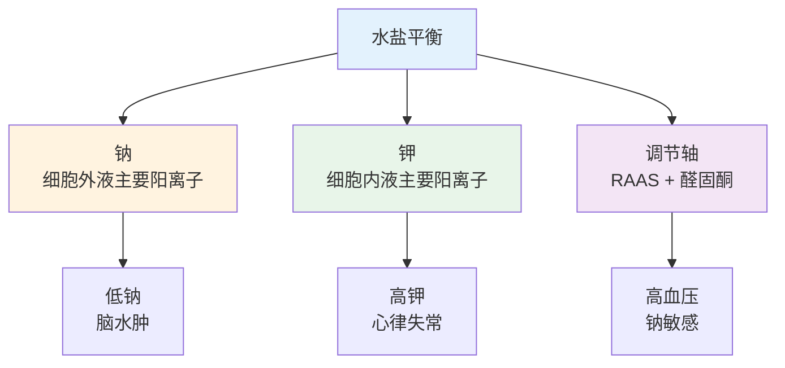
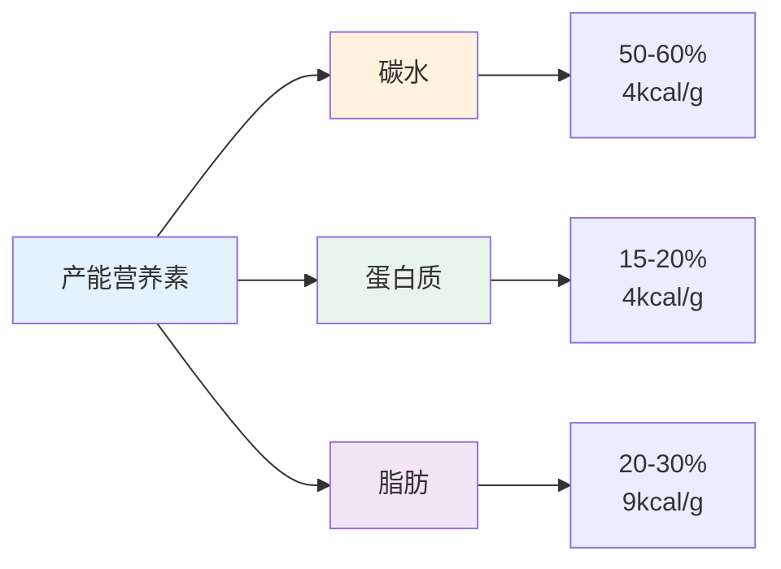
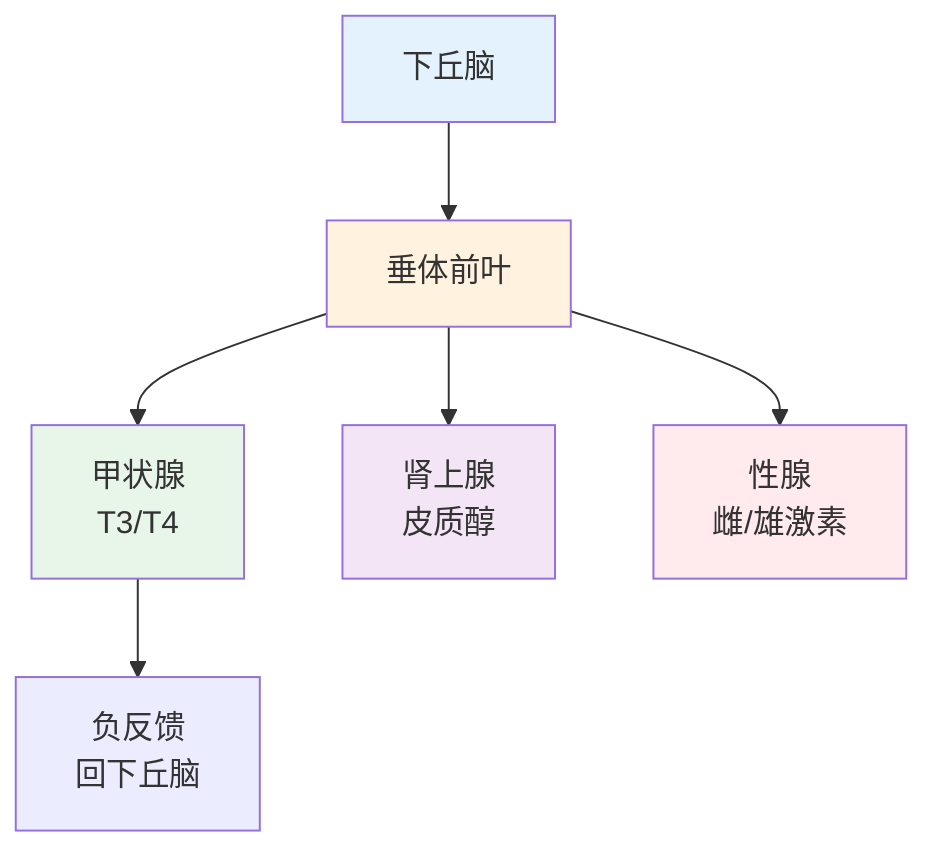

# 人体生理高频考点

> **费曼学习法**：生理题考的是"正常值 + 调节机制"，记住水盐、体温、供能比、两大调节轴就够了。

---

## 一、水盐平衡（高频计算与判断）

| 指标 | 数值 | 说明 |
|------|------|------|
| 成人体含水量 | 60% 体重 | 老年约 50-55% |
| 每日水需要 | 2500-3000mL | 显性失水 + 不显性失水 |
| 血钠正常 | 135-145mmol/L | <135 低钠血症；>145 高钠 |
| 血钾正常 | 3.5-5.5mmol/L | <3.5 低钾（乏力/心律失常）；>5.5 高钾（透析患者警惕） |

**钠钾考点：** 低钾最常见于"呕吐 + 利尿剂"患者；高血压患者限钠（<5g/日）是基础。

---

## 二、体温

| 项目 | 数值 |
|------|------|
| 口腔温度正常 | 36.3-37.2°C |
| 腋温正常 | 36.0-37.0°C |
| 发热标准 | 腋温 ≥37.3°C |
| 高热 | ≥39.1°C |
| 持续高热处理 | 腋温 ≥38.5°C 物理降温；≥39.1°C 建议就医 |

---

## 三、三大产能营养素

| 营养素 | 供能比例（成人） | 产能（kcal/g） | 考点 |
|--------|----------------|----------------|------|
| 碳水 | 50-60% | 4 | 主要供能；精制糖控制 |
| 蛋白质 | 15-20% | 4 | 成人 0.8-1.0g/kg/日；肾病需限 0.6g/kg |
| 脂肪 | 20-30% | 9 | 饱和脂肪 <10% 总能量；反式脂肪避免 |

**能量计算（考试常出）：**

| 条件 | 公式 |
|------|------|
| 基础代谢率 | 1.04×体重(kg)+10×身高(cm)-106-10×年龄（女）；1.0×体重(kg)+6.25×身高(cm)-5（男，简化） |
| 实际需能量 | BMR × 活动系数（轻体力 1.1-1.3，中 1.55，重 1.8） |

> 实际考试通常直接给能量目标，重点在三大营养素比例 + 产能换算。

---

## 四、神经与内分泌调节（两大轴）

### 4.1 下丘脑-垂体-靶腺轴

**考点：** TSH 升高 + T4 降低 = 原发性甲减；TSH 降低 + T4 升高 = 原发性甲亢。

### 4.2 肾素-血管紧张素-醛固酮（RAAS）

| 步骤 | 关键 |
|------|------|
| 肾素释放 | 血压↓ 或 血钠↓ 时 |
| 血管紧张素 II | 收缩血管 + 升血压 |
| 醛固酮 | 保钠排钾 → 血容量↑ |
| 阻断 | ACEI/ARB 降压药机制 |

**考点：** ACEI（依那普利）副作用 = 干咳；ARB（缬沙坦）无干咳；两者均监测血钾。

---

## 五、易混淆点 / 常见坑

| 误区 | 正确做法 |
|------|----------|
| 蛋白质越多越好 | 正常成人 0.8-1.0g/kg/日；肾病反而要限 0.6g/kg |
| 脂肪不能吃 | 必需脂肪酸（ω-6/ω-3）须摄入；饱和脂肪才限制 |
| 发热就吃抗生素 | 发热是症状，多数为病毒感染；抗生素只对细菌有效 |
| TSH 升高 = 甲亢 | TSH 升高 + T4 降低 = 甲减（TSH 升高是代偿） |
| 腋温正常就是健康 | 体温 + 心率 + 血压 + 血氧才是完整生命体征 |

---

## 六、一页速查

| 问题 | 答案 |
|------|------|
| 成人体含水量 | 约 60% 体重 |
| 血钾正常 | 3.5-5.5mmol/L |
| 三大产能比例 | 碳水 50-60%、蛋白 15-20%、脂肪 20-30% |
| 脂肪产能 | 9 kcal/g |
| 发热标准（腋温） | ≥37.3°C |
| TSH 高 + T4 低 | 原发性甲减 |
| RAAS 最终效应 | 收缩血管 + 保钠排钾 + 升压 |
| ACEI 主要副作用 | 干咳 |

---

## 七、相关链接

| 主题 | 链接 |
|------|------|
| 基础医学总览 | [02 基础医学](index.md) |
| 解剖考点 | [01 解剖](01-anatomy.md) |
| 药理速记 | [03 病理与药理](03-pathology-pharmacology.md) |
| 疾病管理 | [05 疾病管理](../05-disease-management/index.md) |
