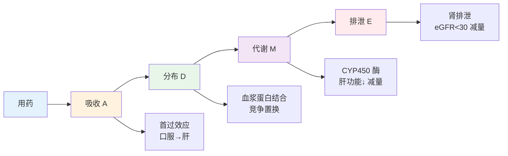
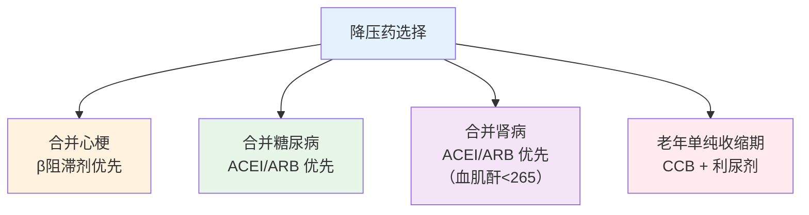

# 病理与药理速记

> **费曼学习法**：药理题考"哪个药治什么 + 副作用是什么"，记住 ADME 四步 + 六大类药物代表药就够。

---

## 一、药代动力学 ADME

| 字母 | 中文 | 考试常考点 |
|------|------|-----------|
| A | 吸收 | 硝酸甘油舌下含服（绕过首过）；口服生物利用度 |
| D | 分布 | 高蛋白结合率药物与同类竞争（华法林 + 新用药 → 出血风险） |
| M | 代谢 | 肝功能不全时经肝代谢药物减量；CYP450 抑制剂（如酮康唑）增加他汀浓度 |
| E | 排泄 | 肌酐清除率 <30 时多数经肾药物须减量或禁用 |

---

## 二、常用药物类别速查（核心六类）

### 2.1 降压药

| 类别 | 代表药 | 关键注意 | 高频考点 |
|------|--------|----------|----------|
| CCB | 氨氯地平 | 缓释片，可单用，脚踝水肿 | 首选合并冠心病/老年 |
| ACEI | 依那普利 | **干咳**；监测血钾；孕期禁用 | 干咳改用 ARB |
| ARB | 缬沙坦 | 无干咳，血钾监测 | 与 ACEI 不联用 |
| β阻滞剂 | 美托洛尔 | 哮喘禁用；**不可骤停**（反跳） | 心梗后首选 |
| 利尿剂 | 氢氯噻嗪 | 低钾；痛风慎用 | 与 NSAIDs 相互作用 |

### 2.2 降糖药

| 类别 | 代表药 | 关键注意 |
|------|--------|----------|
| 二甲双胍 | 二甲双胍 | 胃肠反应；**eGFR<30 禁用**；服 OGTT 前停 48h |
|磺酰脲类 | 格列吡嗪 | **低血糖风险**最高（老年人警惕） |
| 阿卡波糖 | 阿卡波糖 | 餐前服；腹胀；与地高辛相互作用 |
| GLP-1 | 利拉鲁肽 | 注射，减重 + 心血管获益；胰腺炎禁忌 |
| SGLT2i | 达格列净 | 泌尿生殖感染风险；eGFR<20 不用 |
| 胰岛素 | 速效/长效 | 速起效 15-30min；低血糖处理（见 05 糖尿病） |

### 2.3 调脂药

| 类别 | 代表药 | 关键注意 |
|------|--------|----------|
| 他汀 | 阿托伐他汀 | 夜间服（胆固醇夜间合成高峰）；监测肝转氨酶；**肌痛警惕横纹肌溶解** |
| 依折麦布 | 依折麦布 | 与他汀联用增强降脂；肝转移酶升高停药 |
| PCSK9 抑制剂 | 依洛尤单抗 | 高 LDL 患者强化降脂；注射 |

**LDL-C 目标（成人）：**

| 风险分层 | LDL-C 目标 | 说明 |
|----------|-----------|------|
| 极高危（心梗史/糖尿病） | <1.8 mmol/L | 强化降脂 |
| 高危 | <2.6 mmol/L | 普通冠心病 |
| 中危 | <3.4 mmol/L | 单一风险因素 |
| 低危 | <4.1 mmol/L | 无风险因素 |

> 目标值以最新血脂指南为准（中国血脂异常指南 2023）。

### 2.4 抗血小板/抗凝

| 药物 | 用途 | 关键注意 |
|------|------|----------|
| 阿司匹林 | 抗血小板（一级/二级预防） | 75-100mg/日；消化道出血史慎用 |
| 氯吡格雷 | 抗血小板 | 支架术后双抗 12 个月（通常） |
| 华法林 | 抗凝 | 监测 INR 2.0-3.0；食物（绿叶蔬菜）影响 |
| 达比加群 | 抗凝（房颤） | 固定剂量，无需 INR；出血风险 |

### 2.5 呼吸

| 药物 | 用途 | 注意 |
|------|------|------|
| 沙美特罗/氟替卡松 | 慢阻肺/哮喘吸入 | 吸入后漱口（防鹅口疮） |
| 布地奈德 | 哮喘吸入 | 长期用注意骨质疏松 |

### 2.6 消化

| 药物 | 用途 | 注意 |
|------|------|------|
| PPI（奥美拉唑） | 抑酸 | 长期用注意镁缺乏；影响某些药物吸收 |
| 多潘立酮 | 促动力 | 与酮康唑联用 QT 延长 |
| 莫沙必利 | 促动力 | 相对副作用少 |

---

## 三、常见不良反应速记（必背）

| 药物 | 副作用 | 记忆口诀 |
|------|--------|----------|
| 二甲双胍 | 胃肠反应 | 双胍"胃不舒服" |
| 磺酰脲类 | **低血糖** | 格列吡嗪"低血糖最高风险" |
| 他汀 | 肌痛、肝转氨酶 | "肌肉+肝" |
| ACEI | 干咳 | "干咳嗽" |
| CCB | 脚踝水肿 | "脚肿" |
| β阻滞剂 | 心动过缓、哮喘诱发 | "慢+喘" |
| 氢氯噻嗪 | 低钾 | "钾丢" |
| 华法林 | 出血 | "INR 监测" |

---

## 四、易混淆点 / 常见坑

| 误区 | 正确做法 |
|------|----------|
| 阿司匹林大剂量才"有害" | 抗血小板剂量（75-100mg）长期用就有出血风险，须评估 |
| 他汀只能降胆固醇 | 他汀稳定斑块，是心血管疾病一级/二级预防核心 |
| ACEI 和 ARB 可以一起用 | 两者不联用（高钾 + 肾损伤风险） |
| 胰岛素只用于 1 型糖尿病 | 2 型晚期胰岛功能衰竭也需要胰岛素 |
| 华法林固定剂量不用监测 | INR 2.0-3.0 须定期监测，食物（绿叶蔬菜）可影响 |
| 抗生素是消炎药 | 抗生素只对细菌有效；病毒感冒不用抗生素 |

---

## 五、一页速查

| 问题 | 答案 |
|------|------|
| 二甲双胍禁用（eGFR） | <30 mL/min/1.73m² |
| 他汀最严重副作用 | 横纹肌溶解（剧烈肌痛 + CK 升高） |
| ACEI 主要副作用 | 干咳 |
| CCB 主要副作用 | 脚踝水肿 |
| 华法林 INR 目标 | 2.0-3.0（一般抗凝） |
| 他汀服用时间 | 晚间（胆固醇夜间合成高峰） |
| 磺酰脲类最危险副作用 | 低血糖（老年人最高风险） |
| 抗血小板双抗疗程（支架后） | 通常 12 个月（以心内科医嘱为准） |

---

## 六、相关链接

| 主题 | 链接 |
|------|------|
| 基础医学总览 | [02 基础医学](index.md) |
| 高血压管理 | [05 高血压](../05-disease-management/index.md) |
| 糖尿病管理 | [05 糖尿病](../05-disease-management/index.md) |
