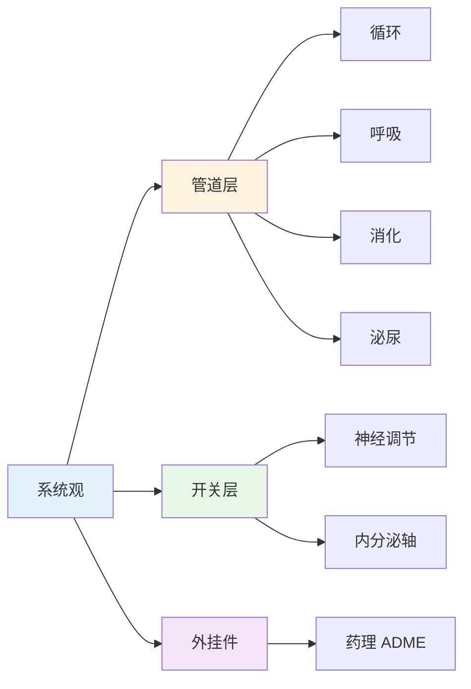

# 基础医学 — 五大系统指标与高频数值详解

> **费曼学习法**：基础医学考的是"系统观"——每个系统在哪、干什么、哪个指标异常代表什么问题。

---

## 一、五大系统核心指标（总览）

| 系统 | 核心功能 | 健康管理最关注指标 |
|------|----------|-------------------|
| 循环 | 血液输运 | 血压、心电、心率 |
| 呼吸 | 气体交换 | SpO₂、肺功能（FEV₁/FVC） |
| 消化 | 营养吸收 | 肝转氨酶、胃肠镜、幽门螺杆菌 |
| 泌尿 | 排泄与水盐 | 肌酐、eGFR、尿常规 |
| 内分泌 | 激素调节 | 血糖、HbA1c、TSH、血脂 |

---

## 二、高频数值速记（跨系统必背）

| 指标 | 正常值 | 适用人群 | 预警 |
|------|--------|----------|------|
| 收缩压 | <120mmHg | 成人（诊室） | ≥140 一级高血压 |
| SpO₂（静息） | ≥95% | 成人 | <90% 就医 |
| 肌酐（男） | 57-111μmol/L | 成人 | >133 查 eGFR |
| 肌酐（女） | 45-84μmol/L | 成人 | >107 查 eGFR |
| eGFR | >90mL/min/1.73m² | 成人 | <60 持续 3 月 = 慢性肾病 |
| TSH | 0.27-4.2mIU/L | 成人 | 看 T3/T4 联动判断 |
| 血钠 | 135-145mmol/L | 成人 | <135 低钠；>145 高钠 |
| 血钾 | 3.5-5.5mmol/L | 成人 | >5.5 查心律失常 |

> 数值细节（血压分级、血糖分界值、量表分界值）分别在 [04 健康评估](../04-health-assessment/index.md)、[05 疾病管理](../05-disease-management/index.md) 展开，本模块只放系统总览层。

---

## 三、考试易混淆组（单选高频）

| 混淆对 | 区分要点 |
|--------|----------|
| 心绞痛 vs 心梗 | 时间 3-5min vs >30min；硝酸有效 vs 无效 |
| 发病率 vs 患病率 | 新发病例 vs 现存活病例（见 [09 健康信息](../09-health-info/index.md)） |
| 首过效应 vs 生物利用度 | 口服经肝被代谢减少 → 舌下含服（硝酸甘油） |
| 低钾 vs 高钾 | 低钾多因呕吐/利尿剂；高钾警惕透析患者 + ACEI |
| TSH 升高 | 不能直接说甲亢——结合 T4：T4 低 = 甲减（代偿），T4 高 = TSH 分泌瘤（少见） |

---

## 四、相关链接

| 主题 | 链接 |
|------|------|
| 基础医学总览 | [02 基础医学](index.md) |
| 解剖考点 | [01 解剖](01-anatomy.md) |
| 生理考点 | [02 生理](02-physiology.md) |
| 药理速记 | [03 药理](03-pathology-pharmacology.md) |
