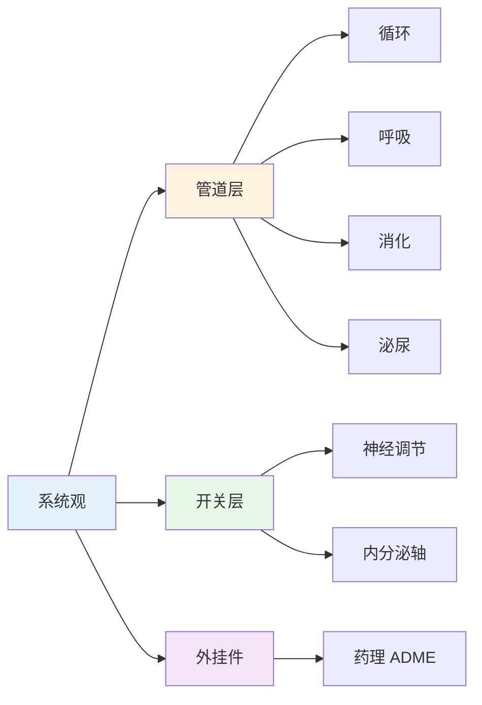

# 基础医学 — 解剖、生理、药理高频考点

> **费曼学习法**：基础医学考的不是背全部结构，而是"系统观"——每个系统在哪、干什么、哪个指标异常代表什么问题。记住"管道（循环/呼吸/消化/泌尿）+ 开关（神经内分泌）+ 外挂件（药理）"三层。

---

## 一、模块定位

解决「考试理论卷医学基础部分的考点」。**优先级 ★★（官方权重 16%，理论卷第一大块）**：占考纲约 10%~15%，是 04 健康评估、05 疾病管理的地基——不懂生理正常值，就读不出异常。

| 子文件 | 内容 | 先看 |
|--------|------|------|
| [01-anatomy.md](01-anatomy.md) | 五大系统解剖与指标对应 | 考试必背 |
| [02-physiology.md](02-physiology.md) | 水盐平衡、体温、三大产能营养素、RAAS 与下丘脑-垂体轴 | 必背 |
| [03-pathology-pharmacology.md](03-pathology-pharmacology.md) | 药代 ADME、六大类药物速查、副作用口诀 | 高频 |

**按场景找答案：**

| 场景 | 看 |
|------|----|
| 客户说"我血压正常为什么还头晕" | [01 解剖](01-anatomy.md) 循环节 |
| 算一日能量需求 | [02 生理](02-physiology.md) 三大产能节 |
| 客户吃二甲双胍胃不舒服 | [03 药理](03-pathology-pharmacology.md) 降糖药节 |

---

## 二、核心知识点提炼（本模块必背）

| 要点 | 数字/口径 |
|------|-----------|
| 五大系统 | 循环/呼吸/消化/泌尿/内分泌（管道 4 + 开关 1） |
| 血压分级（成人诊室） | 1级 140-159/90-99；2级 160-179/100-109；3级 ≥180/110mmHg |
| 心绞痛 vs 心梗 | 时间 3-5min vs >30min；硝酸有效 vs 无效 |
| 慢阻肺诊断 | 吸入支气管舒张剂后 FEV₁/FVC <0.70 |
| 三大产能供能比 | 碳水 50-60%、蛋白 15-20%、脂肪 20-30% |
| 药代 ADME | 首过效应、CYP450 代谢、肾排泄 eGFR<30 减量 |
| 他汀最严重副作用 | 横纹肌溶解（肌痛 + CK 升高） |
| 二甲双胍禁用 | eGFR<30mL/min/1.73m² |

---

## 三、五大系统核心指标（总览）

| 系统 | 核心功能 | 健康管理最关注指标 |
|------|----------|-------------------|
| 循环 | 血液输运 | 血压、心电、心率 |
| 呼吸 | 气体交换 | SpO₂、肺功能（FEV₁/FVC） |
| 消化 | 营养吸收 | 肝转氨酶、胃肠镜、幽门螺杆菌 |
| 泌尿 | 排泄与水盐 | 肌酐、eGFR、尿常规 |
| 内分泌 | 激素调节 | 血糖、HbA1c、TSH、血脂 |

---

## 四、高频数值速记（跨系统必背）

| 指标 | 正常值 | 适用人群 | 预警 |
|------|--------|----------|------|
| 收缩压 | <120mmHg | 成人（诊室） | ≥140 一级高血压 |
| SpO₂（静息） | ≥95% | 成人 | <90% 就医 |
| 肌酐（男） | 57-111μmol/L | 成人 | >133 查 eGFR |
| 肌酐（女） | 45-84μmol/L | 成人 | >107 查 eGFR |
| eGFR | >90mL/min/1.73m² | 成人 | <60 持续 3 月 = 慢性肾病 |
| TSH | 0.27-4.2mIU/L | 成人 | 看 T3/T4 联动判断 |
| 血钠 | 135-145mmol/L | 成人 | <135 低钠；>145 高钠 |
| 血钾 | 3.5-5.5mmol/L | 成人 | >5.5 查心律失常 |

> 数值细节（血压分级、血糖分界值、量表分界值）分别在 [04 健康评估](../04-health-assessment/index.md)、[05 疾病管理](../05-disease-management/index.md) 展开，本模块只放系统总览层。

---

## 五、考试易混淆组（单选高频）

| 混淆对 | 区分要点 |
|--------|----------|
| 心绞痛 vs 心梗 | 时间 3-5min vs >30min；硝酸有效 vs 无效 |
| 发病率 vs 患病率 | 新发病例 vs 现存活病例（见 [09 健康信息](../09-health-info.md)） |
| 首过效应 vs 生物利用度 | 口服经肝被代谢减少 → 舌下含服（硝酸甘油） |
| 低钾 vs 高钾 | 低钾多因呕吐/利尿剂；高钾警惕透析患者 + ACEI |
| TSH 升高 | 不能直接说甲亢——结合 T4：T4 低 = 甲减（代偿），T4 高 = TSH 分泌瘤（少见） |

---

## 六、一页速查

| 问题 | 答案 |
|------|------|
| 冠脉狭窄多少引发心绞痛 | >70%（临床口径） |
| 慢阻肺诊断（吸入支气管舒张剂后） | FEV₁/FVC <0.70 |
| 三大产能比例（成人） | 碳水 50-60%、蛋白 15-20%、脂肪 20-30% |
| 脂肪产能 | 9kcal/g |
| 二甲双胍禁用 | eGFR<30mL/min/1.73m² |
| 他汀最严重副作用 | 横纹肌溶解（肌痛 + CK 升高） |
| ACEI 主要副作用 | 干咳（改 ARB） |
| β阻滞剂禁忌 | 哮喘；不可骤停 |
| 幽门螺杆菌根除 | PPI + 铋剂 + 2 种抗生素，14 天 |

---

## 七、相关链接

| 主题 | 链接 |
|------|------|
| 知识体系全景 | [00 全景](../00-overview.md) |
| 解剖考点 | [01 解剖](01-anatomy.md) |
| 生理考点 | [02 生理](02-physiology.md) |
| 药理速记 | [03 药理](03-pathology-pharmacology.md) |
| 疾病基础（03） | [03 疾病基础](../03-disease-basics.md) |
| 健康评估（04） | [04 健康评估](../04-health-assessment/index.md) |
| 疾病管理（05） | [05 疾病管理](../05-disease-management/index.md) |

---

## 八、推荐阅读

- 《系统解剖学》（院校教材）— 人民卫生出版社
- 《生理学与药理学》（院校教材）— 人民卫生出版社
- 《健康管理师》（三级）第 2 章 — 人民卫生出版社
