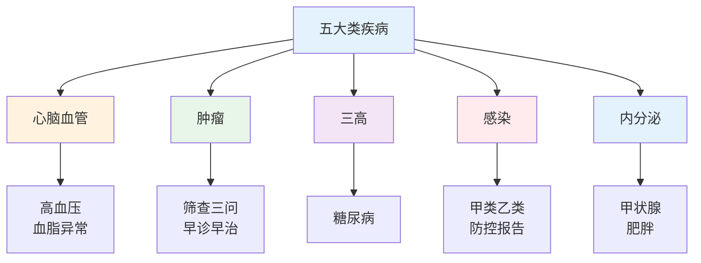
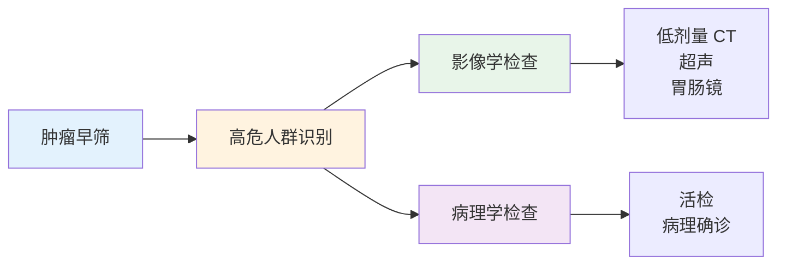
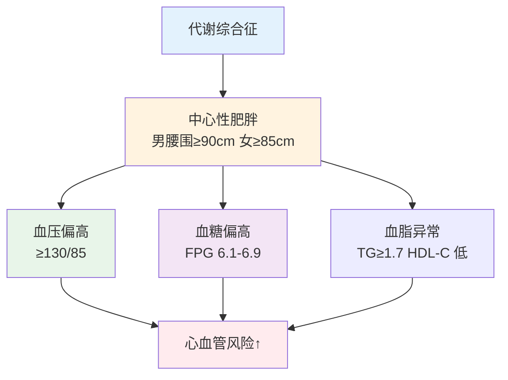

# 疾病基础 — 五大类疾病认知框架

> **费曼学习法**：认识疾病的套路就三问——"这病怎么定义、谁容易得、在哪一级能拦住"。三问答完，疾病管理的框架就出来了。

---

## 一、模块定位

解决「疾病认知框架」。**优先级 ★★**：考纲模块，是 05 疾病管理的地基——05 讲"怎么管"，本模块讲"管的是什么"。

**内容组织原则：** 每类疾病统一按「定义 → 高危因素 → 三级预防落点」展开，不展开诊断细节（诊断属于医疗行为，见 [11 边界](11-boundaries/index.md)）。

### 核心知识点提炼（本模块必背）

| 要点 | 数字/口径 |
|------|-----------|
| 认识疾病三问 | 怎么定义 / 谁容易得 / 哪一级能拦住 |
| 脑卒中识别 | FAST，立即 120 + 记录发病时间 |
| 肿瘤筛查 | 高危人群：肺癌每年低剂量 CT、40-75 岁每 10 年肠镜 |
| 肿瘤标志物 | 辅助监测，不单独用于确诊（CEA/AFP/CA125/PSA） |
| 三高诊断分界 | 血压 ≥140/90、空腹血糖 ≥7.0、LDL-C ≥4.1mmol/L |
| 传染病三环节 | 传染源 / 传播途径 / 易感人群 |
| 甲类传染病 | 鼠疫、霍乱（2 小时内报告） |
| 肥胖（中国成人） | BMI ≥28.0 |

---

## 二、心脑血管疾病

### 2.1 定义与分型

| 疾病 | 定义 | 高频考点 |
|------|------|----------|
| 高血压 | 诊室血压 ≥140/90mmHg（成人，非同日 3 次） | 分级：1级 140-159/90-99；2级 160-179/100-109；3级 ≥180/110 mmHg |
| 冠心病 | 冠状动脉粥样硬化致心肌缺血 | 心绞痛（3-5min 缓解）vs 心梗（>30min，硝酸无效） |
| 脑卒中 | 脑血管意外（缺血性 80%+ / 出血性） | FAST 识别：Face-Arm-Speech-Time |

### 2.2 高危因素

| 可干预 | 不可干预 |
|--------|----------|
| 吸烟、高血压、高血脂、糖尿病、肥胖、缺乏运动、高盐饮食 | 年龄（男>45，女>55）、家族史、男性 |

**缺血性脑卒中识别（FAST，必背）：**

| 字母 | 检查 | 阳性表现 |
|------|------|----------|
| F | 脸 | 口角歪斜 |
| A | 臂 | 单侧上肢无力下垂 |
| S | 言语 | 言语含糊 |
| T | 时间 | 立即拨打 120，记录发病时间 |

### 2.3 三级预防落点

| 级别 | 落点 |
|------|------|
| 一级 | 限钠 <5g/日、戒烟、运动 150-300min/周、控制体重 |
| 二级 | 每年血压自测；40 岁以上每年血脂；心电异常随访 |
| 三级 | 规范用药（遵医嘱）、二级预防（双抗 + 他汀，遵医嘱）、康复训练 |

---

## 三、肿瘤

### 3.1 高危与筛查

| 癌种 | 高危因素 | 建议筛查 |
|------|----------|----------|
| 肺癌 | 吸烟 ≥20 包年、职业暴露 | 高危人群每年低剂量胸部 CT |
| 胃癌 | 幽门螺杆菌阳性、高盐腌制饮食、家族史 | 胃镜（高危 40 岁起） |
| 结直肠癌 | 肠息肉史、家族史 | 40-75 岁每 10 年肠镜；高危提前 |
| 乳腺癌 | 家族史、BMI 偏高、晚育 | 40 岁起每年乳腺检查 |
| 宫颈癌 | HPV 持续感染 | 21-65 岁定期 HPV + TCT（以当地筛查方案为准） |

### 3.2 肿瘤标志物（认知即可，不作筛查金标准）

| 标志物 | 关联 | 注意 |
|--------|------|------|
| CEA | 消化道肿瘤 | 特异性有限，吸烟者可升高 |
| AFP | 肝细胞癌 | 肝炎/肝硬化可升高 |
| CA125 | 卵巢癌 | 月经期可升高 |
| PSA | 前列腺癌 | 老年男性随年龄升高 |

> 标志物升高 ≠ 患癌，须结合影像与病理——这是"读体检报告"最高频的误区。

### 3.3 三级预防落点

| 级别 | 落点 |
|------|------|
| 一级 | 戒烟（肺癌首要）、减重、限酒、规律运动、食品安全（霉变食品、腌制） |
| 二级 | 按上表高危筛查；发现癌前病变（息肉、CIN）随访 |
| 三级 | 规范治疗 + 康复 + 营养支持（防癌因性营养不良） |

---

## 四、三高（代谢性疾病）

### 4.1 三高速记

| 疾病 | 诊断分界值 | 高危因素 |
|------|-----------|----------|
| 高血压 | ≥140/90mmHg（诊室，成人） | 高盐、肥胖、家族史、压力 |
| 2型糖尿病 | 空腹 ≥7.0、随机 ≥11.1mmol/L、HbA1c ≥6.5% | 肥胖、缺乏运动、家族史 |
| 血脂异常 | 空腹总胆固醇 ≥5.7、LDL-C ≥4.1mmol/L（高危目标 <2.6 见 [02 药理](02-basic-medicine/index.md)） | 高脂饮食、肥胖、吸烟 |

**代谢综合征诊断口径：** 中心性肥胖 + 血压偏高 + 血糖偏高 + 血脂异常四项中 ≥3 项（以最新指南为准）。

### 4.2 三级预防落点

| 级别 | 落点 |
|------|------|
| 一级 | 体重管理（BMI<24）、限盐限油、每周 150min 运动、戒烟 |
| 二级 | 每年查血压、空腹血糖、血脂；IGT（空腹 6.1-7.0）每 1-3 年复查 |
| 三级 | 管理详见 [05 疾病管理](05-disease-management/index.md) |

---

## 五、感染性疾病

### 5.1 甲乙丙类分类（法规考点）

| 类别 | 代表病 | 管理要点 |
|------|--------|----------|
| 甲类（2 种） | 鼠疫、霍乱 | 2 小时内报告；严格隔离 |
| 乙类（重点） | 肺结核、流感、新冠相关（以当期公告为准）、乙肝 | 按甲类管理的乙类病须特别关注 |
| 丙类 | 手足口、风疹 | 症状监测 |

### 5.2 传染病三环节（必背）

| 环节 | 含义 | 切断方式 |
|------|------|----------|
| 传染源 | 携带病原体的人/动物 | 隔离、治疗 |
| 传播途径 | 飞沫/接触/消化道/血液 | 洗手、通风、戴口罩、消毒 |
| 易感人群 | 未免疫者 | 疫苗接种、提高免疫力 |

### 5.3 三级预防落点

| 级别 | 落点 |
|------|------|
| 一级 | 疫苗接种、手卫生、食品安全 |
| 二级 | 症状监测、密切接触者管理、疫情报告 |
| 三级 | 规范治疗、并发症管理、康复随访 |

---

## 六、内分泌疾病

| 疾病 | 定义 | 高危因素 | 三级预防落点 |
|------|------|----------|--------------|
| 2型糖尿病 | 胰岛素抵抗 + 功能减退 | 肥胖、家族史、缺乏运动 | 详见 [05 糖尿病管理](05-disease-management/index.md) |
| 甲状腺疾病 | 甲亢（TSH↓T4↑）/甲减（TSH↑T4↓） | 女性、碘摄入异常、自身免疫 | 每年甲功体检；随访遵医嘱 |
| 肥胖症 | BMI ≥28（中国标准，成人） | 能量正平衡、家族史 | 详见 [06 营养](06-nutrition.md)、[07 运动](07-exercise.md) |

**肥胖分级（中国成人标准）：**

| 分级 | BMI（kg/m²） |
|------|-------------|
| 正常 | 18.5-23.9 |
| 超重 | 24.0-27.9 |
| 肥胖 | ≥28.0 |
| 重度肥胖 | ≥32.5 |

---

## 七、易混淆点 / 常见坑

| 误区 | 正确做法 |
|------|----------|
| 肿瘤标志物升高就是癌症 | 标志物特异性有限，须结合影像 + 病理 |
| 三高是"老年病" | 代谢综合征青年检出率升高，20 岁起就应每年查 |
| 高血压没有症状就不用管 | 高血压"无声杀手"，症状常在靶器官损害后才出现 |
| 感冒都要用抗生素 | 病毒感冒不用抗生素；细菌性才需评估 |
| 甲类传染病只有 2 种 | 正确——鼠疫、霍乱；乙类中有病种按甲类管理（以当期公告为准） |

---

## 八、一页速查

| 问题 | 答案 |
|------|------|
| 血压诊断分界值（成人，诊室） | ≥140/90mmHg（非同日 3 次） |
| 糖尿病诊断（HbA1c） | ≥6.5%（需结合其他标准，见 05） |
| LDL-C 高危目标 | <2.6mmol/L（极高危 <1.8） |
| 脑卒中识别 | FAST，立即 120 + 记录发病时间 |
| 甲类传染病 | 鼠疫、霍乱（2 小时内报告） |
| 肥胖（中国成人） | BMI ≥28.0 |
| 肿瘤标志物意义 | 辅助监测，不单独用于筛查确诊 |
| 传染病三环节 | 传染源、传播途径、易感人群 |

---

## 九、相关链接

| 主题 | 链接 |
|------|------|
| 知识体系全景 | [00 全景](00-overview.md) |
| 基础医学（02） | [02 基础医学](02-basic-medicine/index.md) |
| 疾病管理（05） | [05 疾病管理](05-disease-management/index.md) |
| 公共卫生（外部） | [公共卫生](../public-health/index.md) |

---

## 十、推荐阅读

- 《内科学》（院校教材，查目标值）— 人民卫生出版社
- 《健康管理师》（三级）疾病基础章节 — 人民卫生出版社
- 《中国居民膳食指南》最新版 — 中国营养学会
