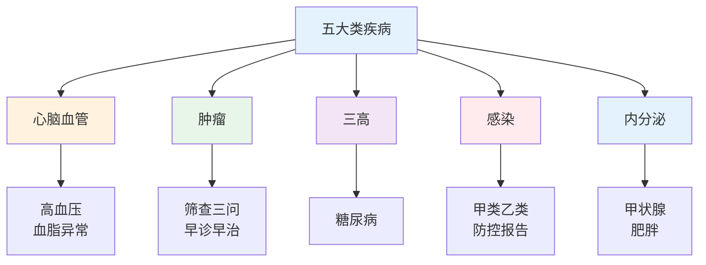
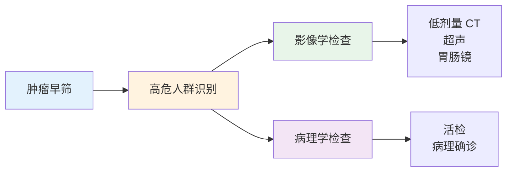
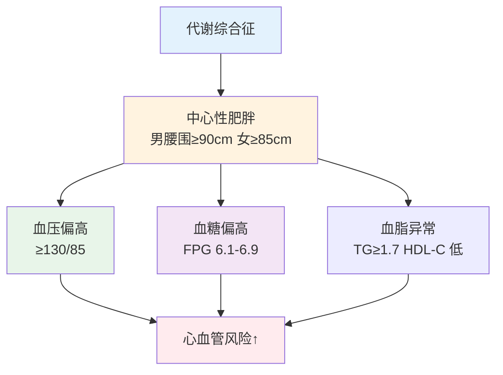

# 疾病基础 — 心脑血管、肿瘤、三高详解

> **费曼学习法**：认识疾病的套路就三问——"这病怎么定义、谁容易得、在哪一级能拦住"。

---

## 五大类疾病全景

## 一、心脑血管疾病

### 1.1 定义与分型

| 疾病 | 定义 | 高频考点 |
|------|------|----------|
| 高血压 | 诊室血压 ≥140/90mmHg（成人，非同日 3 次） | 分级：1级 140-159/90-99；2级 160-179/100-109；3级 ≥180/110 mmHg |
| 冠心病 | 冠状动脉粥样硬化致心肌缺血 | 心绞痛（3-5min 缓解）vs 心梗（>30min，硝酸无效） |
| 脑卒中 | 脑血管意外（缺血性 80%+ / 出血性） | FAST 识别：Face-Arm-Speech-Time |

### 1.2 高危因素

| 可干预 | 不可干预 |
|--------|----------|
| 吸烟、高血压、高血脂、糖尿病、肥胖、缺乏运动、高盐饮食 | 年龄（男>45，女>55）、家族史、男性 |

**缺血性脑卒中识别（FAST，必背）：**

| 字母 | 检查 | 阳性表现 |
|------|------|----------|
| F | 脸 | 口角歪斜 |
| A | 臂 | 单侧上肢无力下垂 |
| S | 言语 | 言语含糊 |
| T | 时间 | 立即拨打 120，记录发病时间 |

### 1.3 三级预防落点

| 级别 | 落点 |
|------|------|
| 一级 | 限钠 <5g/日、戒烟、运动 150-300min/周、控制体重 |
| 二级 | 每年血压自测；40 岁以上每年血脂；心电异常随访 |
| 三级 | 规范用药（遵医嘱）、二级预防（双抗 + 他汀，遵医嘱）、康复训练 |

---

## 二、肿瘤

### 2.1 高危与筛查

| 癌种 | 高危因素 | 建议筛查 |
|------|----------|----------|
| 肺癌 | 吸烟 ≥20 包年、职业暴露 | 高危人群每年低剂量胸部 CT |
| 胃癌 | 幽门螺杆菌阳性、高盐腌制饮食、家族史 | 胃镜（高危 40 岁起） |
| 结直肠癌 | 肠息肉史、家族史 | 40-75 岁每 10 年肠镜；高危提前 |
| 乳腺癌 | 家族史、BMI 偏高、晚育 | 40 岁起每年乳腺检查 |
| 宫颈癌 | HPV 持续感染 | 21-65 岁定期 HPV + TCT（以当地筛查方案为准） |

### 2.2 肿瘤标志物（认知即可，不作筛查金标准）

| 标志物 | 关联 | 注意 |
|--------|------|------|
| CEA | 消化道肿瘤 | 特异性有限，吸烟者可升高 |
| AFP | 肝细胞癌 | 肝炎/肝硬化可升高 |
| CA125 | 卵巢癌 | 月经期可升高 |
| PSA | 前列腺癌 | 老年男性随年龄升高 |

> 标志物升高 ≠ 患癌，须结合影像与病理——这是"读体检报告"最高频的误区。

### 2.3 三级预防落点

| 级别 | 落点 |
|------|------|
| 一级 | 戒烟（肺癌首要）、减重、限酒、规律运动、食品安全（霉变食品、腌制） |
| 二级 | 按上表高危筛查；发现癌前病变（息肉、CIN）随访 |
| 三级 | 规范治疗 + 康复 + 营养支持（防癌因性营养不良） |

---

## 三、三高（代谢性疾病）

### 3.1 三高速记

| 疾病 | 诊断分界值 | 高危因素 |
|------|-----------|----------|
| 高血压 | ≥140/90mmHg（诊室，成人） | 高盐、肥胖、家族史、压力 |
| 2型糖尿病 | 空腹 ≥7.0、随机 ≥11.1mmol/L、HbA1c ≥6.5% | 肥胖、缺乏运动、家族史 |
| 血脂异常 | 空腹总胆固醇 ≥5.7、LDL-C ≥4.1mmol/L（高危目标 <2.6 见 [02 药理](../02-basic-medicine/index.md)） | 高脂饮食、肥胖、吸烟 |

**代谢综合征诊断口径：** 中心性肥胖 + 血压偏高 + 血糖偏高 + 血脂异常四项中 ≥3 项（以最新指南为准）。

### 3.2 三级预防落点

| 级别 | 落点 |
|------|------|
| 一级 | 体重管理（BMI<24）、限盐限油、每周 150min 运动、戒烟 |
| 二级 | 每年查血压、空腹血糖、血脂；IGT（空腹 6.1-7.0）每 1-3 年复查 |
| 三级 | 管理详见 [05 疾病管理](../05-disease-management/index.md) |

---

## 四、相关链接

| 主题 | 链接 |
|------|------|
| 疾病基础总览 | [03 疾病基础](index.md) |
| 基础医学（02） | [02 基础医学](../02-basic-medicine/index.md) |
| 疾病管理（05） | [05 疾病管理](../05-disease-management/index.md) |
