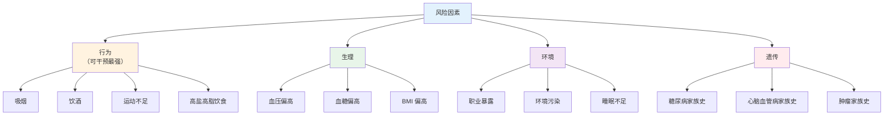
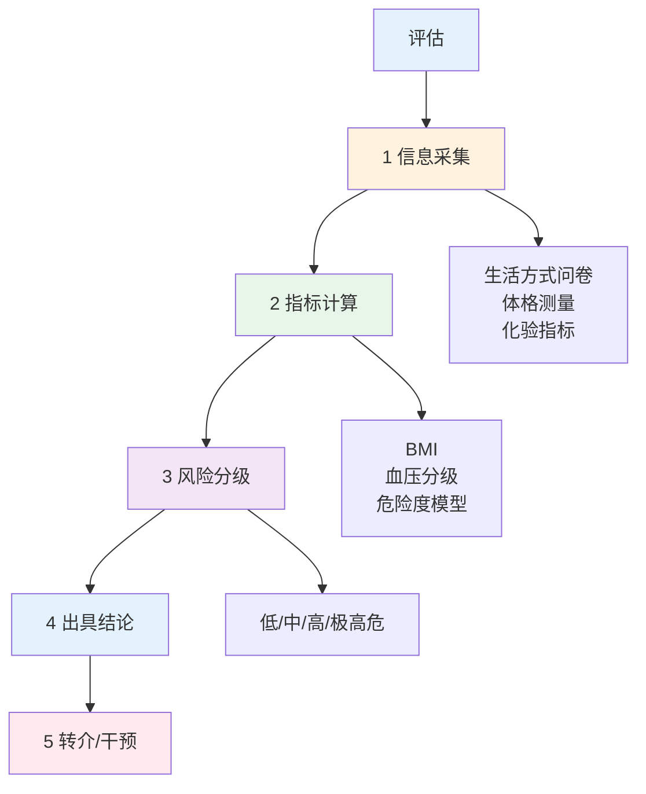

# 风险因素识别与评估流程

> **费曼学习法**：风险因素就四个来源——"你怎么做的（行为）、你现在的（生理）、你身边的（环境）、你爸妈给的（遗传）"。

---

## 一、模块定位

评估链路第一步。**优先级 ★★★**：操作技能卷"健康信息采集与评估"的核心考点。

---

## 二、四类风险因素

### 2.1 行为因素（干预抓手，重点）

| 因素 | 量化口径 | 相关疾病 |
|------|----------|----------|
| 吸烟 | 烟龄 × 每日支数（"包年"= 10支/日×1年） | 肺癌、COPD、冠心病 |
| 饮酒 | 酒精量 g/日（男 <25g、女 <15g，成人） | 肝损伤、血压升高 |
| 运动不足 | <150min 中等强度/周（成人） | 肥胖、2型糖尿病 |
| 高盐 | ≥5g/日 成人摄入盐 | 高血压 |

### 2.2 生理因素

| 因素 | 识别指标 | 说明 |
|------|----------|------|
| 超重/肥胖 | BMI、腰围（见 [02 测量](02-physical-measurements.md)） | 代谢综合征核心 |
| 血压偏高 | 120-139/80-89mmHg（成人，诊室） | 高血压前期 |
| 血糖偏高 | 空腹 6.1-6.9mmol/L（IGT 区间，成人） | 详见 [05 糖尿病](../05-disease-management/index.md) |

### 2.3 环境与遗传

| 类型 | 举例 | 识别方式 |
|------|------|----------|
| 职业暴露 | 粉尘（尘肺）、苯（血液系统）、农药 | 职业史问询（工种 + 年限 + 防护措施） |
| 环境污染 | 雾霾、饮水氟超标地区 | 居住地史 |
| 遗传 | 一级亲属（父母/兄弟姐妹/子女）早发心脑血管病（男<55、女<65） | 家族史问诊（三代） |

---

## 三、健康风险评估（HRA）流程

**关键约束：**

| 约束 | 内容 |
|------|------|
| 信息源 | 本人主诉 + 体检数据 + 既往史（须客户授权，见 [11 个保](../11-boundaries/index.md)） |
| 风险分级依据 | 危险度模型（如冠心病 10 年危险度）；**模型输出是概率，不是诊断** |
| 结论表述 | "高/中/低风险"，不得表述为"你得了/没得某病" |
| 转介 | 高风险或发现异常指标 → 建议就医（转诊提醒，不替医生决策） |

---

## 四、信息采集清单（实操）

| 类别 | 必问项 |
|------|--------|
| 现病史 | 已知疾病、服药情况、过敏史 |
| 生活方式 | 吸烟（包年）、饮酒（g/日）、运动（min/周）、睡眠（h/日） |
| 家族史 | 一级亲属心脑血管病、糖尿病、肿瘤及发病年龄 |
| 职业史 | 工种、年限、粉尘/化学接触、防护措施 |
| 女性 | 孕产史（与糖尿病、代谢相关） |

---

## 五、易混淆点 / 常见坑

| 误区 | 正确做法 |
|------|----------|
| "没症状 = 没风险" | 血压、血脂异常可无症状（无声杀手），必须测量 |
| 只问行为因素 | 家族史 + 职业史是独立风险来源，须系统问询 |
| 风险分级后直接开干预 | 先出评估结论 + 转介建议，干预方案须基于评估定目标 |
| 风险评估 = 诊断 | HRA 输出概率分级，不是疾病诊断（边界见 [11](../11-boundaries/index.md)） |
| 家族史问一代就够 | 问三代，重点关注一级亲属的发病年龄 |

---

## 六、一页速查

| 问题 | 答案 |
|------|------|
| 四类风险因素 | 行为、生理、环境、遗传 |
| 可干预最强因素 | 行为因素 |
| 高血压前期 | 120-139/80-89mmHg（成人诊室） |
| 包年怎么算 | 每日支数×年数÷20（吸烟指标） |
| 饮酒限量（成人） | 男 <25g/日、女 <15g/日 酒精 |
| 一级亲属早发心梗定义 | 男<55 岁、女<65 岁 |
| HRA 结论口径 | 风险分级（低/中/高），不诊断 |

---

## 七、相关链接

| 主题 | 链接 |
|------|------|
| 健康评估总览 | [04 总览](index.md) |
| 体格测量 | [02 测量](02-physical-measurements.md) |
| 疾病管理（干预后） | [05 疾病管理](../05-disease-management/index.md) |
