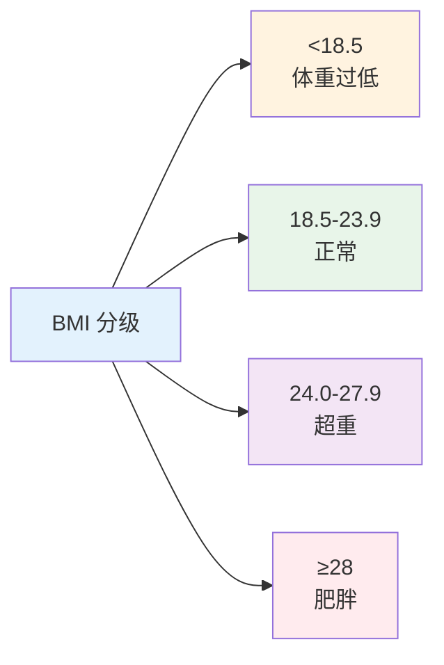
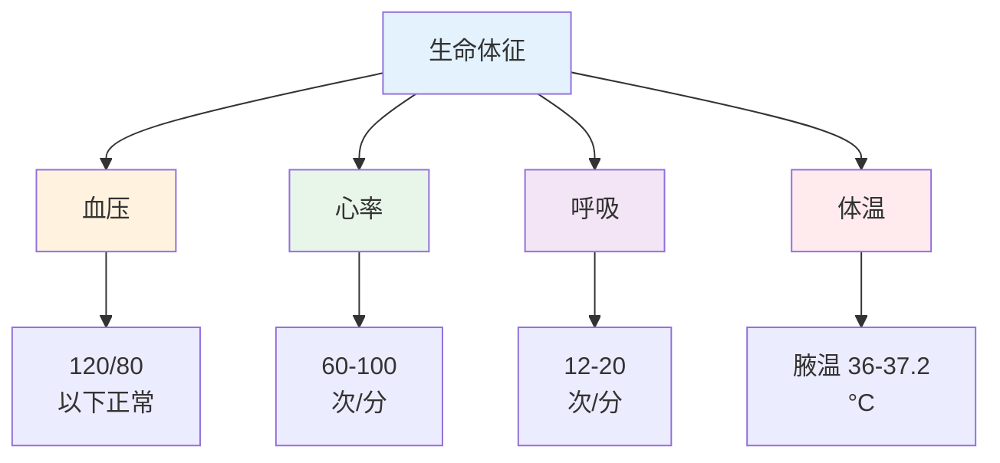

# 体格测量规范

> **费曼学习法**：测量值不可靠，后面全白搭。重点记三件事：BMI 怎么分级、腰围多少算中心性肥胖、血压怎么量才算数。

---

## 一、模块定位

评估链路第二步"量"。**优先级 ★★★**：操作技能卷直接考测量规范（顺序、方法、读数）。

---

## 二、BMI 分级（中国成人标准）

| 分级 | BMI（kg/m²） | 说明 |
|------|-------------|------|
| 体重过低 | <18.5 | 营养不良风险 |
| 正常 | 18.5-23.9 | — |
| 超重 | 24.0-27.9 | 干预窗口期 |
| 肥胖 | 28.0-32.4 | 建议减重 |
| 重度肥胖 | ≥32.5 | 综合干预（营养 + 运动 + 就医） |

**计算与例子：** 70kg、身高 170cm 的成人 → BMI = 70/1.7² ≈ 24.2（超重下限）。

> 老年人与儿童青少年标准不同，本表只用于成人（18-64 岁）。

---

## 三、腰围（中心性肥胖）

| 指标 | 标准 | 适用 |
|------|------|------|
| 中心性肥胖界值 | 男 ≥90cm；女 ≥85cm | 中国成人 |
| 理想控制目标 | 男 <85cm；女 <80cm | 干预目标 |

**测量规范：** 站立位，软尺经脐上 1cm（肋骨下缘与髂嵴中点连线中点近似位置），呼气末读数，取 2 次均值。

> 腰围可独立于 BMI：BMI 正常的"瘦胖子"（低肌肉量 + 内脏脂肪）靠腰围识别。

---

## 四、血压测量规范（必背）

### 4.1 标准流程

| 步骤 | 规范 |
|------|------|
| 测量前 | 安静休息 5min；30min 内不吸烟、不喝咖啡/浓茶、不剧烈运动 |
| 体位 | 坐位，背靠椅，双脚不交叉，手臂与心脏同高 |
| 袖带 | 下缘距肘窝 2-3cm，松紧可伸入 1-2 指 |
| 读数 | 平静吸气末读数，收缩压取柯氏音第一音，舒张压取消失音 |
| 复测 | 间隔 1-2min 再测 1-2 次，取后 2 次均值 |

### 4.2 数值分级（成人，诊室）

| 分级 | 收缩压 | 舒张压 |
|------|--------|--------|
| 正常 | <120mmHg | <80mmHg |
| 正常高值 | 120-139mmHg | 80-89mmHg |
| 1 级高血压 | 140-159mmHg | 90-99mmHg |
| 2 级高血压 | 160-179mmHg | 100-109mmHg |
| 3 级高血压 | ≥180mmHg | ≥110mmHg |

> 取高者定级：如 160/90mmHg 按 2 级计。

### 4.3 常见测量错误（操作卷高频）

| 错误 | 后果 |
|------|------|
| 袖带太松 | 读数偏高 |
| 手臂低于心脏 | 读数偏高 |
| 测量时说话 | 读数偏高 |
| 憋尿 | 读数偏高（建议先排尿） |
| 首次读数记录 | 应取后 2 次均值 |

---

## 五、其他测量要点

| 指标 | 规范 |
|------|------|
| 体脂率 | 生物电阻抗（BIA）法；空腹或餐后 2h 测量更稳定 |
| 心率 | 安静坐位 5min 后测 1min；成人 60-100 次/min |
| 呼吸率 | 不告知对象直接观察；成人 12-20 次/min |

---

## 六、易混淆点 / 常见坑

| 误区 | 正确做法 |
|------|----------|
| BMI 正常就不用测腰围 | 中心性肥胖可独立存在，两者都测 |
| 在家量一次血压下结论 | 规范：非同日 3 次 + 早晚各测（家庭自测记录 7 天取均值参考） |
| 收缩压和舒张压独立看 | 取较高一级定分级 |
| 袖带绑在哪 | 上臂（肘窝上 2-3cm），不是前臂 |
| 体脂率一次测不准 | 同一设备、相近时段、相近状态测量才可比 |

---

## 七、一页速查

| 问题 | 答案 |
|------|------|
| 成人 BMI 正常 | 18.5-23.9kg/m² |
| 腰围中心性肥胖 | 男 ≥90cm、女 ≥85cm |
| 诊室血压分级依据 | 取收缩/舒张较高一级 |
| 血压测量前休息 | 5min，30min 内不烟不咖啡 |
| 袖带位置 | 肘窝上 2-3cm |
| 心率正常（成人，安静） | 60-100 次/min |
| 测量后取哪次 | 间隔 1-2min 再测 2 次取均值 |

---

## 八、相关链接

| 主题 | 链接 |
|------|------|
| 健康评估总览 | [04 总览](index.md) |
| 高血压管理 | [05 高血压](../05-disease-management/index.md) |
| 风险因素 | [01 风险因素](01-risk-factors.md) |
