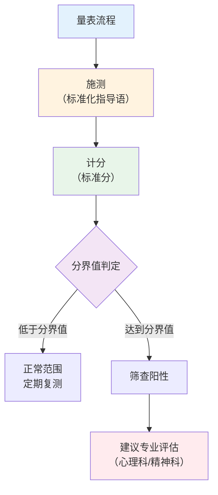
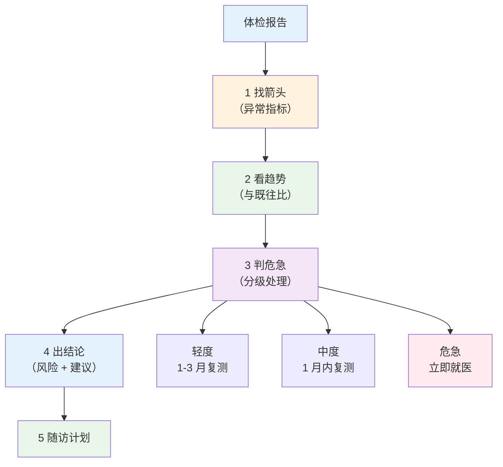

# 心理评估工具与体检报告解读

> **费曼学习法**：量表只筛不诊，体检报告看趋势不看单值。

---

## 一、模块定位

评估链路第三、四步"测"和"读"。**优先级 ★★★**：量表分界值 + 报告解读是单选高频考点，也是业务刚需。

---

## 二、心理量表分界值（必背）

| 量表 | 用途 | 分界值 | 注意 |
|------|------|--------|------|
| SAS | 焦虑自评 | ≥50（标准分，中国常模） | 量表筛、不诊断；须结合临床 |
| SDS | 抑郁自评 | ≥50（标准分，中国常模） | 含自伤表述须立即转介 |
| PHQ-9 | 抑郁筛查 | ≥5 轻 / ≥10 中 / ≥15 中重度 | 第 9 项（自伤）阳性立即转介 |
| GAD-7 | 焦虑筛查 | ≥5 轻 / ≥10 中 / ≥15 中重度 | 筛查工具 |
| 失眠（ISI） | 失眠严重度 | ≥8 中重度失眠 | 辅助量化工具 |

**使用约束：**

| 约束 | 内容 |
|------|------|
| 施测环境 | 安静、一对一、说明"非考试、无对错" |
| 结果表述 | "筛查提示焦虑/抑郁风险，建议专业评估"，不说"你得了抑郁症" |
| 自伤风险 | PHQ-9 第 9 项、SDS 自伤项阳性 → 立即建议就医，不拖延 |
| 复测 | 稳定人群每 3-6 个月；干预中按月（遵医嘱/方案） |

> 量表只能"筛"不能"诊"，这是与"诊断"红线的直接考点（见 [11 边界](../11-boundaries/index.md)）。

---

## 三、体检报告常见异常速查

### 3.1 异常指标速查表（成人）

| 指标 | 正常参考 | 异常方向 | 处理 |
|------|----------|----------|------|
| 血压（诊室） | <120/80mmHg | ≥140/90 | 复测；3 次均高 → 就医评估 |
| 空腹血糖 | 3.9-6.1mmol/L | ≥7.0 | 复测 + HbA1c 确认 |
| 糖化 HbA1c | 4.0-6.0% | ≥6.5% | 结合空腹血糖，建议就医 |
| 总胆固醇 | <5.2mmol/L | ≥5.7 | 调脂评估（LDL-C 更关键） |
| LDL-C | <3.4（普通人群） | ≥4.1 | 高危患者目标 <2.6（见 [02 药理](../02-basic-medicine/index.md)） |
| 甘油三酯 | <1.7mmol/L | ≥2.3 | 饮食 + 运动干预 |
| 尿酸 | 男 <420、女 <360μmol/L | >480 | 饮食 + 就医（痛风发作） |
| 转氨酶 ALT | 男 <40、女 <40U/L | >80 | 肝病评估 |
| 肌酐（男/女） | 57-111 / 45-84μmol/L | 升高 | 查 eGFR |
| 尿蛋白 | <0.15g/24h | 升高 | 复测 + 泌尿科 |
| TSH | 0.27-4.2mIU/L | 升高 + T4 低 | 甲减评估 |

### 3.2 读报告流程

**分级处置口径：**

| 级别 | 例子 | 处置 |
|------|------|------|
| 轻度 | 甘油三酯 2.0-2.2mmol/L | 饮食运动干预，3 个月复测 |
| 中度 | 空腹血糖 7.0-8.0mmol/L | 1 个月内复测 + HbA1c |
| 危急 | 血压 ≥180/110mmHg；LDL-C ≥5.7mmol/L 合并糖尿病 | 立即就医，不停自行处理 |

### 3.3 报告解读高频误区

| 误区 | 正确做法 |
|------|----------|
| 肿瘤标志物升高 = 癌症 | 结合影像 + 病理；标志物特异性有限（见 [03 疾病基础](../03-disease-basics/index.md)） |
| 单次数值异常就下结论 | 看趋势（与既往比）+ 复测确认 |
| 只看"正常/异常"标签 | 看参考区间 + 临床意义（如 ALT 2 倍上限比 1.2 倍更有意义） |
| 替医生判读 | 给出"建议就医评估"，不替代诊断 |

---

## 四、易混淆点 / 常见坑

| 误区 | 正确做法 |
|------|----------|
| SAS/SDS 一次高就"确诊" | 量表筛，须专业评估确认 |
| 空腹血糖 6.3 就"是糖尿病" | 复测 + HbA1c + 随机/OGTT 综合判定 |
| 尿素氮升高 = 肾功能差 | 先查肌酐 + eGFR；尿素氮受蛋白饮食影响大 |
| 血脂四项都看总胆固醇 | 临床以 LDL-C 为核心，HDL-C 是保护因素 |
| 尿蛋白阳性一次就肾病 | 晨尿 + 1h 后排除体位性蛋白尿，复测尿白蛋白/肌酐 |

---

## 五、一页速查

| 问题 | 答案 |
|------|------|
| PHQ-9 ≥15 怎么处理 | 中重度，转介 + 第 9 项阳性立即就医 |
| 量表结果能诊断吗 | 不能，仅筛查 |
| LDL-C 普通人群参考 | <3.4mmol/L；高危目标 <2.6 |
| HbA1c 诊断参考 | ≥6.5%（结合空腹血糖确认） |
| 报告处置分级 | 轻度 1-3 月复测 / 中度 1 月内 / 危急立即就医 |
| 尿酸男/女上限 | 420/360μmol/L |
| ALT 升高优先查什么 | 肝病（乙肝/脂肪肝）评估 |

---

## 六、相关链接

| 主题 | 链接 |
|------|------|
| 健康评估总览 | [04 总览](index.md) |
| 风险因素 | [01 风险因素](01-risk-factors.md) |
| 疾病管理 | [05 疾病管理](../05-disease-management/index.md) |
| 医疗行为边界 | [11 边界合规](../11-boundaries/index.md) |
