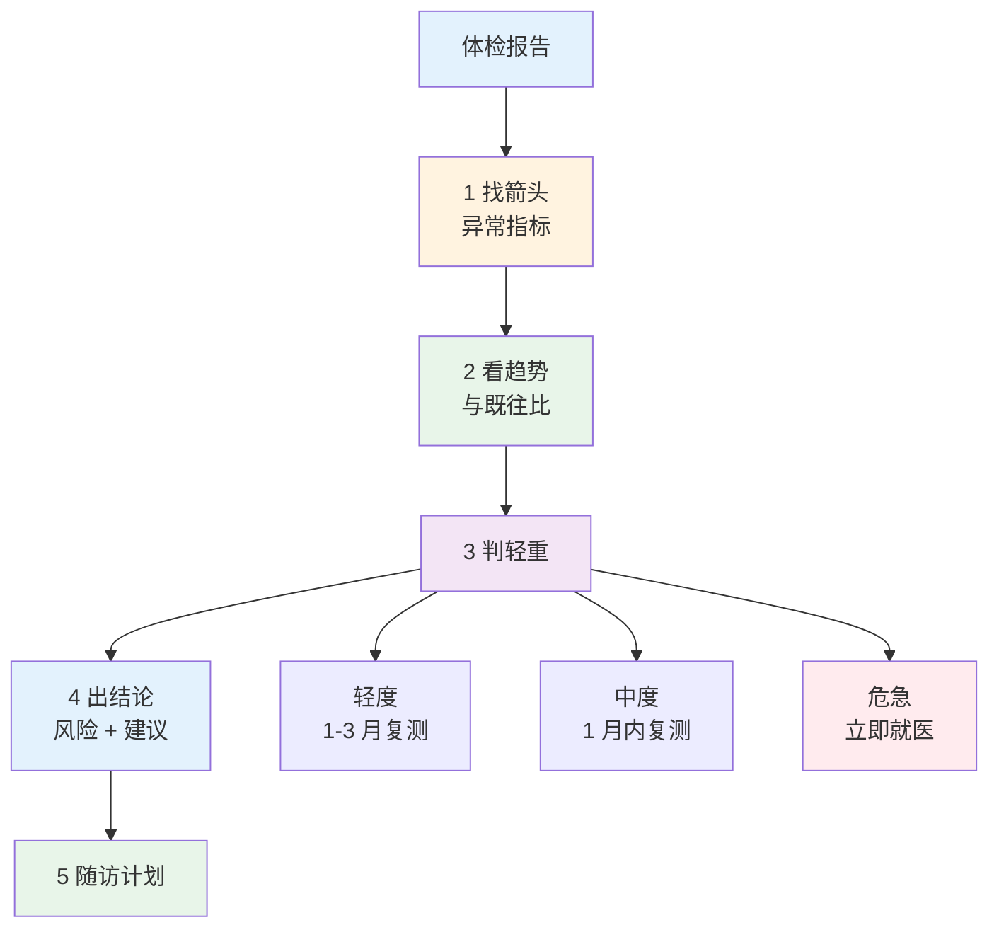

# 健康体检报告解读

> **费曼学习法**：读报告三步——找箭头（异常）、看趋势（与既往比）、判轻重（分级处置）。

---

## 一、模块定位

评估链路第四步"读"。**优先级 ★★★**：业务高频（客户拿着体检报告来），操作卷也考"报告异常处理"。

> 注：本文件与 [03-psychological-tools.md](03-psychological-tools.md) 同属评估链路，量表部分看 03。

---

## 二、常见异常指标速查（成人）

| 指标 | 正常参考 | 异常方向 | 处理 |
|------|----------|----------|------|
| 血压（诊室） | <120/80mmHg | ≥140/90 | 复测；3 次均高就医评估 |
| 空腹血糖 | 3.9-6.1mmol/L | ≥7.0 | 复测 + HbA1c 确认 |
| 糖化 HbA1c | 4.0-6.0% | ≥6.5% | 结合空腹血糖，建议就医 |
| 总胆固醇 | <5.2mmol/L | ≥5.7 | 调脂评估（LDL-C 更关键） |
| LDL-C | <3.4（普通） | ≥4.1 | 高危目标 <2.6（见 [02 药理](../02-basic-medicine/index.md)） |
| 甘油三酯 | <1.7mmol/L | ≥2.3 | 饮食 + 运动干预 |
| 尿酸 | 男 <420 / 女 <360μmol/L | >480 | 饮食 + 就医（痛风发作） |
| ALT | 男 <40 / 女 <40U/L | >80 | 肝病评估 |
| 肌酐（男） | 57-111μmol/L | 升高 | 查 eGFR |
| 尿蛋白 | <0.15g/24h | 升高 | 复测 + 泌尿科 |
| TSH | 0.27-4.2mIU/L | 升 + T4 低 | 甲减评估 |

---

## 三、读报告流程

**分级处置口径：**

| 级别 | 例子 | 处置 |
|------|------|------|
| 轻度 | 甘油三酯 2.0-2.2mmol/L | 饮食运动干预，3 月复测 |
| 中度 | 空腹血糖 7.0-8.0mmol/L | 1 月内复测 + HbA1c |
| 危急 | 血压 ≥180/110mmHg | 立即就医，不自行处理 |

**读报告五原则：**

| 原则 | 说明 |
|------|------|
| 找箭头 | 先看异常，再看临界（正常高值） |
| 看趋势 | 单次数值须与既往比（同实验室） |
| 判危急 | 按上表分级；危急项 24h 内告知客户就医 |
| 不诊断 | 给"建议就医评估"，不下诊断结论 |
| 留档 | 报告存档（客户授权，见 [11 个保](../11-boundaries/index.md)） |

---

## 四、高频报告场景（情景题）

| 情景 | 处理 |
|------|------|
| LDL-C 4.5mmol/L + 糖尿病 | 高危/极高危，目标 <2.6mmol/L，建议心内科 + 强化生活方式 |
| 空腹血糖 7.2 + HbA1c 6.8% | 疑似 2 型糖尿病，建议糖代谢专科评估（OGTT/HbA1c 确认） |
| 肿瘤标志物 CEA 轻度升高（吸烟者） | 不等同癌症，3 月复查 + 影像评估 |
| 血压 180/110mmHg 单次 | 立即就医（3 级高血压风险），不停自行处理 |

---

## 五、易混淆点 / 常见坑

| 误区 | 正确做法 |
|------|----------|
| 单次数值异常就下结论 | 看趋势 + 复测确认 |
| 肿瘤标志物升高 = 癌症 | 结合影像 + 病理，标志物特异性有限 |
| 血脂四项都看总胆固醇 | 临床以 LDL-C 为核心，HDL-C 是保护因素 |
| 尿蛋白阳性一次就肾病 | 晨尿 + 排除体位性蛋白尿，复测尿白蛋白/肌酐 |
| 替医生判读 | 给"建议就医评估"，不替代诊断 |

---

## 六、一页速查

| 问题 | 答案 |
|------|------|
| 读报告三步 | 找箭头 → 看趋势 → 判轻重 |
| 处置分级 | 轻度 1-3 月复测 / 中度 1 月内 / 危急立即就医 |
| LDL-C 普通人群参考 | <3.4mmol/L |
| 危急血压（立即就医） | ≥180/110mmHg |
| CEA 轻度升高（吸烟者） | 3 月复查 + 影像，不诊断癌症 |
| 报告存档须 | 客户授权（见 11 个保） |

---

## 七、相关链接

| 主题 | 链接 |
|------|------|
| 健康评估总览 | [04 总览](index.md) |
| 心理量表 | [03 量表](03-psychological-tools.md) |
| 基础医学 | [02 基础医学](../02-basic-medicine/index.md) |
| 行业实操（业务版） | [10 行业实操](../10-industry-practice/index.md) |
