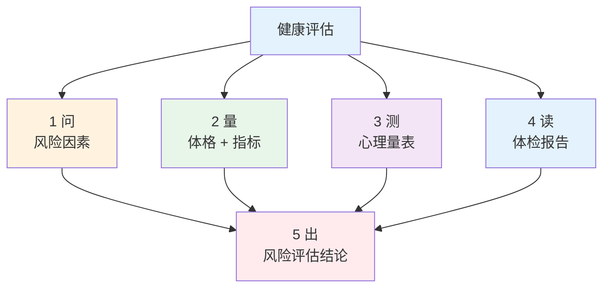
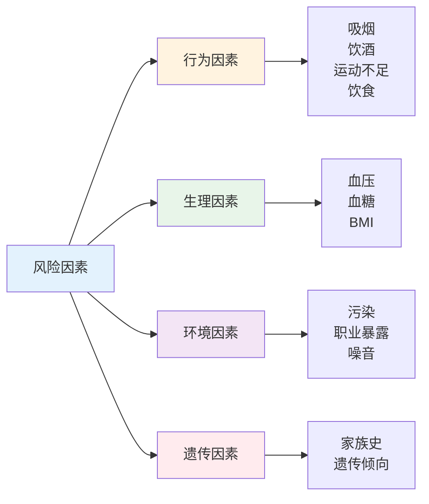

# 健康评估 — 评估链路、风险因素与易混淆详解

> **费曼学习法**：健康评估 = 三件事：问清楚（危险因素）、量出来（体格 + 指标）、算明白（量表 + 报告）。

---

## 一、评估链路总览

**健康管理全流程定位：** 评估是「评估→干预→随访→结局」的第一步（详见 [05 疾病管理](../05-disease-management/index.md)），评估结论决定干预方向。

---

## 二、核心流程（速览）

### 2.1 风险因素四象限

> 可干预性排序：**行为因素可干预性最强**（吸烟、运动、饮食是干预抓手），遗传因素只能识别不能改。

---

## 三、易混淆点 / 常见坑

| 误区 | 正确做法 |
|------|----------|
| 量表分数高 = 患抑郁症 | 量表是筛查工具，确诊须精神科评估 |
| 自己量一次血压就能下结论 | 须规范测量（坐位安静 5min）+ 非同日多次 |
| BMI 正常就不用管 | 中心性肥胖（腰围）可独立于 BMI 存在 |
| 风险因素只问行为 | 遗传（家族史）+ 环境（职业暴露）同等重要 |
| 读报告只看箭头 | 须结合既往值变化趋势 + 靶器官影响 |

---

## 四、相关链接

| 主题 | 链接 |
|------|------|
| 健康评估总览 | [04 健康评估](index.md) |
| 风险因素详解 | [01 风险因素](01-risk-factors.md) |
| 体格测量规范 | [02 测量](02-physical-measurements.md) |
| 心理量表详解 | [03 量表](03-psychological-tools.md) |
| 体检报告解读 | [04 报告](04-medical-report.md) |
| 疾病管理 | [05 疾病管理](../05-disease-management/index.md) |
