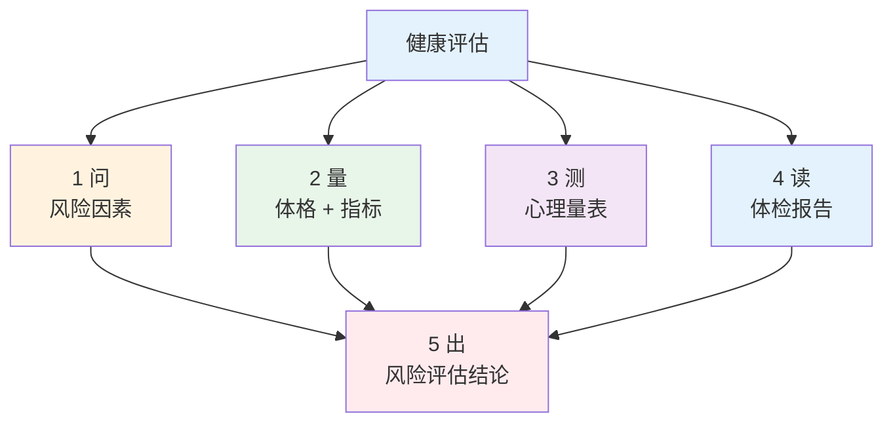
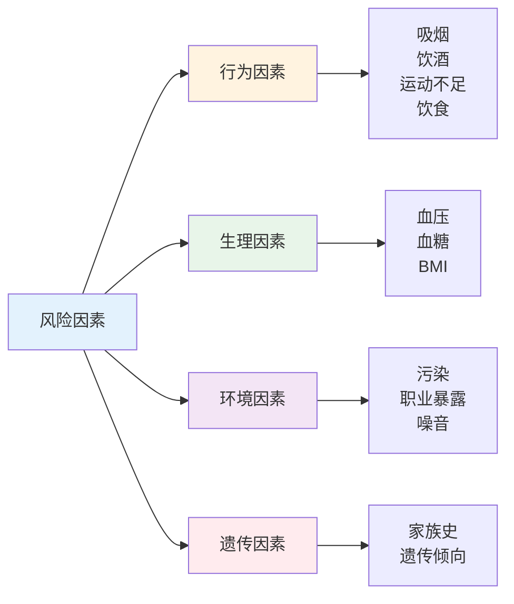

# 健康评估 — 风险识别、体格测量、心理量表与体检报告

> **费曼学习法**：健康评估 = 三件事：问清楚（危险因素）、量出来（体格 + 指标）、算明白（量表 + 报告）。

---

## 一、模块定位

解决「如何系统地评估一个人的健康状态」。**优先级 ★★★（官方权重：技能卷"信息采集"20% + "健康风险评估与分析"10%，为技能卷第一大块）**，也是业务的第一环节。

| 子文件 | 内容 | 先看 |
|--------|------|------|
| [01-risk-factors.md](01-risk-factors.md) | 四类风险因素 + 风险评估流程 | 业务第一步 |
| [02-physical-measurements.md](02-physical-measurements.md) | BMI、腰围、血压测量规范 | 必背数字 |
| [03-psychological-tools.md](03-psychological-tools.md) | SAS/SDS/PHQ-9/GAD-7 分界值 | 量表类题必考 |
| [04-medical-report.md](04-medical-report.md) | 常见异常指标速查 + 读报告流程 | 业务高频 |

**按场景找答案：**

| 场景 | 看 |
|------|----|
| 客户来建档，先问什么 | [01 风险因素](01-risk-factors.md) |
| 血压怎么量才算数 | [02 测量规范](02-physical-measurements.md) |
| 量表多少分算异常 | [03 量表](03-psychological-tools.md) |
| 体检报告箭头怎么解读 | [04 报告](04-medical-report.md) |

**本模块官方权重：** 技能卷「信息采集」20%（含体格测量）+「健康风险评估与分析」10% —— 技能卷第一大块。

---

## 二、评估链路总览

**健康管理全流程定位：** 评估是「评估→干预→随访→结局」的第一步（详见 [05 疾病管理](../05-disease-management/index.md)），评估结论决定干预方向。

---

## 三、核心知识点提炼（本模块必背）

| 要点 | 数字/口径 |
|------|-----------|
| 评估四步 | 问（风险因素）→ 量（体格）→ 测（量表）→ 读（报告） |
| 可干预最强风险因素 | 行为因素（吸烟/饮食/运动） |
| BMI 正常（成人） | 18.5-23.9kg/m²；≥28 肥胖 |
| 腰围中心性肥胖 | 男 ≥90cm、女 ≥85cm |
| 血压测量规范 | 坐位安静 5min，袖带肘窝上 2-3cm，取后 2 次均值 |
| PHQ-9 分界值 | ≥5 轻 / ≥10 中 / ≥15 中重；第 9 项阳性立即转介 |
| 量表定位 | 筛查非诊断，阳性须专业评估 |
| 报告处置分级 | 轻度 1-3 月复测 / 中度 1 月内 / 危急立即就医 |

---

## 四、核心流程（速览）

### 4.1 风险因素四象限

> 可干预性排序：**行为因素可干预性最强**（吸烟、运动、饮食是干预抓手），遗传因素只能识别不能改。

## 五、易混淆点 / 常见坑

| 误区 | 正确做法 |
|------|----------|
| 量表分数高 = 患抑郁症 | 量表是筛查工具，确诊须精神科评估 |
| 自己量一次血压就能下结论 | 须规范测量（坐位安静 5min）+ 非同日多次 |
| BMI 正常就不用管 | 中心性肥胖（腰围）可独立于 BMI 存在 |
| 风险因素只问行为 | 遗传（家族史）+ 环境（职业暴露）同等重要 |
| 读报告只看箭头 | 须结合既往值变化趋势 + 靶器官影响 |

---

## 六、一页速查

| 问题 | 答案 |
|------|------|
| 评估四步 | 问（风险）→ 量（体格）→ 测（量表）→ 读（报告） |
| 可干预最强的风险因素 | 行为因素（吸烟/饮食/运动） |
| 中国成人 BMI 正常 | 18.5-23.9 kg/m² |
| 腰围中心性肥胖（男/女） | ≥90cm / ≥85cm |
| PHQ-9 ≥15 | 中重度，转介 + 关注自伤项 |
| 量表能诊断吗 | 不能，仅筛查 |
| 血压正常（成人） | <120/80mmHg（诊室） |

---

## 七、相关链接

| 主题 | 链接 |
|------|------|
| 风险因素详解 | [01 风险因素](01-risk-factors.md) |
| 体格测量规范 | [02 测量](02-physical-measurements.md) |
| 心理量表详解 | [03 量表](03-psychological-tools.md) |
| 体检报告解读 | [04 报告](04-medical-report.md) |
| 疾病管理 | [05 疾病管理](../05-disease-management/index.md) |
| 行业实操 | [10 行业实操](../10-industry-practice/index.md) |

---

## 八、推荐阅读

- 《健康管理师》（三级）健康评估章节 — 人民卫生出版社
- 《医学心理学》（院校教材）— 人民卫生出版社
- 《中国居民膳食指南》（饮水与营养素参考值）— 中国营养学会
