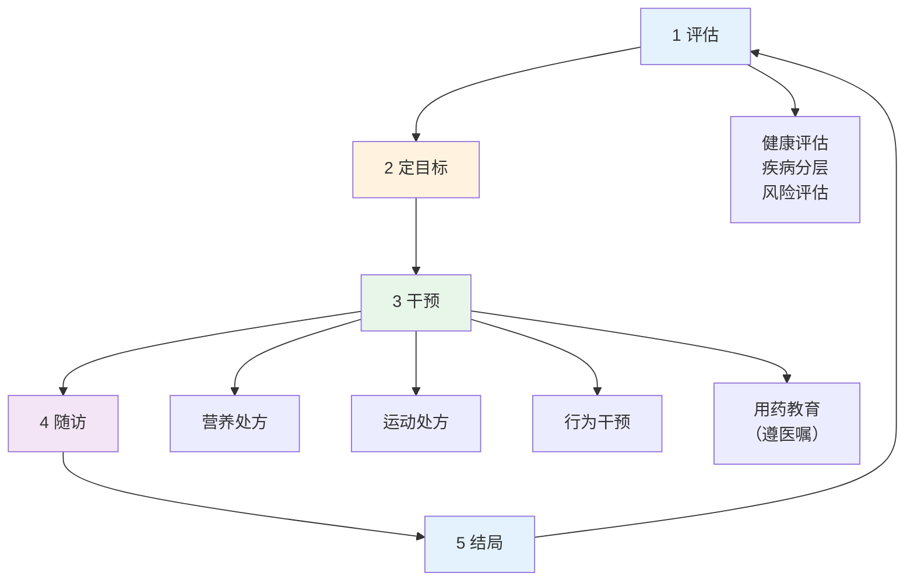
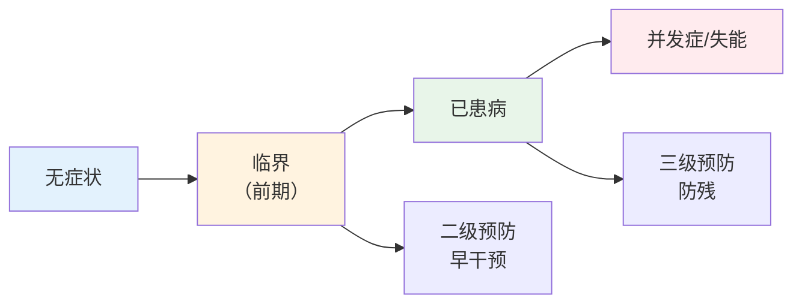
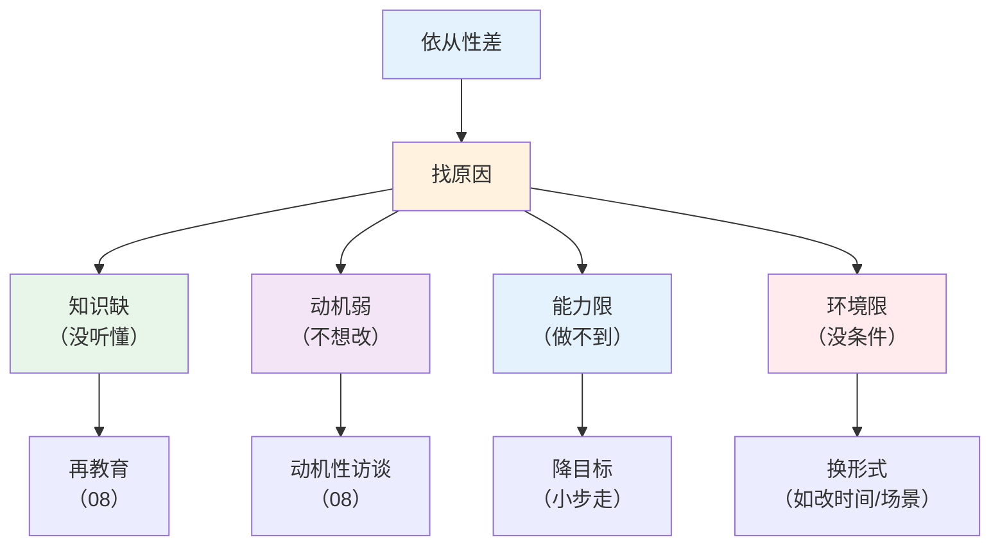

# 慢病管理全流程

> **费曼学习法**：慢病管理的本质是"循环"——评估定目标、干预给抓手、随访盯执行、结局看指标，然后回到评估。

---

## 一、模块定位

05 模块的框架文件。**优先级 ★★★**：操作卷"管理方案制定"考的就是流程完整性。

---

## 二、管理流程详解

**各环节核心动作：**

| 环节 | 动作 | 关键产出 |
|------|------|----------|
| 评估 | 健康评估（04）+ 既往病史 + 实验室 | 疾病分层 + 个体化目标 |
| 定目标 | 按指南定指标目标 + 知情同意 | 书面目标（客户确认） |
| 干预 | 营养（06）+ 运动（07）+ 行为（08） | 干预方案 + 执行计划 |
| 随访 | 周期随访 + 依从性评估 | 执行记录 + 问题清单 |
| 结局 | 对比目标与实际 | 达标调整/未达标加强 |

---

## 三、三级预防在慢病中的落点

| 级别 | 慢病落点 | 举例 |
|------|----------|------|
| 一级 | 病因预防（针对无症状人群） | 限钠、减重、戒烟、运动 |
| 二级 | 早发现早干预（针对临界/已患病早期） | 高血压前期管理；IGT 干预；糖前期逆转方案 |
| 三级 | 防残（已患病） | 糖尿病足预防；心梗后康复；卒中后二级预防 |

> 一级预防面向"还没病"的人群（健康促进）；二级面向"临界"；三级面向"已患病防残"。

---

## 四、随访周期表

| 人群 | 随访周期 | 内容 |
|------|----------|------|
| 达标稳定（如血压 <130/80 持续） | 每 3 月 1 次 | 指标复核 + 依从性 + 方案微调 |
| 未达标 / 调整方案期 | 每 2 周 1 次 | 指标 + 方案执行 + 调整 |
| 高危新发（如新诊断 2 型糖尿病） | 前 3 月每月 1 次 | 强化干预 + 并发症筛查教育 |
| 老年多病（≥2 种慢病） | 每 1-2 月 1 次 | 多指标 + 用药教育 |

**随访内容固定四查：**

| 查项 | 内容 |
|------|------|
| 指标 | 血压/血糖/血脂/体重（按病种） |
| 执行 | 运动次数、饮食记录、吸烟饮酒 |
| 问题 | 依从性障碍、不良反应、生活变化 |
| 下一步 | 是否调整目标/方案/频率 |

---

## 五、依从性管理（成败关键）

> 依从性干预方法（动机性访谈 OARS、SMART、打卡工具）详见 [08 心理行为](../08-psychology-education/index.md) 与 [10 行为工具](../10-industry-practice/index.md)。

---

## 六、易混淆点 / 常见坑

| 误区 | 正确做法 |
|------|----------|
| 干预一次就行 | 管理是循环，不随访不调整 = 无效 |
| 目标定得越低越好 | 个体化（老年/多病者目标放宽，遵医嘱） |
| 随访只看指标 | 同时盯依从性，是干预成败关键 |
| 三级预防 = 住院康复 | 三级预防 = 防残（社区/门诊层面同样适用） |
| 方案调整可以自行决定 | 调药须遵医嘱；生活方式调整可与客户协商后实施 |

---

## 七、一页速查

| 问题 | 答案 |
|------|------|
| 管理四环节 | 评估→定目标→干预→随访→结局（循环） |
| 三级预防落点 | 一级无症状/二级临界/三级已患病防残 |
| 达标稳定随访 | 每 3 月 1 次 |
| 新诊断强化期 | 前 3 月每月 1 次 |
| 随访固定四查 | 指标、执行、问题、下一步 |
| 依从性四原因 | 知识、动机、能力、环境 |
| 调药 | 遵医嘱，健康管理师不处方 |

---

## 八、相关链接

| 主题 | 链接 |
|------|------|
| 05 总览 | [05 总览](index.md) |
| 高血压管理 | [02 高血压](02-hypertension.md) |
| 糖尿病管理 | [03 糖尿病](03-diabetes.md) |
| 行为干预方法 | [08 心理行为](../08-psychology-education/index.md) |
