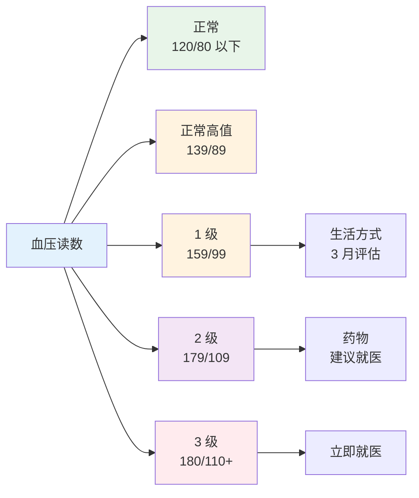
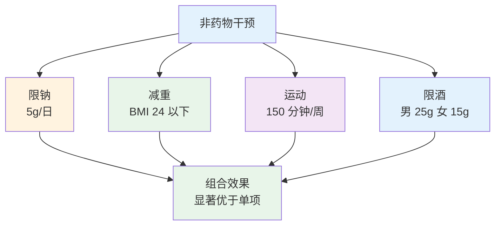

# 高血压管理

> **费曼学习法**：高血压管理三件事——量对（血压读数规范）、定对（分级目标）、管住（限钠+运动+遵医嘱）。

---

## 一、模块定位

05 模块高频业务文件。**优先级 ★★★**：随访场景第一高频病种。

---

## 二、诊断与分级（成人，诊室）

| 分级 | 收缩压 | 舒张压 |
|------|--------|--------|
| 正常 | <120mmHg | <80mmHg |
| 正常高值 | 120-139mmHg | 80-89mmHg |
| 1 级高血压 | 140-159mmHg | 90-99mmHg |
| 2 级高血压 | 160-179mmHg | 100-109mmHg |
| 3 级高血压 | ≥180mmHg | ≥110mmHg |

**诊断口径（2024 指南）：** 诊室血压非同日 3 次 ≥140/90mmHg；或家庭血压连测 5-7 天均值 ≥135/85mmHg；或 24h 动态血压均值 ≥130/80mmHg（见 [04 测量规范](../04-health-assessment/index.md)）。

> 注：取收缩压/舒张压较高一级定级。

---

## 三、治疗目标（个体化，遵医嘱）

| 人群 | 目标（2024 指南） |
|------|------|
| 一般成人 | <140/90mmHg；耐受者可降至 <130/80mmHg |
| 糖尿病合并 | <130/80mmHg（遵医嘱） |
| 老年（65-79 岁） | <140/90mmHg，耐受者 <130/80mmHg |
| 高龄（≥80 岁） | <150/90mmHg，耐受者 <140/90mmHg |
| 合并肾病/蛋白尿 | <130/80mmHg（遵医嘱） |

> 口径依据：《中国高血压防治指南（2024 年修订版）》。

---

## 四、非药物干预（核心抓手）

| 措施 | 量化 | 预期降压（约） |
|------|------|---------------|
| 限钠 | <5g 盐/日（≈一啤酒瓶盖，成人） | 5-6mmHg |
| 减重 | BMI <24 | 每减 10kg 降 5-20mmHg |
| 运动 | 中等强度 150-300min/周 | 5-8mmHg |
| 限酒 | 男 <25g、女 <15g 酒精/日 | 2-4mmHg |
| DASH 饮食 | 蔬果全谷物 + 低脂奶 | 8-14mmHg |

**运动选择（结合 [07 运动](../07-exercise/index.md)）：** 中等强度有氧（快走、骑车、游泳）为主，每周 5-7 次；避免 2 级以上高血压未控制时的剧烈运动。

---

## 五、用药注意（健康管理师口径）

> 红线：健康管理师**不处方、不调药**；用药教育 + 依从性随访是职责（见 [11 边界](../11-boundaries/index.md)）。

| 药物 | 关键注意 |
|------|----------|
| CCB（氨氯地平） | 缓释片每日 1 次；脚踝水肿常见 |
| ACEI（依那普利） | 干咳改用 ARB；监测血钾；孕期禁用 |
| ARB（缬沙坦） | 无干咳；血钾监测 |
| β阻滞剂（美托洛尔） | 哮喘禁用；**不可骤停**（反跳） |
| 利尿剂（氢氯噻嗪） | 低钾；痛风慎用 |

**依从性教育要点：**

| 要点 | 说明 |
|------|------|
| 不擅自停药 | 血压正常是药效在维持，停药反跳 |
| 定时服药 | 每日固定时间，漏服按医嘱补 |
| 记录血压 | 家庭自测：早晚各 1-2 次，连测 7 天取均值 |
| 不良反应上报 | 干咳/水肿/低钾症状，建议就医评估 |

---

## 六、随访计划

| 状态 | 周期 | 内容 |
|------|------|------|
| 新诊断/调整期 | 2 周 1 次 | 血压 + 依从性 + 方案调整 |
| 稳定达标 | 3 月 1 次 | 血压 + 体重 + 生活方式复核 |
| 老年多病 | 1-2 月 1 次 | 血压 + 用药教育 + 跌倒风险评估 |

**危急处置：**

| 情景 | 处置 |
|------|------|
| 血压 ≥180/110 + 症状（头痛/胸闷/视物模糊） | **立即就医**（高血压急症风险） |
| 单次数值高无症状 | 安静 5min 复测，仍高记录 + 48h 内随访 |
| 家庭自测均值 >135/85 | 复测确认，提醒就医评估 |

---

## 七、易混淆点 / 常见坑

| 误区 | 正确做法 |
|------|----------|
| 血压正常就停药 | 擅自停药反跳风险，调药遵医嘱 |
| 1 级高血压都能吃降压药 | 1 级先生活方式干预 3 月评估，再定（遵医嘱） |
| 降压药越贵越好 | 适合即好，依从性比价格重要 |
| 家庭自测一次偏高就紧张 | 7 天均值 + 规范测量才有意义 |
| β阻滞剂随便停 | 骤停可诱发心绞痛/心梗（反跳） |

---

## 八、一页速查

| 问题 | 答案 |
|------|------|
| 高血压诊断（诊室） | ≥140/90mmHg（非同日 3 次）；家庭自测 ≥135/85 |
| 一般目标 | <140/90mmHg，耐受者 <130/80mmHg |
| 糖尿病合并目标 | <130/80mmHg（遵医嘱） |
| 限钠 | <5g 盐/日 |
| β阻滞剂关键注意 | 哮喘禁用；不可骤停 |
| 血压 ≥180/110 + 症状 | 立即就医 |
| 家庭自测方法 | 早晚各 1-2 次，连测 7 天取均值 |

---

## 九、相关链接

| 主题 | 链接 |
|------|------|
| 05 总览 | [05 总览](index.md) |
| 全流程 | [01 全流程](01-general-flow.md) |
| 血压测量规范 | [04 测量](../04-health-assessment/index.md) |
| 运动指导 | [07 运动](../07-exercise/index.md) |
