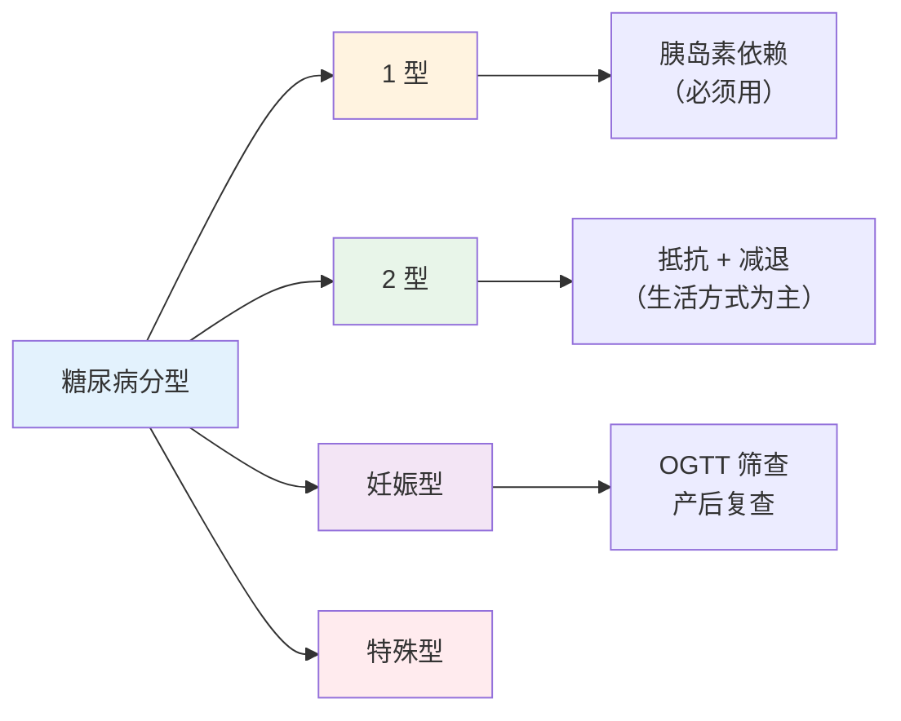
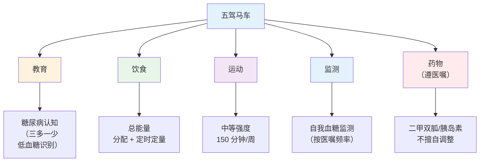
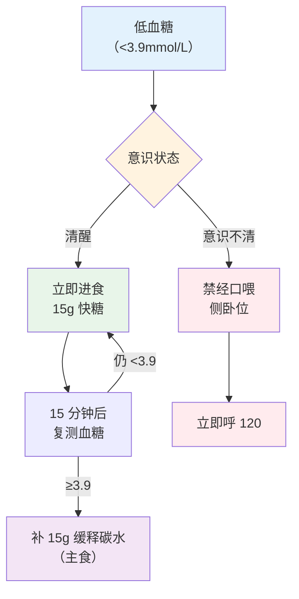

# 糖尿病管理

> **费曼学习法**：糖尿病管理 = "五驾马车"（教育、饮食、运动、监测、药物）+ 防低血糖。药物那匹"马"归医生，其余四匹是健康管理师的主场。

---

## 一、模块定位

05 模块高频业务文件。**优先级 ★★★**：随访场景第二高频病种。

---

## 二、分型与诊断

### 2.1 分型速记

| 分型 | 特点 | 考点 |
|------|------|------|
| 1 型 | 自身免疫致胰岛 β 细胞破坏，**必须用胰岛素** | 多见于青少年，发病急 |
| 2 型 | 胰岛素抵抗 + 功能减退，占比约 95% | 肥胖相关，进展慢 |
| 妊娠期 | 孕 24-28 周筛查（OGTT） | 产后复查 |
| 其他特殊型 | 单基因病、胰腺疾病等 | 占比小，认知即可 |

### 2.2 诊断标准（成人）

| 标准 | 数值 | 注意 |
|------|------|------|
| 空腹血糖（FPG） | ≥7.0mmol/L | 空腹 = 8h 以上未进食 |
| 随机血糖 | ≥11.1mmol/L + 糖尿病症状 | 症状 = 三多一少 |
| OGTT 2h 血糖 | ≥11.1mmol/L | 75g 葡萄糖耐量试验 |
| 糖化 HbA1c | ≥6.5% | 须实验室标准化，结合其他标准确认 |

**糖耐量受损（IGT）：** OGTT 2h 血糖 7.8-11.0mmol/L；**空腹血糖受损（IFG）：** 6.1-6.9mmol/L（成人）。IGT/IFG 是 2 型糖尿病前状态，重点干预对象。

---

## 三、血糖控制目标（成人 2 型，遵医嘱个体化）

| 指标 | 目标值 | 适用 |
|------|--------|------|
| 空腹血糖 | 4.4-7.0mmol/L | 一般成人 |
| 非空腹（餐后 2h） | <10.0mmol/L | 一般成人 |
| HbA1c | <7% | 一般成人；老年/多病者可放宽（遵医嘱） |

> 老年、病程长、低血糖高危者目标放宽，以医嘱为准。

---

## 四、五驾马车（干预框架）

### 4.1 饮食管理要点（详细见 [06 营养](../06-nutrition/index.md)）

| 要点 | 内容 |
|------|------|
| 总能量 | 按理想体重 + 活动量定（轻体力 25-30kcal/kg/日） |
| 三大产能 | 碳水 50-60%、蛋白 15-20%、脂肪 20-30% |
| 定时定量 | 三餐规律，加餐在固定时间（防低血糖） |
| 低 GI 优先 | 全谷物、豆类、蔬菜（见 10 行业实操食谱） |
| 限糖 | 含糖饮料控制 <25g 游离糖/日（成人） |

### 4.2 运动管理要点（详细见 [07 运动](../07-exercise/index.md)）

| 项 | 内容 |
|----|------|
| 量 | 中等强度 150-300min/周（成人） |
| 时机 | 餐后 1h 开始（避开血糖高峰） |
| 禁忌 | 血糖 >16.7mmol/L 暂不运动（酮症风险）；低血糖未纠正不运动 |
| 防低血糖 | 运动前血糖 <5.6mmol/L 先补 15g 碳水再运动 |

### 4.3 监测

| 监测 | 频率参考 |
|------|----------|
| 自我血糖（按医嘱） | 新诊断/调药期每日 2-4 次；稳定期每周 2-3 次 |
| HbA1c | 每 3-6 月 1 次 |
| 并发症筛查 | 足部、眼底、尿白蛋白每年 1 次 |

---

## 五、低血糖处理（必背）

| 步骤 | 操作 | 注意 |
|------|------|------|
| 识别 | 出汗、心悸、手抖、饥饿、意识改变 | 低血糖意识不清者最危险 |
| 清醒处理 | 15g 快糖（葡萄糖片/含糖饮料 150mL） | 避免脂肪（延缓吸收） |
| 复测 | 15min 后测血糖 | 仍低再补 15g |
| 意识不清 | **禁经口喂**（误吸风险），侧卧 + 呼 120 | 侧卧防误吸 |
| 后续 | 恢复后查原因 + 防再发 | 记录低血糖事件 |

---

## 六、随访计划（结合 01 全流程）

| 状态 | 周期 | 内容 |
|------|------|------|
| 新诊断强化期 | 前 3 月每月 1 次 | 强化干预 + 依从性 |
| 调药期 | 2 周 1 次 | 血糖 + 低血糖事件 + 方案调整 |
| 稳定期 | 3 月 1 次 | 指标 + 生活方式 + HbA1c |
| 每年 | 并发症筛查 | 足/眼底/尿白蛋白（遵医嘱） |

---

## 七、易混淆点 / 常见坑

| 误区 | 正确做法 |
|------|----------|
| 血糖正常就不吃饭 | 规律饮食防低血糖，"饿过头"是低血糖主因 |
| 低血糖意识不清喂糖水 | 禁经口喂（误吸），侧卧 + 120 |
| 胰岛素是"1 型专属" | 2 型晚期胰岛功能衰竭同样需胰岛素（遵医嘱） |
| 调药可以自行决定 | 调药遵医嘱；生活方式调整可与客户协商 |
| 运动时间越早越好 | 餐后 1h 开始避高峰；空腹运动低血糖风险 |

---

## 八、一页速查

| 问题 | 答案 |
|------|------|
| 2 型糖尿病诊断（FPG） | ≥7.0mmol/L（需确认） |
| HbA1c 诊断参考 | ≥6.5%（须标准化 + 确认） |
| 血糖目标（成人） | 空腹 4.4-7.0、HbA1c <7% |
| IGT 区间（OGTT 2h） | 7.8-11.0mmol/L |
| 低血糖值 | <3.9mmol/L |
| 清醒低血糖处理 | 15g 快糖，15min 复测 |
| 意识不清低血糖 | 侧卧 + 120，禁经口喂 |
| 五驾马车主场 | 教育/饮食/运动/监测（药物遵医嘱） |

---

## 九、相关链接

| 主题 | 链接 |
|------|------|
| 05 总览 | [05 总览](index.md) |
| 全流程 | [01 全流程](01-general-flow.md) |
| 营养干预 | [06 营养](../06-nutrition/index.md) |
| 运动干预 | [07 运动](../07-exercise/index.md) |
| 食谱实操 | [10 行业实操](../10-industry-practice/index.md) |
