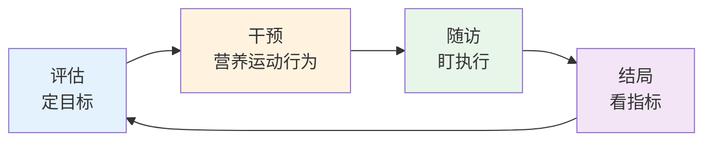

# 疾病管理 — 慢病全流程与高血压、糖尿病管理

> **费曼学习法**：慢病管理 = 四个环：评估（定目标）→ 干预（营养+运动+行为）→ 随访（盯执行）→ 结局（看指标）。高血压和糖尿病是"重中之重"。

---

## 一、模块定位

解决「慢病怎么系统管」。**优先级 ★★★（官方权重：技能卷"干预方案的实施"10% + "跟踪随访"10%，合计 20%）**，业务核心。

| 子文件 | 内容 | 先看 |
|--------|------|------|
| [01-general-flow.md](01-general-flow.md) | 慢病管理全流程 + 三级预防落点 + 随访周期 | 框架 |
| [02-hypertension.md](02-hypertension.md) | 高血压：分级、目标、非药物 + 用药注意 | 高频 |
| [03-diabetes.md](03-diabetes.md) | 糖尿病：分型、诊断、目标、五驾马车、低血糖处理 | 高频 |

**按场景找答案：**

| 场景 | 看 |
|------|----|
| 新建慢病档案 | [01 全流程](01-general-flow.md) |
| 高血压客户随访 | [02 高血压](02-hypertension.md) |
| 糖尿病客户血糖高 | [03 糖尿病](03-diabetes.md) |

---

## 二、管理全流程（总览）

**四个环节的核心：**

| 环节 | 做什么 | 输出 |
|------|--------|------|
| 评估 | 健康评估（04 模块）+ 疾病分层 | 个体化目标（如血压 <130/80） |
| 干预 | 营养处方 + 运动处方 + 行为干预（06/07/08） | 干预方案 + 知情同意 |
| 随访 | 按周期随访（见 01） | 执行记录 + 依从性评估 |
| 结局 | 看指标变化 | 目标是否达成；未达成调整方案 |

> 管理全流程细节与随访周期表见 [01 全流程](01-general-flow.md)；高血压/糖尿病目标值见 02/03。

---

## 三、核心知识点提炼（本模块必背）

| 要点 | 数字/口径 |
|------|-----------|
| 管理四环节 | 评估→干预→随访→结局（循环） |
| 高血压诊断（2024 指南） | 诊室 ≥140/90mmHg（非同日 3 次）；家庭自测 ≥135/85 |
| 高血压一般目标 | <140/90mmHg，耐受者 <130/80mmHg |
| 糖尿病诊断 | 空腹 ≥7.0 / 随机 ≥11.1mmol/L / HbA1c ≥6.5%（须确认） |
| 血糖目标（成人） | 空腹 4.4-7.0、HbA1c <7% |
| 低血糖（清醒） | 15g 快糖，15min 复测 |
| 低血糖（意识不清） | 侧卧 + 呼 120，禁经口喂 |
| 管理红线 | 不诊断、不处方、调药遵医嘱 |

## 四、高血压速览（详见 02）

| 项 | 内容 |
|----|------|
| 诊断 | 诊室 ≥140/90mmHg（成人，非同日 3 次） |
| 分级 | 1级 140-159/90-99；2级 160-179/100-109；3级 ≥180/110 mmHg |
| 一般目标 | <140/90；糖尿病合并 <130/80（遵医嘱） |
| 非药物 | 限钠 <5g/日、减重、运动 150-300min/周 |

---

## 五、糖尿病速览（详见 03）

| 项 | 内容 |
|----|------|
| 诊断 | 空腹 ≥7.0 / 随机 ≥11.1mmol/L / HbA1c ≥6.5%（需确认） |
| 血糖目标 | 空腹 4.4-7.0、非空腹 <10.0mmol/L、HbA1c <7%（成人） |
| 五驾马车 | 教育、饮食、运动、监测、药物（医嘱） |
| 低血糖处理 | 清醒 15g 糖 15min 复测；意识不清禁经口喂，侧卧 + 呼 120 |

---

## 六、易混淆点 / 常见坑

| 误区 | 正确做法 |
|------|----------|
| 高血压没有症状就没事 | "无声杀手"，靶器官损害（心脑肾眼）常在症状后 |
| 血压正常就停药 | 擅自停药反跳风险，调药须遵医嘱 |
| 血糖正常就不吃饭 | 饮食控制 + 规律进餐，避免低血糖 |
| 管理 = 开药 | 健康管理师不处方；营养/运动/行为是主线，用药遵医嘱 |
| 随访只看指标 | 同时盯依从性（运动次数、饮食记录），是干预成败关键 |

---

## 七、一页速查

| 问题 | 答案 |
|------|------|
| 慢病管理四环节 | 评估→干预→随访→结局（循环） |
| 高血压诊断 | ≥140/90mmHg（非同日 3 次） |
| 糖尿病诊断（HbA1c） | ≥6.5%（须确认） |
| 血糖目标（成人） | 空腹 4.4-7.0、HbA1c <7% |
| 低血糖清醒处理 | 15g 糖，15min 复测 |
| 低血糖意识不清 | 侧卧 + 呼 120，禁经口喂 |
| 管理红线 | 不诊断、不处方，调药遵医嘱 |

---

## 八、相关链接

| 主题 | 链接 |
|------|------|
| 管理全流程 | [01 全流程](01-general-flow.md) |
| 高血压管理 | [02 高血压](02-hypertension.md) |
| 糖尿病管理 | [03 糖尿病](03-diabetes.md) |
| 营养干预 | [06 营养](../06-nutrition/index.md) |
| 运动干预 | [07 运动](../07-exercise/index.md) |
| 行为干预 | [08 心理行为](../08-psychology-education/index.md) |
