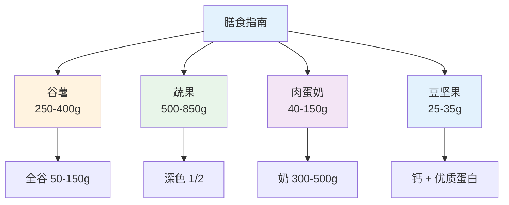
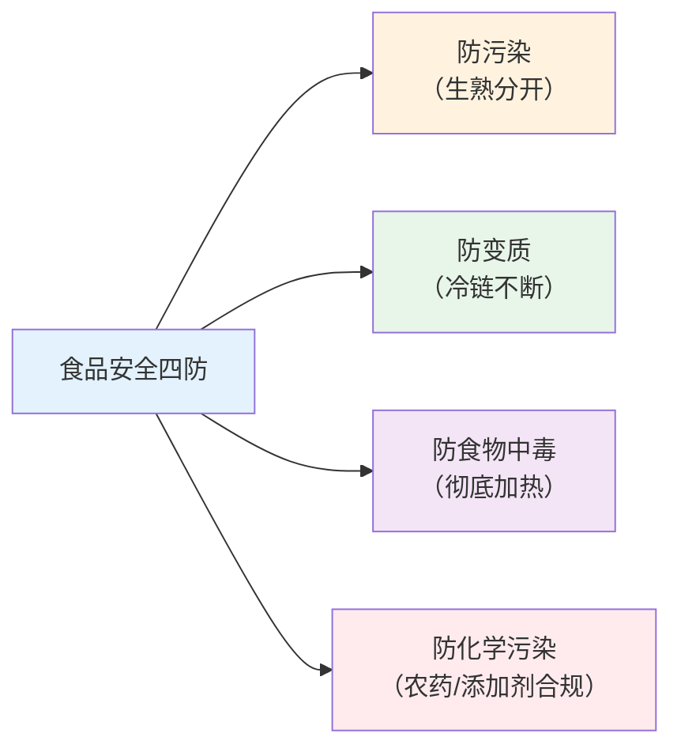

# 营养与食品安全

> **费曼学习法**：营养建议的核心不是"吃什么好"，而是"怎么把一日食谱配平"——三大产能算对、交换份用起来、特殊人群有针对性。

---

## 一、模块定位

解决「营养建议的理论与合规边界」。**优先级 ★★★**：考纲权重最高模块之一；业务中"营养建议"场景的理论基础（实操见 [10 行业实操](10-industry-practice/index.md)）。

---

## 二、膳食指南要点（中国居民，成人）

### 2.1 每日食物量参考（轻体力成人）

| 食物类别 | 每日量 | 说明 |
|----------|--------|------|
| 谷薯类 | 250-400g（全谷物 50-150g） | 主食核心，粗细搭配 |
| 蔬菜 | 300-500g（深色占一半） | 深色蔬菜 ≥1/2 |
| 水果 | 200-350g | 整果，不榨汁 |
| 畜禽肉 | 40-75g | 适量 |
| 水产 | 40-75g | 优先于畜肉 |
| 蛋类 | 40-50g（约 1 个） | 不弃蛋黄 |
| 奶及奶制品 | 300-500g（成人） | 钙的主要来源 |
| 大豆及坚果 | 25-35g | 优质蛋白 + 不饱和脂肪 |

**调味与补充：**

| 项 | 标准（成人） |
|----|-------------|
| 烹调用油 | 25-30g/日 |
| 食盐 | <5g/日（≈一啤酒瓶盖） |
| 饮水 | 1500-1700mL/日（轻体力，温白开水） |
| 添加糖 | <25g/日（最好 <50g，指南推荐） |
| 酒精 | 建议不饮酒；如饮，男 <25g、女 <15g/日 |

### 2.2 三大产能营养素供能比（成人）

| 营养素 | 供能比 | 产能 | 记忆 |
|--------|--------|------|------|
| 碳水 | 50-60% | 4kcal/g | 主要供能 |
| 蛋白质 | 15-20% | 4kcal/g | 0.8-1.0g/kg/日 |
| 脂肪 | 20-30% | 9kcal/g | 饱和脂肪 <10% 总能量 |

---

## 三、食物交换份法（配餐核心工具）

| 交换份 | 每份食物量 | 每份热量 | 适用 |
|--------|-----------|----------|------|
| 谷薯类 | 25g（生重） | 90kcal | 主食替换 |
| 蔬菜类 | 100g | 90kcal | 绿叶菜 |
| 水果类 | 200g | 90kcal | 中糖水果 |
| 肉蛋类 | 100g（瘦肉） | 90kcal | 蛋白来源 |
| 奶类 | 100mL | 90kcal | 奶/酸奶替换 |
| 豆类 | 25g | 90kcal | 豆腐/豆浆 |
| 油脂 | 5g | 90kcal | 烹调油 |

**应用原则：** 同交换份内食物可互换（90kcal 等量），保持"总量不变、结构可调"。详细配餐步骤见 [10 食谱实操](10-industry-practice/index.md)。

> 考试常考"90kcal 一个交换份 + 各份对应克数"，数字必须精确。

---

## 四、特殊人群膳食原则

| 人群 | 核心要点 |
|------|----------|
| 孕产妇 | 叶酸 0.4-0.8mg/日（孕前 3 月起）；钙 1000-1300mg/日；多餐少量；食品安全（避免生食、未熟肉类） |
| 儿童（1-6 岁） | 保证奶 + 蛋 + 瘦肉；限糖限盐；规律进餐；避免整粒坚果（窒息风险，<4 岁） |
| 老年人（65+） | 优质蛋白 1.0-1.2g/kg/日（防肌少症）；钙 1000mg/日 + 维生素 D；软烂食物；限钠 |
| 糖尿病 | 低 GI 食物、定时定量、控总量；详见 [05 糖尿病](05-disease-management/index.md) |
| 高血压 | 限钠 <5g/日、DASH 饮食、限酒 |

---

## 五、食品安全高频考点

### 5.1 食物中毒常见源

| 食物 | 风险 | 预防 |
|------|------|------|
| 四季豆 | 皂苷 + 植物血凝素 | 彻底煮熟（无豆腥味） |
| 鲜黄花菜 | 秋水仙碱 | 焯水 + 浸泡后食用 |
| 木耳 | 米酵菌酸（泡发过久） | 干木耳现泡现用，不隔夜 |
| 豆浆 | 皂苷 | 充分煮沸（假沸后 5min+） |
| 河豚 | 河豚毒素 | 禁食（有毒部位） |

**食源性重点：** 诺如病毒（冬春季腹泻主因，手卫生 + 生熟分开）、沙门氏菌（鸡蛋/禽肉中心温度 ≥75°C）。

### 5.2 HACCP 概念（认知即可）

HACCP = 危害分析与关键控制点：在食品生产链识别关键控制点（如加热、冷藏温度），设定控制限值并监测。考试考"是什么 + 用途"，不考实操细节。

---

## 六、保健食品合规（与 [11 边界](11-boundaries/index.md) 呼应）

| 项 | 合规口径 |
|----|----------|
| 注册/备案 | 保健食品须取得注册/备案后方可销售，标签标批准文号 |
| 标签声明 | 必须标"本品不能代替药物" |
| 宣传红线 | 不得宣称疾病预防/治疗功能；不得用"疗效"暗示 |
| 销售行为 | 不得向消费者做功效演示、现场体验疗效暗示 |

> 行业实操中"能不能推荐保健品"见 [11 食品合规](11-boundaries/index.md)。

---

## 七、易混淆点 / 常见坑

| 误区 | 正确做法 |
|------|----------|
| 水果代替蔬菜 | 纤维 + 微量营养素不同，不可互替 |
| 只喝豆浆就能补蛋白 | 大豆蛋白需与谷物/蛋肉互补（赖氨酸-亮氨酸互补） |
| 减肥 = 不吃主食 | 限碳水到 50% 以下需医疗监督，普通人 45-60% |
| 保健品可以多吃 | 按标签剂量，超量有中毒风险（如维生素 A 脂溶性蓄积） |
| 果汁 = 水果 | 榨汁损失纤维 + 游离糖升高，整果优先 |
| 四季豆煮变色就行 | 须"彻底"（无豆腥味），中心温度达标 |

---

## 八、一页速查

| 问题 | 答案 |
|------|------|
| 每日主食（成人） | 谷薯 250-400g，全谷 50-150g |
| 盐/油上限（成人） | 盐 <5g、油 25-30g/日 |
| 添加糖 | <25g/日 |
| 交换份 | 90kcal/份（谷薯 25g、水果 200g、肉 100g、奶 100mL） |
| 孕妇叶酸 | 0.4-0.8mg/日（孕前 3 月起） |
| 老年蛋白 | 1.0-1.2g/kg/日 |
| 豆浆煮沸 | 假沸后再煮 5min+ |
| 保健品标签必写 | "本品不能代替药物" |

---

## 九、相关链接

| 主题 | 链接 |
|------|------|
| 知识体系全景 | [00 全景](00-overview.md) |
| 食谱实操（行业版） | [10 行业实操](10-industry-practice/index.md) |
| 糖尿病膳食 | [05 糖尿病](05-disease-management/index.md) |
| 食品宣传合规 | [11 边界](11-boundaries/index.md) |
| 营养学（外部） | [营养学](../nutrition/index.md) |

---

## 十、推荐阅读

- 《中国居民膳食指南（2022）》— 中国营养学会
- 《食物成分表（标准版）》— 中国营养学会
- 《健康管理师》（三级）营养章节 — 人民卫生出版社
