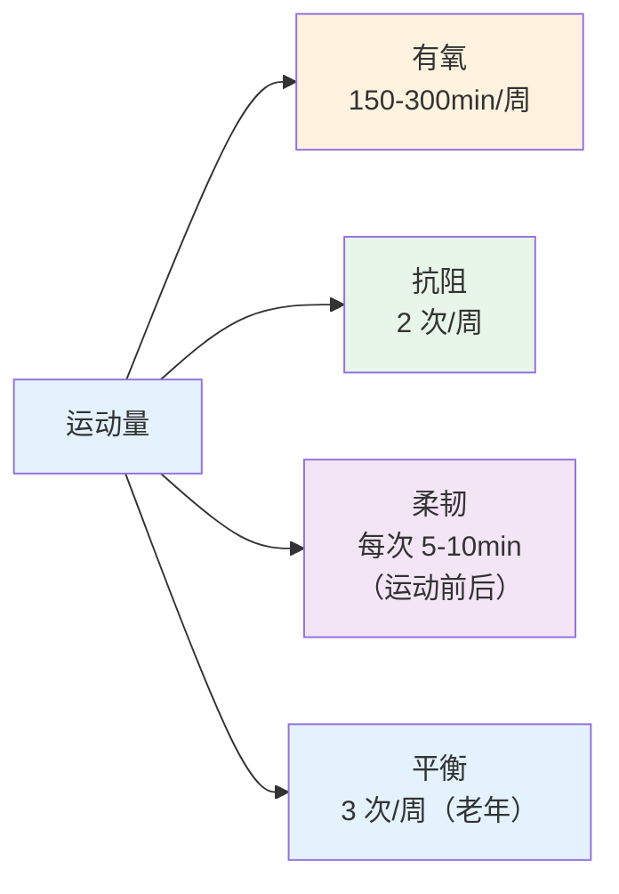
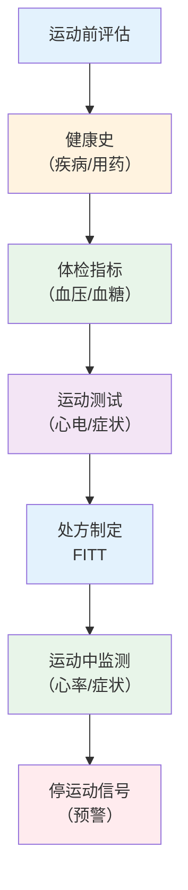

# 运动健身指导

> **费曼学习法**：运动处方就五要素 FITT——多少（F）、多强（I）、多久（T）、什么（T）、总量（V）。强度判定记住"靶心率 + RPE"两个尺子。

---

## 一、模块定位

解决「运动建议怎么给」。**优先级 ★★**：考纲模块；慢病干预三抓手之一（与 06 营养、08 行为并列，落地在 [05 疾病管理](../05-disease-management/index.md)）。

---

## 二、每周运动推荐量

| 人群 | 推荐量 | 说明 |
|------|--------|------|
| 成人（18-64） | 中等强度有氧 150-300min/周 + 抗阻 2 次/周 | 中等 = 谈话能说话但不能唱歌 |
| 青少年（6-17） | 60min/日 | 含强化骨肌肉活动 3 次/周 |
| 老年（65+） | 150min/周 + 平衡训练 3 次/周（防跌倒） | 能力者加抗阻 |

---

## 三、运动处方五要素 FITT

| 要素 | 含义 | 高频口径 |
|------|------|----------|
| F | 频率 Frequency | 有氧 3-5 次/周；抗阻 2 次/周（同肌群 48h 间隔） |
| I | 强度 Intensity | 靶心率 60-80%（最大心率）或 RPE 12-16 |
| T | 时间 Time | 每次 30-60min（含热身/放松） |
| T | 类型 Type | 有氧 + 抗阻 + 柔韧组合 |
| V | 总量 Volume | 每周中等强度分钟数（目标 150-300） |

### 3.1 强度判定两把尺子（必背）

| 方法 | 公式/分度 | 适用 |
|------|----------|------|
| 靶心率 | 最大心率 ≈ 220 - 年龄；靶心率 = 最大值 × 60-80% | 有设备者 |
| RPE（Borg 6-20） | 12-16 = 中等强度（谈话能说不能唱） | 无设备者 |
| 心率储备法（HRres） | 靶心率 = 静息 + (220-年龄-静息) × 60-80% | 老年/药物者 |

**例子（成人 50 岁）：** 最大心率 ≈ 170 次/min；靶心率 = 170 × 60-80% = 102-136 次/min。

> 服用 β 阻滞剂（如美托洛尔）者靶心率不准，以 RPE 为准（见 [02 药理](../02-basic-medicine/index.md)）。

---

## 四、不同人群运动注意

| 人群 | 注意 |
|------|------|
| 高血压 | 血压未控制（≥180/110mmHg）暂缓运动；避免憋气动作（举重屏气）；运动中测血压 >180 停 |
| 糖尿病 | 运动前血糖 <5.6mmol/L 先补 15g 碳水；运动 <16.7mmol/L 不运动（酮症风险）；随身带糖块 |
| COPD | 呼吸费力时减量；呼吸操 + 小步行走；避免污染环境 |
| 孕产妇 | 中低强度（散步、孕妇操）；避免仰卧位（孕中期后）；无医学禁忌 |
| 老年 | 平衡训练防跌倒；骨质疏松者避免冲击性运动 |
| 减重者 | 运动前后热量缺口记录；每周 0.5kg 减重速度 |

### 4.1 运动中"停"信号（高危，必背）

| 信号 | 处理 |
|------|------|
| 胸闷/胸痛 | 立即停，症状不缓解呼叫 120 |
| 心率 > 靶心率上限仍不降 | 降强度观察 5min |
| 头晕/眼前发黑 | 立即停，坐位/卧位休息 |
| 血糖 <3.9mmol/L | 停运动，补 15g 糖，15min 复测 |
| 血压 >180/110mmHg | 停运动，就医评估 |

---

## 五、运动禁忌（绝对/相对）

| 类别 | 情形 |
|------|------|
| 绝对禁忌 | 急性心梗（未稳定）、不稳定心绞痛、未控制严重高血压（≥200/110mmHg）、急性发热 |
| 相对禁忌 | 未控制高血糖（>16.7mmol/L）、低血糖（<5.6 未纠正）、严重心律失常未评估、妊娠中晚期高危 |

> 判断是否运动 = 先评估（健康史 + 指标）→ 再定强度 → 全程预警信号教育（客户能识别"停"信号）。

---

## 六、易混淆点 / 常见坑

| 误区 | 正确做法 |
|------|----------|
| 心率越快越好 | 超过靶心率上限反而危险；强度"中等"才是减脂+心肺安全区 |
| 糖尿病人运动越多越好 | 血糖未稳定（过高/过低）时运动风险增加 |
| 高血压者做深蹲/举铁没问题 | 憋气动作升压，未控制者避免；需屏气时改呼气式 |
| 减重主要靠力量训练 | 热量缺口核心在饮食（06 营养），运动辅助 |
| 老年运动只看步数 | 老年核心是平衡训练（防跌倒）+ 抗阻（防肌少） |

---

## 七、一页速查

| 问题 | 答案 |
|------|------|
| 成人每周有氧 | 150-300min 中等强度 + 2 次抗阻 |
| 靶心率公式 | (220-年龄) × 60-80% |
| RPE 中等强度 | 12-16（Borg 6-20） |
| 糖尿病运动前 | 血糖 <5.6 先补 15g 碳水 |
| 血压运动红线 | >180/110mmHg 停 |
| β阻滞剂者强度判定 | 用 RPE，不用靶心率 |
| 运动禁忌（绝对） | 急性心梗、不稳定心绞痛、未控制重度高血糖、发热 |

---

## 八、相关链接

| 主题 | 链接 |
|------|------|
| 知识体系全景 | [00 全景](../00-overview/index.md) |
| 疾病管理 | [05 疾病管理](../05-disease-management/index.md) |
| 营养 | [06 营养](../06-nutrition/index.md) |
| 行业实操（运动工具） | [10 行业实操](../10-industry-practice/index.md) |

---

## 九、推荐阅读

- 《运动处方》（院校教材）— 人民卫生出版社
- 《中国成人身体活动量指南》— 国家体育总局
- 《健康管理师》（三级）运动章节 — 人民卫生出版社
