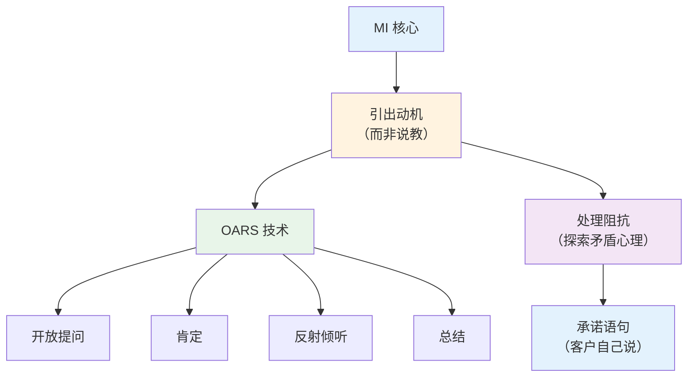
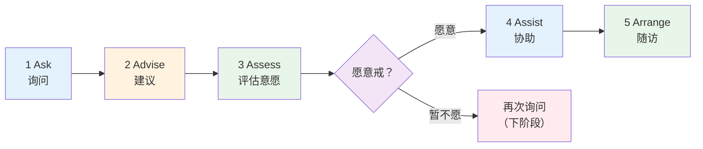
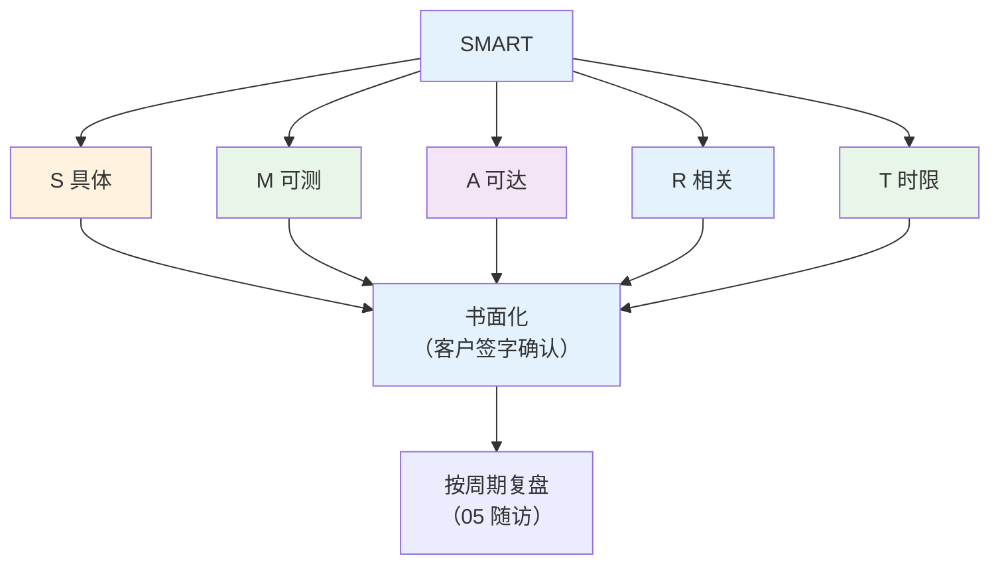
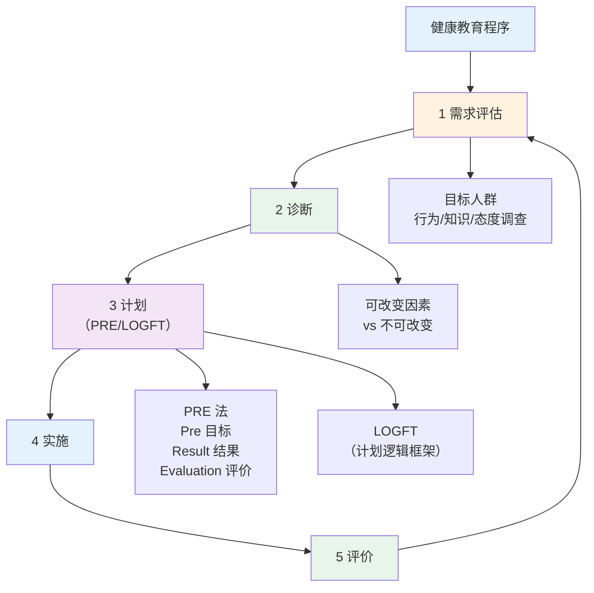

# 心理与行为干预 + 健康教育

> **费曼学习法**：行为干预的核心是"动机"——人不缺信息，缺的是改变的理由和抓手。记住 OARS（访谈）+ 5A（戒烟）+ SMART（目标）三套工具。

---

## 一、模块定位

解决「怎么让人真的改变行为」。**优先级 ★★★（官方权重：健康教育 7% + 技能卷"健康教育"5% + 行为干预贯穿干预方案 10%）**；所有干预的"软性"支撑（营养/运动处方能否落地取决于行为干预）。

---

## 二、动机性访谈（MI）

### 2.1 OARS 四技术（必背）

| 技术 | 含义 | 例子 |
|------|------|------|
| O | 开放式提问 | "运动对你有什么意义？"（非"你运动吗？"） |
| A | 肯定 | "你这周走了 3 次，坚持得不错" |
| R | 反射式倾听 | "听起来你既想运动，又担心没时间" |
| S | 总结 | "今天我们谈了 3 点，你的目标是……" |

**核心原则：** 不说服、不说教；矛盾心理（"我想戒又难戒"）是正常的，探索而非纠正。

### 2.2 矛盾心理（Ambivalence）处理

| 状态 | 应对 |
|------|------|
| 高意愿 + 高信心 | 直接定 SMART 目标 |
| 高意愿 + 低信心 | 拆小目标 + 既往成功经验 |
| 低意愿 + 高信心 | MI 探索 + 风险教育（不评判） |
| 双低 | 仅关系维护，不强行推进 |

---

## 三、5A 戒烟流程（必背）

| 步骤 | 内容 | 注意 |
|------|------|------|
| Ask | 识别吸烟者 + 询问吸烟量（包年） | 每次接触都问 |
| Advise | 个体化建议（"对你来说戒烟意味着……"） | 简短、非评判 |
| Assess | 评估戒断意愿（"你愿意这次戒吗？"） | 暂不愿 = 下阶段再问 |
| Assist | 协助制定戒烟计划 + 提供资源（戒烟门诊） | 确定日期、替代行为 |
| Arrange | 安排随访（1/3/6 月） | 复吸 = 再尝试，非失败 |

**关键数字：** 5A 流程中，"愿意戒"的吸烟者 30 天内成功率最高；复吸率约 70-80%，强调"再尝试"而非"失败"。

---

## 四、SMART 目标设定

| 字母 | 含义 | 例子（减重） |
|------|------|-------------|
| S | 具体 | "每周快走 4 次"（非"多运动"） |
| M | 可测量 | 每次 40min，心率 120-140 次/min |
| A | 可达成 | 基于当前 2 次/周基础 +2 次 |
| R | 相关 | 与总目标"3 月减重 4kg"一致 |
| T | 有时限 | 4 周内达成并维持 |

**完整例子：** "未来 4 周（T），每周快走 4 次（S/A），每次 40min、心率 120-140（M），配合减重 4kg 总目标（R）。"

---

## 五、健康教育程序

| 步骤 | 输出 |
|------|------|
| 需求评估 | 目标人群健康数据 + 行为调查 |
| 诊断 | 可改变的核心问题（1-3 个） |
| 计划 | PRE 法（Pre 目标 / Result 结果 / Evaluation 评价）或 LOGFT 逻辑框架 |
| 实施 | 教育活动（讲座/工作坊/一对一） |
| 评价 | 知识/行为/结局三级评价 |

---

## 六、行为改变理论速记（每个一句话）

| 理论 | 一句话 |
|------|--------|
| 知信行（KAP） | 知识 → 信念 → 行为，知识是基础但非充分条件 |
| 跨理论模型（TTM） | 改变分 5 阶段：前意向/意向/准备/行动/维持，干预随阶段匹配 |
| 计划行为理论（TPB） | 行为意向 = 态度 + 主观规范 + 感知行为控制 |
| 社会支持理论 | 支持网络影响行为维持（家庭/同伴/专业支持） |
| 健康信念模式 | 行为取决于"威胁感知 × 获益感知 - 成本感知" |

> 考试常考"属于哪个理论"，记住每个理论的核心名词（TTM 的"5 阶段"、TPB 的"三感知"）。

---

## 七、健康促进五大领域（奥塔维昂宪章）

| 领域 | 考点 |
|------|------|
| 制定健康政策 | 健康融入所有政策 |
| 创造支持环境 | 无烟环境、健康食物可及 |
| 加强社区行动 | 社区健康组织 |
| 发展个人技能 | 健康教育、自我效能 |
| 重新定向服务 | 服务从"治病"转向"防病 + 全人" |

---

## 八、易混淆点 / 常见坑

| 误区 | 正确做法 |
|------|----------|
| 戒烟靠"意志力" | 5A + 动机性访谈 + 随访，不是"想戒就能戒" |
| SMART 目标定得越高越好 | A（可达成）是前提，小步走 > 大目标 |
| 健康教育 = 讲知识 | 三级评价（知识/行为/结局），行为改变才是目标 |
| 复吸 = 彻底失败 | TTM 维持期反复正常，再尝试 |
| 理论套场景 | 先识客户处于哪一阶段（TTM），再选干预 |

---

## 九、一页速查

| 问题 | 答案 |
|------|------|
| OARS | 开放、肯定、反射、总结 |
| 5A | Ask/Advise/Assess/Assist/Arrange |
| SMART 顺序 | 具体/可测/可达/相关/时限 |
| TTM 五阶段 | 前意向/意向/准备/行动/维持 |
| 健康教育程序 | 评估→诊断→计划→实施→评价 |
| 健康促进五大领域 | 政策/环境/社区/技能/服务 |
| 戒烟随访节点 | 1/3/6 月 |
| 行为干预核心 | 动机（非说教） |

---

## 十、相关链接

| 主题 | 链接 |
|------|------|
| 知识体系全景 | [00 全景](00-overview.md) |
| 疾病管理（应用） | [05 疾病管理](05-disease-management/index.md) |
| 行业实操（工具落地） | [10 行业实操](10-industry-practice/index.md) |
| 营养行为（06） | [06 营养](06-nutrition.md) |

---

## 十一、推荐阅读

- 《健康教育学》（院校教材）— 人民卫生出版社
- 《动机性访谈》（经典译本）
- 《健康管理师》（三级）心理与行为章节 — 人民卫生出版社
