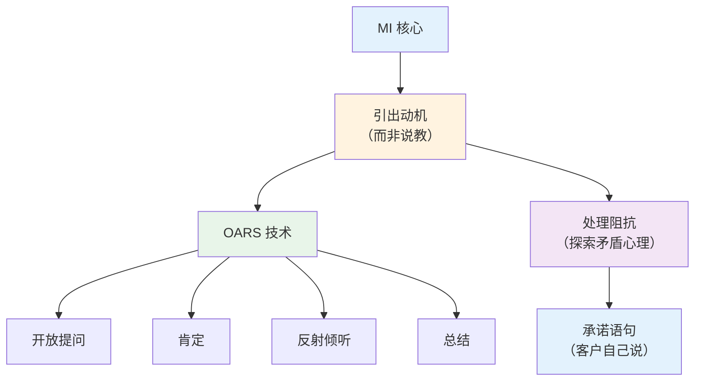
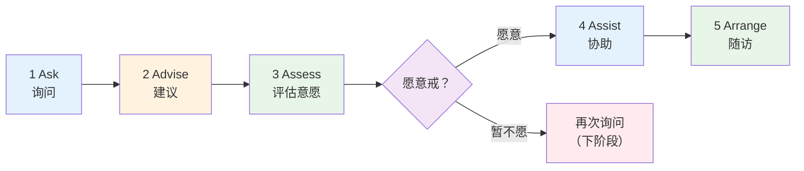
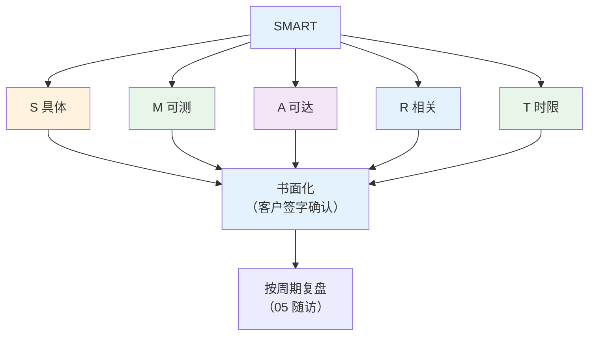

# 心理与行为干预 — 动机性访谈、5A 戒烟、SMART 详解

> **费曼学习法**：行为干预的核心是"动机"——人不缺信息，缺的是改变的理由和抓手。记住 OARS + 5A + SMART 三套工具。

---

## 一、动机性访谈（MI）

### 1.1 OARS 四技术（必背）

| 技术 | 含义 | 例子 |
|------|------|------|
| O | 开放式提问 | "运动对你有什么意义？"（非"你运动吗？"） |
| A | 肯定 | "你这周走了 3 次，坚持得不错" |
| R | 反射式倾听 | "听起来你既想运动，又担心没时间" |
| S | 总结 | "今天我们谈了 3 点，你的目标是……" |

**核心原则：** 不说服、不说教；矛盾心理（"我想戒又难戒"）是正常的，探索而非纠正。

### 1.2 矛盾心理（Ambivalence）处理

| 状态 | 应对 |
|------|------|
| 高意愿 + 高信心 | 直接定 SMART 目标 |
| 高意愿 + 低信心 | 拆小目标 + 既往成功经验 |
| 低意愿 + 高信心 | MI 探索 + 风险教育（不评判） |
| 双低 | 仅关系维护，不强行推进 |

---

## 二、5A 戒烟流程（必背）

| 步骤 | 内容 | 注意 |
|------|------|------|
| Ask | 识别吸烟者 + 询问吸烟量（包年） | 每次接触都问 |
| Advise | 个体化建议（"对你来说戒烟意味着……"） | 简短、非评判 |
| Assess | 评估戒断意愿（"你愿意这次戒吗？"） | 暂不愿 = 下阶段再问 |
| Assist | 协助制定戒烟计划 + 提供资源（戒烟门诊） | 确定日期、替代行为 |
| Arrange | 安排随访（1/3/6 月） | 复吸 = 再尝试，非失败 |

**关键数字：** 5A 流程中，"愿意戒"的吸烟者 30 天内成功率最高；复吸率约 70-80%，强调"再尝试"而非"失败"。

---

## 三、SMART 目标设定

| 字母 | 含义 | 例子（减重） |
|------|------|-------------|
| S | 具体 | "每周快走 4 次"（非"多运动"） |
| M | 可测量 | 每次 40min，心率 120-140 次/min |
| A | 可达成 | 基于当前 2 次/周基础 +2 次 |
| R | 相关 | 与总目标"3 月减重 4kg"一致 |
| T | 有时限 | 4 周内达成并维持 |

**完整例子：** "未来 4 周（T），每周快走 4 次（S/A），每次 40min、心率 120-140（M），配合减重 4kg 总目标（R）。"

---

## 四、相关链接

| 主题 | 链接 |
|------|------|
| 心理行为总览 | [08 心理与行为干预](index.md) |
| 疾病管理（应用） | [05 疾病管理](../05-disease-management/index.md) |
| 行业实操（工具落地） | [10 行业实操](../10-industry-practice/index.md) |
