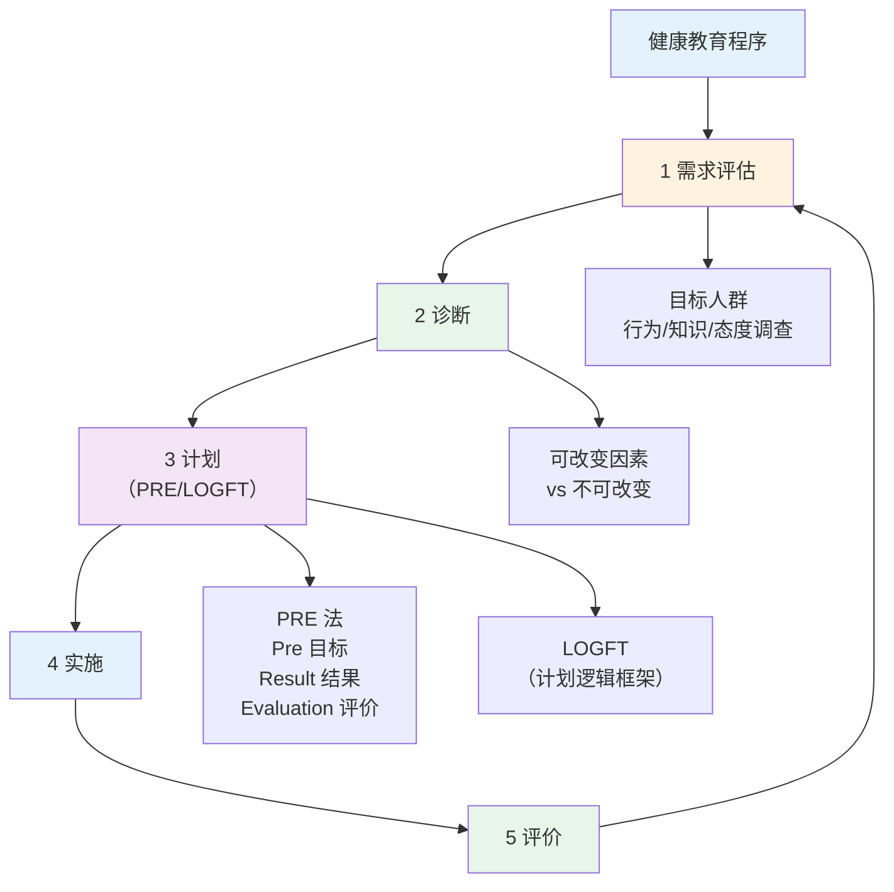

# 健康教育 — 程序、行为改变理论与五大领域

> **费曼学习法**：健康教育 = 评估→诊断→计划→实施→评价；行为理论记住每个的"核心名词"。

---

## 一、健康教育程序

| 步骤 | 输出 |
|------|------|
| 需求评估 | 目标人群健康数据 + 行为调查 |
| 诊断 | 可改变的核心问题（1-3 个） |
| 计划 | PRE 法（Pre 目标 / Result 结果 / Evaluation 评价）或 LOGFT 逻辑框架 |
| 实施 | 教育活动（讲座/工作坊/一对一） |
| 评价 | 知识/行为/结局三级评价 |

---

## 二、行为改变理论速记（每个一句话）

| 理论 | 一句话 |
|------|--------|
| 知信行（KAP） | 知识 → 信念 → 行为，知识是基础但非充分条件 |
| 跨理论模型（TTM） | 改变分 5 阶段：前意向/意向/准备/行动/维持，干预随阶段匹配 |
| 计划行为理论（TPB） | 行为意向 = 态度 + 主观规范 + 感知行为控制 |
| 社会支持理论 | 支持网络影响行为维持（家庭/同伴/专业支持） |
| 健康信念模式 | 行为取决于"威胁感知 × 获益感知 - 成本感知" |

> 考试常考"属于哪个理论"，记住每个理论的核心名词（TTM 的"5 阶段"、TPB 的"三感知"）。

---

## 三、健康促进五大领域（奥塔维昂宪章）

| 领域 | 考点 |
|------|------|
| 制定健康政策 | 健康融入所有政策 |
| 创造支持环境 | 无烟环境、健康食物可及 |
| 加强社区行动 | 社区健康组织 |
| 发展个人技能 | 健康教育、自我效能 |
| 重新定向服务 | 服务从"治病"转向"防病 + 全人" |

---

## 四、易混淆点 / 常见坑

| 误区 | 正确做法 |
|------|----------|
| 戒烟靠"意志力" | 5A + 动机性访谈 + 随访，不是"想戒就能戒" |
| SMART 目标定得越高越好 | A（可达成）是前提，小步走 > 大目标 |
| 健康教育 = 讲知识 | 三级评价（知识/行为/结局），行为改变才是目标 |
| 复吸 = 彻底失败 | TTM 维持期反复正常，再尝试 |
| 理论套场景 | 先识客户处于哪一阶段（TTM），再选干预 |

---

## 五、相关链接

| 主题 | 链接 |
|------|------|
| 心理行为总览 | [08 心理与行为干预](index.md) |
| 动机性访谈/SMART/5A | [01 详解](01-mi-smart-5a.md) |
| 疾病管理 | [05 疾病管理](../05-disease-management/index.md) |
| 营养行为（06） | [06 营养](../06-nutrition/index.md) |
