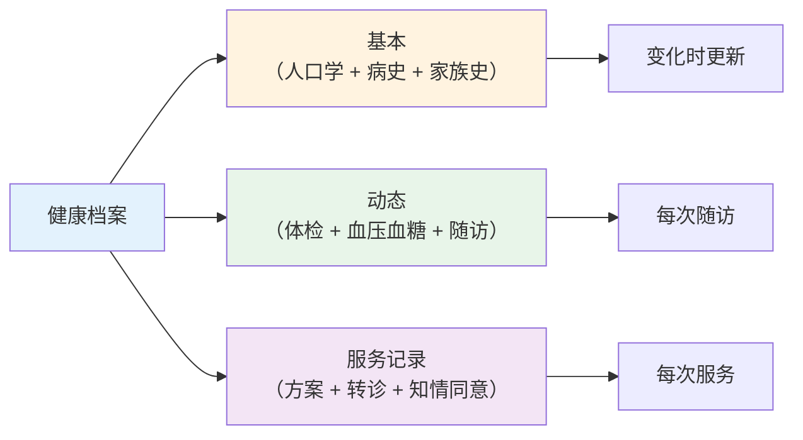
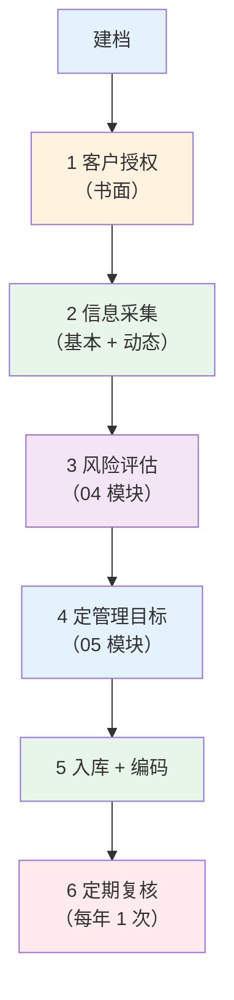
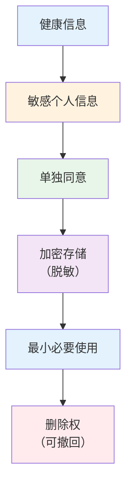

# 健康信息与服务

> **费曼学习法**：健康信息工作就三件事——建档案（结构化存储）、算指标（流行病学）、守合规（个人信息保护）。

---

## 一、模块定位

解决「健康信息的规范管理与合规处理」。**优先级 ★（官方权重：流行病与卫生统计 12%，理论卷第二大块）**：重点在"指标计算 + 档案规范 + 个保合规"。

### 核心知识点提炼（本模块必背）

| 要点 | 数字/口径 |
|------|-----------|
| 发病率 vs 患病率 | 新发 vs 现存（慢病患病率 >> 发病率） |
| RR = 10 含义 | 暴露组风险是非暴露组 10 倍 |
| 强关联阈值 | RR ≥ 3 |
| 健康信息性质 | 敏感个人信息，须单独同意 |
| 健康档案三块 | 基本 / 动态 / 服务记录 |
| 委托第三方 | 合同约定 + 监督义务 |

---

## 二、健康档案规范

### 2.1 三块结构（必记）

| 块 | 内容 | 更新频率 |
|----|------|----------|
| 基本项目 | 人口学、病史、家族史、生活方式 | 建档时 + 变化时 |
| 动态项目 | 体检指标、血压血糖记录、随访记录 | 每次随访 |
| 服务记录 | 干预方案、转诊记录、知情同意书 | 每次服务 |



### 2.2 建档流程



**关键合规点：** 建档前须取得客户书面授权（见 [11 个保](../11-boundaries/index.md)）；档案编码不可使用姓名作唯一标识（防泄露）。

---

## 三、流行病学指标（高频计算）

| 指标 | 计算公式 | 意义 |
|------|----------|------|
| 发病率 | 新病例 / 暴露人口 × K | 疾病"发生"频率 |
| 患病率 | 现患病例 / 调查人口 × K | 疾病"存在"频率 |
| 死亡率 | 死亡人数 / 平均人口 × K | 人口死亡风险 |
| 病死率 | 死亡人数 / 病例数 × K | 疾病严重程度 |
| RR（相对风险） | 暴露组发病率 / 非暴露组发病率 | 关联强度（≥3 即强关联） |
| OR（比值比） | 病例组暴露 odds / 对照组暴露 odds | 病例对照研究用 |
| AR（归因风险） | 暴露组发病率 - 非暴露组发病率 | 暴露"多导致"的发病 |

**计算例（RR）：**

```
暴露组（吸烟）发病 20/1000 = 2%
非暴露组（不吸烟）发病 2/1000 = 0.2%
RR = 2% / 0.2% = 10
→ 吸烟者肺癌风险是不吸烟者的 10 倍
AR = 2% - 0.2% = 1.8%
→ 每 1000 吸烟者多 18 例"归因"于吸烟
```

> 考试常考"RR=10 怎么解释"——务必会读数字，不只背公式。

---

## 四、数据管理与个人信息保护（法规要旨）

### 4.1 核心原则（《个人信息保护法》）

| 原则 | 考点 |
|------|------|
| 合法、正当、必要 | 收集限于服务目的，最小必要 |
| 单独同意 | 健康信息属敏感个人信息，须**单独同意**（非一般同意） |
| 加密存储 | 敏感信息须加密或匿名化存储 |
| 委托处理 | 委托第三方须合同约定 + 监督义务 |
| 删除权 | 客户可要求删除（法定保留除外） |



### 4.2 实操合规速记

| 场景 | 合规要点 |
|------|----------|
| 收集体检报告 | 书面授权 + 告知用途 |
| 转诊时交数据 | 仅交必要数据 + 接收方合规 |
| 数据分析（匿名化） | 脱敏后可用于统计，不可用于个人 |
| 委托第三方处理 | 合同约定 + 持续监督 |

> 详细业务场景合规见 [11 边界与合规](../11-boundaries/index.md)。

---

## 五、健康信息服务场景（业务）

| 服务 | 内容 |
|------|------|
| 健康咨询 | 评估 + 建议 + 转诊提醒（不诊断） |
| 健康教育 | 讲座 / 一对一 / 团体（08 模块） |
| 随访管理 | 按周期 + 依从性（05 模块） |
| 体检解读 | 报告异常分级处置（04 模块） |

---

## 六、易混淆点 / 常见坑

| 误区 | 正确做法 |
|------|----------|
| 发病率 = 患病率 | 发病是"新发"，患病是"现存"（慢病患病率>>发病率） |
| RR 只用于队列研究 | RR 也可从病例对照粗算，但 OR 才是病例对照的标准指标 |
| 健康信息一般同意就行 | 属敏感个人信息，须**单独同意** |
| 档案建完就不用管 | 每年复核 + 变化更新 |
| 数据给第三方做"脱敏"就行 | 须合同约定 + 监督义务（不只是脱敏） |

---

## 七、一页速查

| 问题 | 答案 |
|------|------|
| 发病率 vs 患病率 | 新发 vs 现存 |
| RR = 10 含义 | 暴露组风险是非暴露组 10 倍 |
| 相对风险强关联阈值 | RR ≥ 3 |
| 健康信息属 | 敏感个人信息，须单独同意 |
| 健康档案三块 | 基本 / 动态 / 服务记录 |
| 删除权 | 客户可要求删除（法定保留除外） |
| 委托第三方处理 | 须合同约定 + 监督 |

---

## 八、相关链接

| 主题 | 链接 |
|------|------|
| 知识体系全景 | [00 全景](../00-overview/index.md) |
| 健康评估 | [04 评估](../04-health-assessment/index.md) |
| 疾病管理 | [05 管理](../05-disease-management/index.md) |
| 边界合规 | [11 边界](../11-boundaries/index.md) |

---

## 九、推荐阅读

- 《流行病学》（院校教材）— 人民卫生出版社
- 《健康教育学》— 人民卫生出版社
- 《个人信息保护法》重点章节（第 28、29 条）
