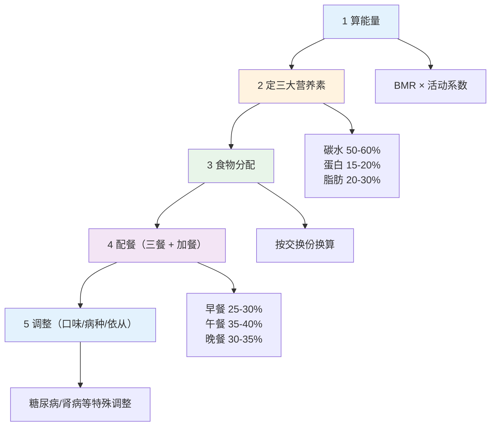
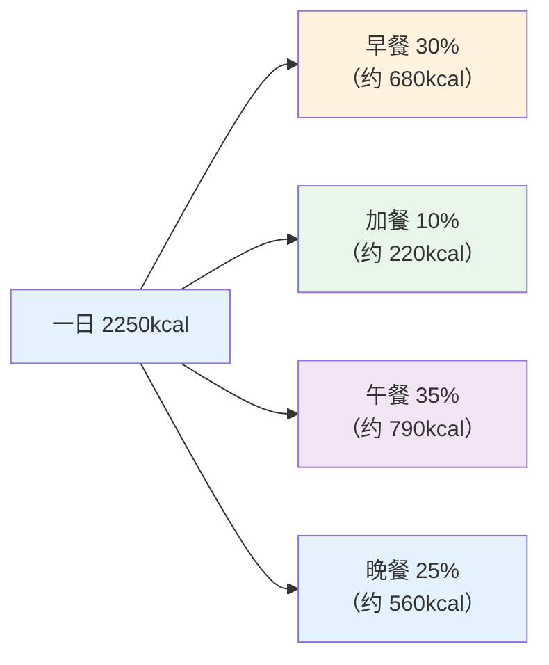

# 营养处方实操 — 食谱编制与食物交换份

> **费曼学习法**：编食谱 = 把"目标能量"拆成"三餐 + 加餐"的具体食物，用交换份保证总量不变、结构可调。

---

## 一、模块定位

营养建议业务的"怎么做"。**业务必备**，理论见 [06 营养](../06-nutrition.md)。

---

## 二、个人一日食谱编制 5 步骤

### 2.1 步骤 1：算目标能量

| 步骤 | 公式/方法 | 例（50 岁男性，75kg，轻体力） |
|------|-----------|------------------------------|
| BMR | 1.0 × 75 + 6.25 × 170 - 5 = 837.5kcal | 简化公式 |
| 活动系数 | 轻体力 1.1-1.3（取 1.2） | 坐班为主 |
| 目标能量 | 837.5 × 1.2 ≈ 1000kcal（举例用，实际按体重需求修正） | — |

> 实际业务按"理想体重 × 25-30kcal/kg/日（轻体力）"更常用：75kg × 30 = 2250kcal/日。

### 2.2 步骤 2：定三大营养素

| 营养素 | 比例 | 克数（2250kcal） | 说明 |
|--------|------|------------------|------|
| 碳水 | 55% | 311g（≈310/4） | 主要供能 |
| 蛋白质 | 15% | 84g（≈84/4） | 0.8-1.0g/kg/日 |
| 脂肪 | 30% | 75g（≈75/9） | 饱和脂肪 <10% 总能量 |

### 2.3 步骤 3：食物分配（交换份法）

按 90kcal/交换份换算（见 [06 营养](../06-nutrition.md)）：

| 食物 | 总克数 | 交换份数 | 食物量 |
|------|--------|----------|--------|
| 谷薯 | 311g | 12.4 份 | 310g 主食（含全谷） |
| 蛋白（肉蛋奶豆） | 84g | 5-6 份 | 肉 40-75g + 蛋 1 个 + 奶 300mL |
| 蔬菜 | 10 份 | 1000g | 深色占一半 |
| 水果 | 1 份 | 200g | 中糖水果 |
| 油脂 | 3 份 | 15g（3×5g） | 烹调用油 |

### 2.4 步骤 4：配餐（三餐 + 加餐）

**配餐例子（轻体力成人）：**

| 餐次 | 食物 | 热量 |
|------|------|------|
| 早餐 | 燕麦 50g + 鸡蛋 1 个 + 牛奶 250mL + 苹果 150g | ~600kcal |
| 上午加餐 | 坚果 10g + 酸奶 100g | ~150kcal |
| 午餐 | 米饭 150g + 鸡胸 100g + 蔬菜 300g + 油 10g | ~800kcal |
| 下午加餐 | 香蕉 1 根 | ~100kcal |
| 晚餐 | 杂粮饭 100g + 鱼 100g + 豆腐 100g + 蔬菜 300g + 油 8g | ~600kcal |

### 2.5 步骤 5：调整（病种/口味/依从）

| 调整维度 | 方法 |
|----------|------|
| 糖尿病 | 全谷物 + 低 GI + 定时定量；加餐碳水 15g 控制（见 [05 糖尿病](../05-disease-management/index.md)） |
| 肾病 | 限蛋白 0.6g/kg/日 + 低磷低钾（遵医嘱） |
| 口味偏好 | 同交换份内互换（牛肉换羊肉） |
| 依从 | 不喜欢的食物换同类交换份 |

---

## 三、食物交换份法应用（"怎么算"详解）

**核心规则：** 同交换份内食物可互换（90kcal 等量）。

| 交换份 | 食物量 | 用途 |
|--------|--------|------|
| 谷薯 1 份 | 25g 生重 | 主食替换 |
| 蔬菜 1 份 | 100g | 绿叶菜 |
| 水果 1 份 | 200g | 中糖水果 |
| 肉蛋 1 份 | 100g 瘦肉 | 蛋白来源 |
| 奶 1 份 | 100mL | 奶类 |
| 豆 1 份 | 25g | 豆制品 |
| 油 1 份 | 5g | 烹调油 |

**实操例子：** 客户不吃猪肉 → 1 份肉（100g 猪瘦肉）换 100g 鸡胸 + 10g 豆腐（同 90kcal 量级）。

> 食物成分查表：《食物成分表（标准版）》，按"食物生重 + 可食部"查。

---

## 四、特殊人群食谱速查

### 4.1 糖尿病低 GI 食物表

| 类别 | 选择 | 避免 |
|------|------|------|
| 主食 | 全麦、燕麦、荞麦、杂豆 | 白米饭、白馒头、米粥（快升糖） |
| 水果 | 苹果、梨、草莓（GI 低） | 西瓜、龙眼、榴莲 |
| 蔬菜 | 绿叶 + 十字花科 | 红薯、土豆（主食化） |

### 4.2 高血压低钠食物选择

| 选择 | 避免 |
|------|------|
| 新鲜蔬菜 + 原味奶 | 腌制品（咸菜、腊肉） |
| 限酱油（10ml≈1.5g 钠） | 鸡精、蚝油过量 |
| 天然香料（葱姜蒜、柠檬） | 高钠调味品堆叠 |

### 4.3 肾病蛋白限制（遵医嘱）

| 要点 | 说明 |
|------|------|
| 蛋白量 | 0.6g/kg/日（维持期 CKD，遵医嘱） |
| 优质蛋白占比 | ≥50%（蛋、奶、瘦肉） |
| 低磷低钾 | 避免高磷（内脏、坚果）+ 高钾（香蕉、橙子过量） |

---

## 五、易混淆点 / 常见坑

| 误区 | 正确做法 |
|------|----------|
| 食谱一天定终身 | 每周复核 + 按体重/指标调整 |
| 交换份可以"超配" | 同份互换，总量不变 |
| 糖尿病人完全不吃糖 | 限游离糖 + 控总量，非零糖 |
| 减重 = 只减脂肪 | 减重 = 热量缺口，三大营养素比例保留 |
| 食谱建议 = 营养诊疗 | 深度营养诊疗转注册营养师/临床营养师 |

---

## 六、一页速查

| 问题 | 答案 |
|------|------|
| 食谱编制第一步 | 算目标能量 |
| 三大产能比例 | 碳水 50-60、蛋白 15-20、脂肪 20-30% |
| 交换份 | 90kcal/份 |
| 三餐热量分配 | 早 30%、午 35%、晚 25% + 加餐 |
| 糖尿病主食 | 全谷物 + 低 GI |
| 肾病蛋白 | 0.6g/kg/日（遵医嘱） |
| 食谱调整 | 同交换份内互换 |

---

## 七、相关链接

| 主题 | 链接 |
|------|------|
| 行业实操总览 | [10 总览](index.md) |
| 营养理论 | [06 营养](../06-nutrition.md) |
| 糖尿病管理 | [05 糖尿病](../05-disease-management/index.md) |
| 行为工具 | [02 行为工具](02-behavior-tools.md) |
