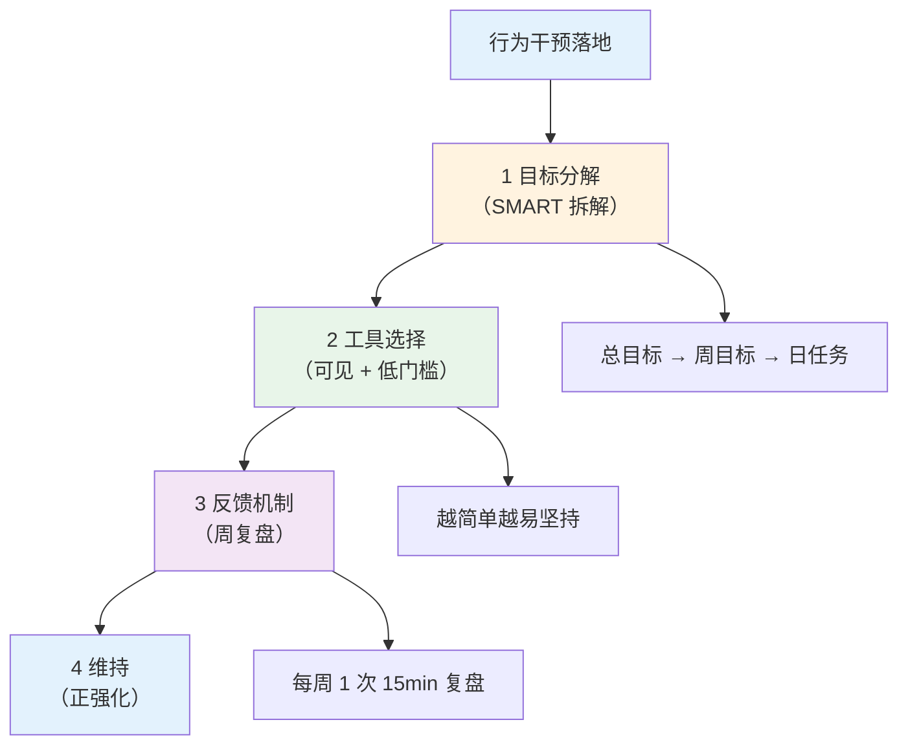
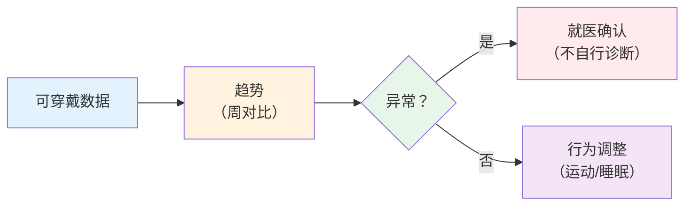

# 行为干预落地工具

> **费曼学习法**：行为干预的落地就一条——"让改变可见"。打卡让你看见行为，数据让你看见趋势，反馈让你下一步知道往哪走。

---

## 一、模块定位

习惯指导业务的"怎么做"。**业务必备**，理论见 [08 心理行为](../08-psychology-education/index.md)。

---

## 二、打卡系统设计

### 2.1 目标分解（SMART → 可执行）

| 层 | 例子（减重 4kg/3 月） |
|----|----------------------|
| 总目标 | 3 月减 4kg |
| 周目标 | 每周减 0.4kg |
| 日任务 | 快走 40min + 饮食记录 + 饮水 1500mL |

### 2.2 工具选择原则

| 原则 | 说明 |
|------|------|
| 低门槛 | 每日 1min 可完成（一个勾选框） |
| 可见 | 趋势图（周/月）> 单次记录 |
| 自动 > 手动 | 可穿戴数据自动同步 > 手动填表 |
| 即时反馈 | 完成后立刻打勾/变色 |

| 工具 | 适用 | 注意 |
|------|------|------|
| 日历打卡（纸质/APP） | 基础行为（饮水/睡眠） | 中断 1 天不"清零"（全有或全无思维误区） |
| 可穿戴 | 步数/心率/睡眠 | 数据是参考（见 3.1） |
| 食物拍照记录 | 饮食管理 | 配合交换份估算 |
| 周复盘表 | 综合行为 | 固定 15min，四问（见 2.3） |

### 2.3 周复盘四问

| 问 | 内容 |
|----|------|
| 做到没 | 本周目标完成率 |
| 卡在哪 | 阻碍（知识/动机/能力/环境，对应 [08 OARS](../08-psychology-education/index.md)） |
| 下一步 | 下周微调整 |
| 进步 | 至少 1 条正反馈 |

---

## 三、可穿戴设备数据解读

### 3.1 指标速查

| 指标 | 参考 | 什么算"异常"（建议就医） |
|------|------|--------------------------|
| 静息心率 | 60-100 次/min（成人） | 持续 >120 或 <50 且伴症状 |
| 步数 | 成人 6000-10000/日 | 长期 <3000（活动不足） |
| 睡眠时长 | 成人 7-9h/日 | 持续 <6h 或 >10h + 日间功能下降 |
| 睡眠分期 | 深睡 + REM 占比 | 设备误差大，仅作参考 |
| HRV（心率变异性） | 个体基线对比 | 持续基线下降（疲劳/压力） |
| SpO₂ | ≥95%（静息） | <90% 需就医 |

**核心原则：** 设备数据是"参考 + 趋势"，不是诊断。异常值 + 症状 = 建议就医（见 [11 边界](../11-boundaries/index.md)）。

### 3.2 常见误读

| 误读 | 正确解读 |
|------|----------|
| 步数没达标 = 运动不足 | 看强度（心率区间）而非仅步数 |
| HRV 一天低 = 出问题了 | HRV 受当日疲劳/酒精/感染影响大，看 7 日基线 |
| 设备睡眠数据 = 真实睡眠 | 设备误差 ±1h 常见，主观感受 + 记录更可靠 |

---

## 四、依从性管理（慢病随访）

| 动作 | 内容 |
|------|------|
| 动机性访谈应用 | 每 2-4 周 1 次 OARS，识别障碍类型（知识/动机/能力/环境，见 [08](../08-psychology-education/index.md)） |
| SMART 设定 | 每次随访更新周目标 |
| 正强化 | 达成 1 项 = 明确肯定（非"你本该做到"） |
| 中断处理 | 打卡中断 ≠ 失败，重启成本 < 重新开始 |
| 家属参与 | 家庭支持（社会支持理论）提升维持率 |

---

## 五、易混淆点 / 常见坑

| 误区 | 正确做法 |
|------|----------|
| 打卡越严格越好 | 严格 ≠ 高依从，"全有或全无"中断风险高 |
| 可穿戴数据当诊断 | 数据是参考，异常须就医确认 |
| 打卡中断就清零重来 | 重启成本低于从零开始，从中断点继续 |
| 行为干预 = 多叮嘱 | 核心是动机 + 可见反馈，不是"唠叨" |

---

## 六、一页速查

| 问题 | 答案 |
|------|------|
| 行为干预核心 | 让改变可见（打卡 + 数据 + 反馈） |
| 目标分解 | 总 → 周 → 日任务（SMART） |
| 周复盘 | 15min 四问（做到/卡点/下一步/进步） |
| 静息心率参考 | 60-100 次/min（成人） |
| HRV 怎么看 | 7 日基线，单日波动不判 |
| 打卡中断 | 重启，不清零 |

---

## 七、相关链接

| 主题 | 链接 |
|------|------|
| 行业实操总览 | [10 总览](index.md) |
| 心理行为理论 | [08 心理行为](../08-psychology-education/index.md) |
| 疾病管理随访 | [05 全流程](../05-disease-management/index.md) |
