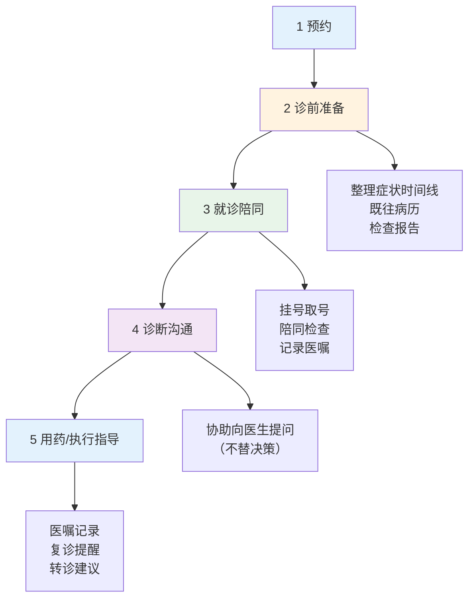
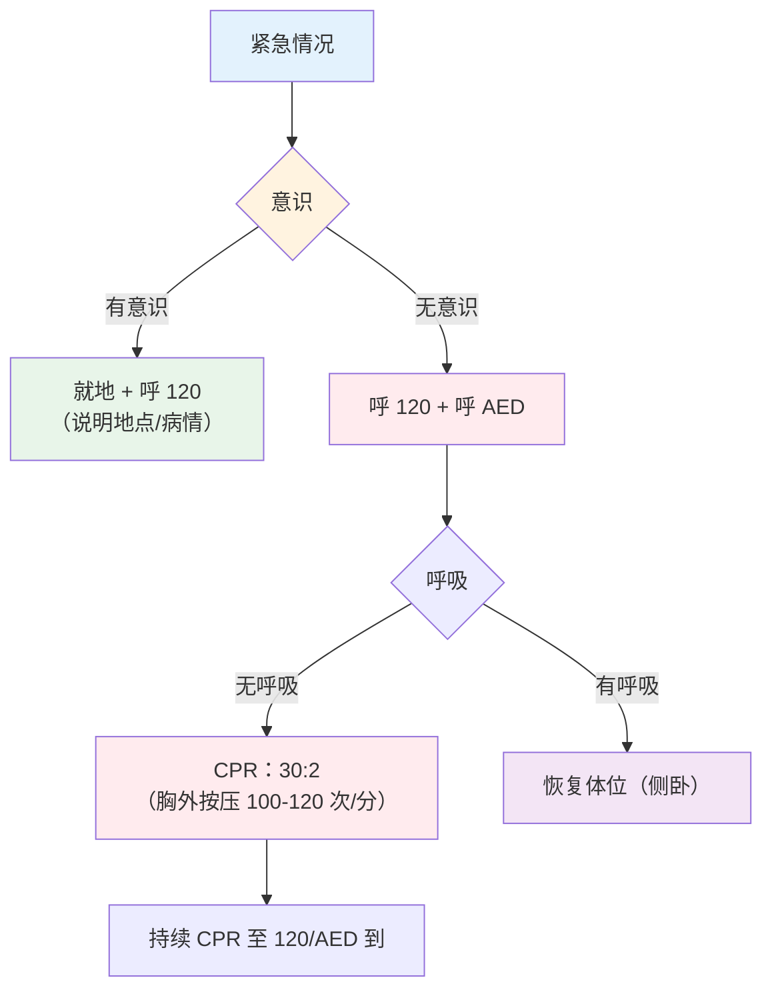

# 陪诊服务 — 流程、沟通与急救

> **费曼学习法**：陪诊的价值 = 替不会表达的人"问对问题 + 盯住执行"。流程是骨架，沟通是肉，急救是底线。

---

## 一、模块定位

陪诊业务的"怎么做"。**业务必备**，流程基础见 [健康医疗](../../healthcare/index.md)（就医流程、就诊准备）。

---

## 二、陪诊服务全流程

### 2.1 各环节要点

| 环节 | 要点 | 红线 |
|------|------|------|
| 预约 | 选对科室（首诊内科/全科起，避免"只看大病去专科"） | 不替客户判断该看什么科 |
| 诊前准备 | 症状时间线 + 用药史 + 过敏史（结构化整理） | 不删改原始病历 |
| 就诊陪同 | 安静记录医嘱（客户可录音授权） | 不打断医患沟通 |
| 诊断沟通 | 协助提问，**不替客户做治疗决策** | 不做"听我的"式建议 |
| 执行指导 | 医嘱文字化 + 复诊日历 + 异常处理 | 停药/调药须遵医嘱 |

---

## 三、就诊沟通脚本（替患者提问模板）

### 3.1 症状描述模板（内行表达）

| 维度 | 外行说法 | 内行说法 |
|------|----------|----------|
| 位置 | "肚子疼" | "右下腹疼痛" |
| 时间 | "疼了几天" | "疼痛 2 天，加重 1 天" |
| 性质 | "很疼" | "绞痛 / 隐痛 / 烧灼痛" |
| 伴随 | "还有别的" | "伴恶心，不伴发热" |
| 诱因/缓解 | "吃了药好了点" | "服用 XX 药后 30min 缓解" |

> 整理原则：位置 + 时间 + 性质 + 伴随 + 诱因/缓解，五维不缺。

### 3.2 用药史模板

| 项 | 内容 |
|----|------|
| 现用药 | 药名 + 剂量 + 频次（带药盒） |
| 既往疗效 | "降压药 X 用了 1 年，近期血压偏高" |
| 过敏史 | 药物/食物/环境（明确写"无"或"有 + 反应"） |

### 3.3 检查结果模板

| 项 | 内容 |
|----|------|
| 关键异常 | "空腹血糖 7.8mmol/L（3 月前 6.5）" |
| 趋势 | 与既往对比（数值 + 时间） |
| 客户担忧 | "客户担心是否要加药"（转达给医生判断） |

---

## 四、老年/术后患者照护常识

### 4.1 防跌倒（老年核心）

| 措施 | 说明 |
|------|------|
| 居家 | 卫生间防滑垫 + 夜灯；门槛条移除 |
| 行动 | 起身三步（坐边 30s → 踩实 → 起） |
| 鞋 | 防滑 + 合脚，不穿拖鞋外出 |
| 用药 | 多重用药（≥5 种）跌倒风险↑，提醒医生复核 |

### 4.2 防压疮（长期卧床）

| 措施 | 频次 |
|------|------|
| 翻身 | 每 2h 一次（记录） |
| 减压 | 气垫床/软垫 |
| 皮肤检查 | 骨突处（骶尾、足跟）每日 |
| 营养 | 蛋白充足（见 [10 食谱](01-nutrition-prescription.md) 老年要点） |

### 4.3 术后饮食过渡

| 阶段 | 内容 | 注意 |
|------|------|------|
| 术后早期（胃管拔除后） | 清流质 → 流质 | 小量多餐 |
| 恢复期 | 半流质 → 软食 | 高蛋白防切口愈合不良 |
| 出院后 | 渐进普食 | 限盐限油，遵医嘱复查 |

> 饮食速度由主管医生/营养师定，陪诊角色是"记录 + 提醒"，不自行调整。

---

## 五、急救资质（陪诊硬加分）

### 5.1 推荐资质

| 资质 | 说明 |
|------|------|
| CPR（心肺复苏） | 红十字会/急救中心证书 |
| AED（自动体外除颤器） | 同上 |
| 急救员 | 含常见急救处理 |

### 5.2 急救核心流程

### 5.3 常见急救处理速查

| 情景 | 处理 |
|------|------|
| 胸痛持续 >15min | 立即 120，勿自驾 |
| 意识丧失 | 120 + 判断呼吸（见上流程图） |
| 烫伤 | 冷水冲 15min，不破皮不涂药膏 |
| 骨折 | 固定不动 + 120 |
| 严重过敏（喉头水肿） | 120，有肾上腺素笔按医嘱用 |
| 中暑 | 阴凉 + 补水，意识异常 120 |

---

## 六、易混淆点 / 常见坑

| 误区 | 正确做法 |
|------|----------|
| 陪诊 = 替病人做主 | 协助沟通，决策权在客户 + 医生 |
| 症状越说越细越好 | 五维结构化，避免流水账 |
| 老人跌倒 = 老化的正常 | 多重用药 + 环境是主因，可干预 |
| 术后饮食自己定速度 | 由医生/营养师定，陪诊记录 + 提醒 |
| 急救可以"看看再说" | 意识丧失 120 + CPR，不等待 |

---

## 七、一页速查

| 问题 | 答案 |
|------|------|
| 陪诊五环节 | 预约 → 准备 → 陪同 → 沟通 → 执行 |
| 症状描述五维 | 位置/时间/性质/伴随/诱因缓解 |
| 防跌倒翻身 | 每 2h 一次 |
| CPR 按压 | 30:2，100-120 次/分 |
| 胸痛 >15min | 立即 120 |
| 术后饮食 | 清→流→半流→软→普，遵医嘱 |
| 陪诊红线 | 不替决策、不调整用药 |

---

## 八、相关链接

| 主题 | 链接 |
|------|------|
| 行业实操总览 | [10 总览](index.md) |
| 就医流程（外部） | [健康医疗](../../healthcare/index.md) |
| 老年营养 | [10 食谱](01-nutrition-prescription.md) |
| 医疗行为边界 | [11 边界](../11-boundaries/index.md) |
