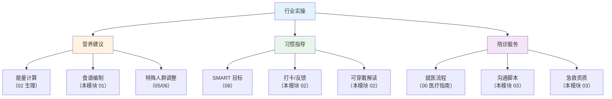

# 行业实操 — 营养处方、行为工具、陪诊、急救

> **费曼学习法**：考试给的是"知识"，业务要的是"动作"。这个模块就是把知识翻译成可执行的步骤：食谱怎么算、打卡怎么做、陪诊怎么陪、急救怎么急。

---

## 一、模块定位

解决「大健康行业实际工作的可落地技能」。**业务必备**（非考纲），覆盖三个核心业务场景：营养建议、生活习惯指导、陪诊。

| 子文件 | 内容 | 先看 |
|--------|------|------|
| [01-nutrition-prescription.md](01-nutrition-prescription.md) | 一日食谱编制 5 步 + 食物交换份法 + 特殊人群食谱 | 营养建议 |
| [02-behavior-tools.md](02-behavior-tools.md) | 打卡系统设计 + 可穿戴数据解读 + 依从性管理 | 习惯指导 |
| [03-accompaniment.md](03-accompaniment.md) | 陪诊全流程 + 沟通脚本 + 老年照护 + 急救资质 | 陪诊服务 |

**按场景找答案：**

| 场景 | 看 |
|------|----|
| 客户要一份一日食谱 | [01 食谱](01-nutrition-prescription.md) |
| 客户运动数据怎么看 | [02 行为工具](02-behavior-tools.md) |
| 明天要陪客户看病 | [03 陪诊](03-accompaniment.md) |

> 理论部分（营养学、行为改变理论）见 06/08 模块；本模块只放"怎么做"。

---

## 二、三个业务场景的能力地图

**能力边界提醒：** 三个场景全部受医疗行为红线约束（见 [11 边界](../11-boundaries/index.md)）——营养建议 ≠ 营养诊疗；习惯指导 ≠ 心理治疗；陪诊 ≠ 诊断/处方。

---

## 三、核心知识点提炼（本模块必背）

| 要点 | 数字/口径 |
|------|-----------|
| 食谱编制第一步 | 算目标能量（BMR × 活动系数） |
| 食物交换份 | 90kcal/份（谷薯 25g、水果 200g、肉 100g、奶 100mL） |
| 行为干预核心 | 让改变可见（打卡 + 数据 + 反馈） |
| 可穿戴定位 | 参考值 + 趋势，不替代医疗诊断 |
| 陪诊五环节 | 预约 → 准备 → 陪同 → 沟通 → 执行 |
| 症状描述五维 | 位置/时间/性质/伴随/诱因缓解 |
| 急救 | CPR 30:2，100-120 次/分；意识不清侧卧 + 120 |
| 业务红线 | 不诊断、不处方、不做医疗决策 |

---

## 四、易混淆点 / 常见坑

| 误区 | 正确做法 |
|------|----------|
| 考试过了就会做业务 | 考试是"判断"，业务是"产出"，两者都要练 |
| 食谱一套通用 | 按能量 + 病种 + 口味调整（糖尿病 ≠ 健康人） |
| 打卡越复杂越好 | 打卡工具越简单越易坚持，核心是"可见反馈" |
| 可穿戴数据 = 诊断 | 设备数据是参考，异常值须就医确认 |
| 陪诊就是"陪着" | 陪诊 = 预约 + 陪同 + 沟通协助 + 用药教育 + 转诊提醒 |

---

## 五、一页速查

| 问题 | 答案 |
|------|------|
| 食谱编制第一步 | 算目标能量（BMR × 活动系数） |
| 业务红线 | 不诊断、不处方、不做医疗决策 |
| 陪诊核心价值 | 替不会表达的人问对问题 + 盯住医嘱执行 |
| 急救资质 | CPR + AED 持证人（红十字会/急救中心） |
| 行为干预核心 | 可见反馈 + 小步目标（SMART） |
| 可穿戴异常 | 参考值，不替代医疗诊断 |

---

## 六、相关链接

| 主题 | 链接 |
|------|------|
| 知识体系全景 | [00 全景](../00-overview/index.md) |
| 营养理论 | [06 营养](../06-nutrition/index.md) |
| 行为理论 | [08 心理行为](../08-psychology-education/index.md) |
| 疾病管理 | [05 疾病管理](../05-disease-management/index.md) |
| 边界合规 | [11 边界](../11-boundaries/index.md) |
