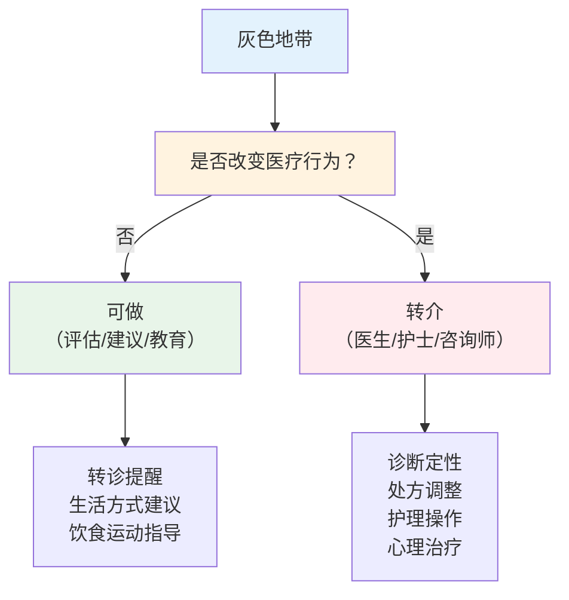

# 医疗行为红线

> **费曼学习法**：红线只有一句话——"评估、建议、随访、教育可以做；诊断、处方、治疗决策不做"。灰色地带的判断逻辑是"这一步是否改变了医疗行为"。

---

## 一、模块定位

合规三条线之"医疗行为红线"。**业务必备**，也是职业资格考试的高频判断考点。

---

## 二、能做 vs 不能做（对照表）

| 类别 | 能做（健康管理师） | 不能做（须医师/护士/其他资质） |
|------|-------------------|------------------------------|
| 信息 | 健康评估、健康档案管理 | 疾病诊断（定性） |
| 建议 | 营养/运动/行为生活方式建议 | 开处方（含中成药西药） |
| 执行 | 干预方案制定 + 依从性随访 | 护理操作（注射/输液/换药） |
| 决策 | 转诊提醒、就医建议 | 治疗决策（手术/介入/用药调整） |
| 教育 | 健康教育、讲座组织 | 心理诊断/心理治疗 |
| 数据 | 健康信息收集（授权下） | 医疗文书签署 |

**关键口径：** "建议"与"诊断"的分界——建议基于评估数据 + 指南，表述为"建议就医评估/可尝试生活方式调整"；诊断是对疾病的定性判断（"你得了 X 病"），属医师行为。

---

## 三、灰色地带情景判断（6 场景）

| 情景 | 判断 | 理由 |
|------|------|------|
| 客户问"我这是不是糖尿病" | 不诊断，转诊提醒 | 疾病定性属医师；"建议做糖耐量/HbA1c 检查"可做 |
| 客户说"停药可以吗" | 不做决定，转医生 | 调药/停药属治疗决策；"建议联系主治医生"可做 |
| 告知客户"肿瘤标志物 CEA 轻度升高" | 可做 + 解释 + 转诊 | 告知检测事实 + 解读（结合吸烟史）可做；"是否癌症"诊断不做 |
| 建议高血压客户"每日快走 30min" | 可做 | 生活方式干预在健康管理师职责内 |
| 客户低血糖意识不清 | 急救 + 120，不处理 | 急救（侧卧/120）可做；后续"调胰岛素"不做 |
| 客户失眠，问"能推荐安眠药吗" | 不推荐，转诊 | 药物推荐属处方行为；"睡眠卫生建议"可做 |
| 客户要减重 30kg，问"打瘦瘦针行吗" | 不做推荐，转诊 | 医疗行为；"营养 + 运动 + 行为干预方案"可做 |
| 客户产后问"母乳够不够" | 可评估 + 建议 | 喂养指导属健康管理师可做范围；"加奶粉剂量"遵医嘱 |

**判断公式：** 该动作是否涉及"对疾病的定性、对处方的调整、对治疗路径的选择"——是则转介，否则可做。

---

## 四、必须转诊的信号（红旗）

| 红旗信号 | 处置 |
|----------|------|
| 意识障碍 | 立即 120 |
| 胸痛 >15min | 立即 120（心梗风险） |
| 严重过敏（喉头水肿） | 120，有肾上腺素笔按医嘱用 |
| 血压 ≥180/110mmHg + 症状 | 立即就医（高血压急症） |
| 血糖 <3.9 意识不清 | 侧卧 + 120（禁经口喂） |
| 自伤/自杀表达 | 立即转介精神科，不留存单独处理 |
| 新发神经症状（面瘫/单侧无力） | FAST 识别，立即 120（卒中窗口期） |

> 转诊 ≠ 终止服务：转诊后继续承担"转诊提醒 + 随访 + 医嘱执行指导"职责。

---

## 五、易混淆点 / 常见坑

| 误区 | 正确做法 |
|------|----------|
| 建议"吃 XX 药"= 处方 | 说"遵医嘱用药"，不指定药物 |
| 体检异常 = 可以直接诊断 | 告知检测事实 + 建议就医，不定性 |
| 客户授权后数据随便给 | 仅给必要数据 + 接收方合规（见 02） |
| 营养建议可以代替诊疗 | 深度营养诊疗（如肾病透析营养）转临床营养师 |
| 转诊 = 甩手 | 转诊后继续随访 + 医嘱执行指导 |

---

## 六、一页速查

| 问题 | 答案 |
|------|------|
| 能做 | 评估、建议、随访、健康教育、转诊提醒 |
| 不能做 | 诊断、处方、治疗决策、护理操作 |
| "是不是糖尿病" | 不诊断，建议检查 + 转诊 |
| "能停药吗" | 不答，转医生 |
| 红旗转诊 | 意识障碍/胸痛/严重过敏/卒中信号/自伤 |
| 判断公式 | 是否改变"定性/处方/治疗路径" |

---

## 七、相关链接

| 主题 | 链接 |
|------|------|
| 边界总览 | [11 总览](index.md) |
| 伦理法规考点 | [01 伦理法规](../01-ethics-legal/index.md) |
| 个保合规 | [02 个保](02-data-privacy.md) |
| 健康医疗（外部） | [健康医疗](../../healthcare/index.md) |
