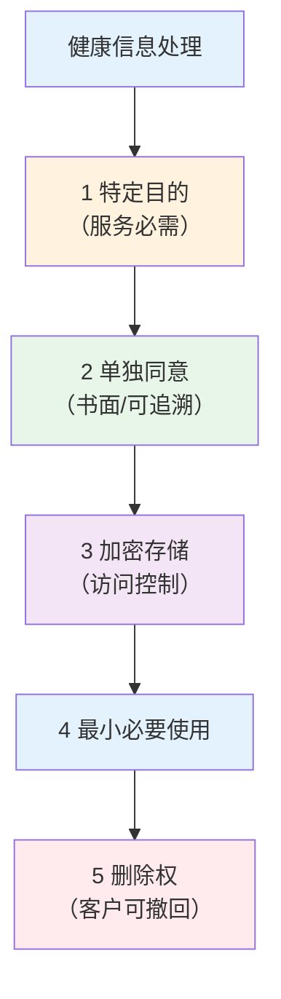

# 个人信息保护合规

> **费曼学习法**：健康信息 = 敏感个人信息，处理它的规矩就是四个字——"单独同意"，加上存储加密、最小必要、可删除。

---

## 一、模块定位

合规三条线之"数据红线"。**业务必备**，法规考点见 [01 伦理法规](../01-ethics-legal/index.md)。

---

## 二、《个人信息保护法》健康信息条款要旨

| 条款要旨 | 含义 | 考点 |
|----------|------|------|
| 第 28 条（敏感个人信息） | 健康医疗信息属敏感个人信息，处理须有"特定目的 + 充分必要性" | 健康信息 ≠ 一般个人信息 |
| 第 29 条（单独同意） | 处理敏感个人信息须取得**单独同意**（非概括同意） | "勾选大框"不算单独同意 |
| 第 51 条（保护措施） | 处理前须评估影响 + 加密等安全措施 | 未做 PIA 不能处理 |
| 第 21 条（委托处理） | 委托第三方须合同约定 + 监督义务 | 数据"给出去"不等于"免责" |
| 第 47 条（删除权） | 个人可要求删除（法定保留除外） | 服务终止后数据处置 |

---

## 三、数据合规场景对照表

| 场景 | 合规要点 | 常见违规 |
|------|----------|----------|
| 收集体检报告 | 书面授权 + 告知用途 + 保存期限 | 口头"给我看看"即存 |
| 存储 | 加密 + 访问分级 + 日志 | 明文 Excel 放公共盘 |
| 内部使用 | 最小必要（岗位需要才可见） | 全员可见客户健康档案 |
| 转诊交数据 | 仅交必要数据 + 接收方合规确认 | 全档案打包外发 |
| 委托第三方处理 | 合同 + 监督 + 终止后删除/返还 | "给了就出事不管" |
| 统计/研究 | 匿名化（不可识别 + 不可复原） | 用"化名"当匿名化 |
| 客户要求删除 | 法定保留期内除外，否则删除 | 口头答应不执行 |

**"匿名化 vs 去标识化"考点：**

| 概念 | 含义 | 是否受个保法约束 |
|------|------|------------------|
| 去标识化 | 可复原（如编号对应表单独存） | 仍属个人信息，须同意 |
| 匿名化 | 不可复原（统计聚合后丢失个体可识别性） | 不属于个人信息，可自由用 |

---

## 四、实操落地（最小合规清单）

| 动作 | 标准 |
|------|------|
| 授权书 | 单独签署（与合同分开），列明用途/期限/删除方式 |
| 存储 | 电子档案加密（AES 256 级）+ 权限分级 |
| 访问 | 岗位必需可见，访问日志留存 |
| 泄露 | 发生须 72h 内报告（客户 + 监管），留痕 |

> 72h 报告口径参考《个保法》第 57 条要旨（泄露及时告知 + 向履行个保职责部门报告），具体时限以最新监管规定为准。

---

## 五、易混淆点 / 常见坑

| 误区 | 正确做法 |
|------|----------|
| 客户口头同意就够 | 敏感信息须单独同意 + 留痕（书面/可追溯电子） |
| 去标识化 = 匿名化 | 可复原的去标识化仍属个人信息 |
| 数据给第三方 = 免责 | 委托处理须合同 + 监督义务 |
| 删除 = 永久删 | 法定保留期（如病历保存年限）内不删，到期删除 |
| 客户不给数据 = 服务不了 | 告知"不提供则无法提供该服务"，不得强制 |

---

## 六、一页速查

| 问题 | 答案 |
|------|------|
| 健康信息性质 | 敏感个人信息 |
| 处理须 | 单独同意 + 特定目的 + 加密 |
| 委托第三方 | 合同 + 监督义务 |
| 删除权 | 客户可撤回/要求删除（法定保留除外） |
| 泄露处置 | 72h 内报告（客户 + 监管） |
| 匿名化标准 | 不可复原 + 不可识别 |

---

## 七、相关链接

| 主题 | 链接 |
|------|------|
| 边界总览 | [11 总览](index.md) |
| 伦理法规考点 | [01 伦理法规](../01-ethics-legal/index.md) |
| 健康信息（模块 09） | [09 健康信息](../09-health-info/index.md) |
