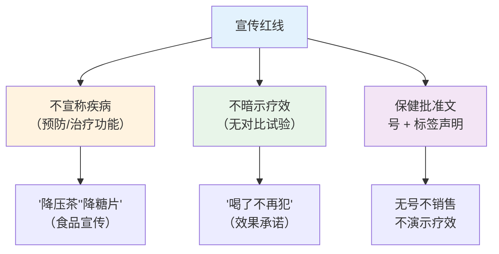
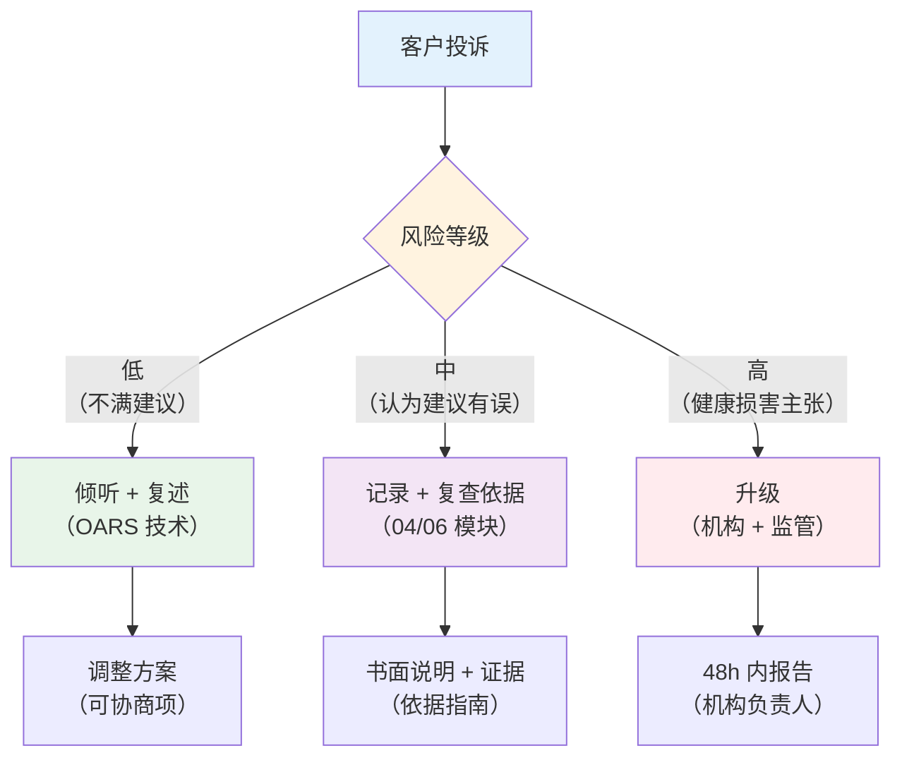

# 食品与保健品宣传合规

> **费曼学习法**：宣传红线就一条——食品/保健品不能"说疗效"。判断一个广告是否违规，就问："这句话是在卖'功能'还是在卖'治病'？"

---

## 一、模块定位

合规三条线之"宣传红线"。**业务必备**，法规考点见 [01 伦理法规](../01-ethics-legal.md)。

---

## 二、宣传红线（核心法规）

| 法规 | 要旨 | 考点 |
|------|------|------|
| 《食品安全法》 | 保健食品须注册/备案；标签声明"本品不能代替药物" | 注册/备案号是销售前提 |
| 《广告法》 | 食品/保健食品广告不得涉及疾病预防、治疗功能 | "疗效"暗示也违规 |
| 《反不正当竞争法》 | 虚假宣传误导消费者 | 夸大 = 误导 |

**三条硬红线：**

**"功能宣称"与"疗效宣称"分界（高频判断）：**

| 表述 | 是否违规 | 理由 |
|------|----------|------|
| 保健品说"辅助降血压"（有批准文号） | 合规（限定） | 注册功能范围内的"辅助"表述 |
| 普通食品说"辅助降血压" | 违规 | 普通食品不得宣称保健功能 |
| 保健品说"喝了血压就正常" | 违规 | 疗效承诺（暗示治疗） |
| 食品说"补充蛋白质" | 合规 | 营养成分事实陈述 |
| 食品说"增强免疫"（普通食品） | 违规 | 普通食品不得宣称保健功能 |

---

## 三、广告场景速判（8 场景）

| 场景 | 是否违规 | 依据/处理 |
|------|----------|----------|
| 朋友圈卖"降压茶"（普通食品） | 违规 | 普通食品不得宣称疾病功能 |
| 短视频说"降糖神药" | 违规 | 疗效暗示 + 普通食品宣称 |
| 保健品直播"喝 30 天指标正常" | 违规 | 效果承诺（须无对比 + 无疗效暗示） |
| 展示保健品批准文号 | 合规 | 合规要素之一 |
| 客户案例"我吃了 X 不犯病了" | 风险 | 个案疗效暗示，删除/警示 |
| 推荐"营养素"给糖尿病人 | 合规（限定） | 营养建议 ≠ 疗效；加"遵医嘱" |
| 用专家名义背书"疗效" | 违规 | 不得利用他人名义证明功效 |
| 销售无号"养生粉" | 违规 | 保健食品须注册/备案 |

**速判口诀：** 普通食品不碰"功能"，保健品只说"辅助"，不承诺"疗效"，无号不销售。

---

## 四、投诉与风险处理

### 4.1 客户不满意响应流程

### 4.2 升级标准（须上报机构/监管）

| 情形 | 处置 |
|------|------|
| 客户主张健康损害（因果） | 48h 内报机构负责人 + 留痕 |
| 涉及宣传违规（已被投诉） | 停止该宣传 + 合规审查 |
| 媒体/社交平台负面曝光 | 机构公关 + 法务介入 |
| 数据泄露投诉 | 按 [02 个保](02-data-privacy.md) 72h 流程 |

### 4.3 纠纷应对原则

| 原则 | 内容 |
|------|------|
| 不私下"赔了了事" | 损害主张须机构评估，避免自认责任 |
| 全程留痕 | 沟通记录 + 客户签字 |
| 不贬损竞品 | 保持客观（伦理红线，见 01） |
| 监管渠道 | 客户可向 12315/市场监管投诉，机构不阻挠 |

---

## 五、易混淆点 / 常见坑

| 误区 | 正确做法 |
|------|----------|
| 保健品可以说"疗效" | 只可"辅助"功能表述（有文号前提下），不得承诺疗效 |
| 普通食品"养生"就没事 | 普通食品不得宣称任何保健功能 |
| 案例分享 = 合规 | 个案"我好了"属疗效暗示，风险 |
| 投诉了马上赔 | 先评估风险等级，损害主张走机构流程 |
| 营养建议 = 疗效承诺 | 加"遵医嘱 + 不替代治疗"限定语 |

---

## 六、一页速查

| 问题 | 答案 |
|------|------|
| 三条宣传红线 | 不宣称疾病功能 / 不暗示疗效 / 无号不销售 |
| 保健品标签必写 | "本品不能代替药物" |
| 普通食品能宣称功能吗 | 不能（仅营养成分事实） |
| 个案"我好了" | 疗效暗示，删除/警示 |
| 投诉升级时限 | 损害主张 48h 报机构 |
| 数据泄露投诉 | 72h 流程（见 02） |

---

## 七、相关链接

| 主题 | 链接 |
|------|------|
| 边界总览 | [11 总览](index.md) |
| 医疗红线 | [01 医疗红线](01-medical-line.md) |
| 个保合规 | [02 个保](02-data-privacy.md) |
| 伦理法规考点 | [01 伦理法规](../01-ethics-legal.md) |
