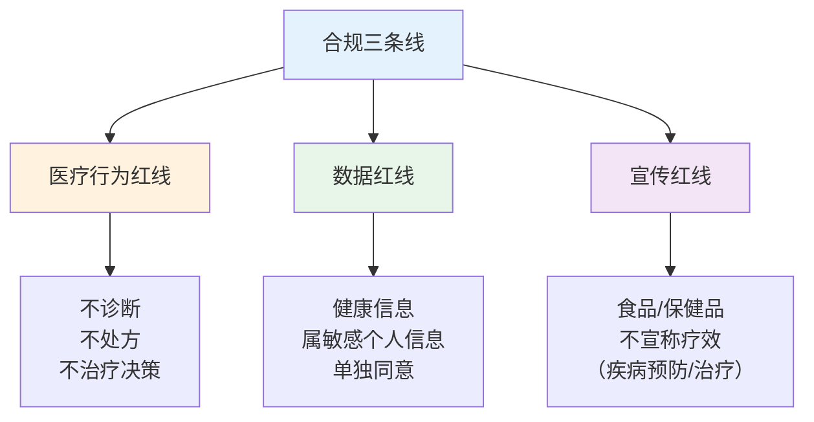

# 边界与合规 — 医疗红线、个保法、食品宣传

> **费曼学习法**：合规 = 划三条线——医疗行为红线（不诊断不处方）、数据红线（健康信息属敏感）、宣传红线（不说疗效）。

---

## 一、模块定位

行业业务的"安全底线"。**业务必备**，与 [01 伦理法规](../01-ethics-legal/index.md) 互补（01 考法规考点，本模块讲业务实操）。

| 子文件 | 内容 | 先看 |
|--------|------|------|
| [01-medical-line.md](01-medical-line.md) | 能做/不能做对照 + 灰色地带判断 + 转诊信号 | 红线 |
| [02-data-privacy.md](02-data-privacy.md) | 个保法健康信息条款 + 数据合规场景表 | 数据 |
| [03-food-advertising.md](03-food-advertising.md) | 食品/保健品宣传合规 + 广告速判 + 投诉处理 | 宣传 |

**按场景找答案：**

| 场景 | 看 |
|------|----|
| 客户问"我这是不是糖尿病" | [01 医疗红线](01-medical-line.md) |
| 客户数据要交给第三方 | [02 个保](02-data-privacy.md) |
| 朋友圈卖降压茶 | [03 食品合规](03-food-advertising.md) |

---

## 二、三条红线总览

**一句话记忆：** 评估/建议/随访/教育可以，诊断/处方/治疗决策不行；数据必须授权 + 加密；宣传不碰"疗效"。

---

## 三、核心知识点提炼（本模块必背）

| 要点 | 数字/口径 |
|------|-----------|
| 三条红线 | 医疗行为 / 数据 / 宣传 |
| 能做 | 评估、建议、随访、健康教育、转诊提醒 |
| 不能做 | 诊断、处方、治疗决策、护理操作 |
| 健康信息 | 敏感个人信息，须单独同意 |
| 食品宣传 | 不得宣称疾病预防/治疗功能 |
| 保健品标签 | 必写"本品不能代替药物" |
| 转诊红旗 | 意识障碍、胸痛、严重过敏、卒中信号、自伤 |
| 数据泄露处置 | 72h 内报告（客户 + 监管） |

---

## 四、易混淆点 / 常见坑

| 误区 | 正确做法 |
|------|----------|
| 给"健康建议"就是诊断 | 基于评估 + 指南的建议 ≠ 诊断（诊断是疾病定性判断） |
| 客户口头同意就能共享数据 | 敏感个人信息须**单独同意 + 留痕**（书面/可追溯电子） |
| 朋友圈发"吃了 X 降血压" | 食品不得宣称疾病治疗功能（违反《广告法》《食品安全法》） |
| 保健品可以说"疗效" | 保健品须有批准文号，且只能标"不能代替药物"，不得暗示疗效 |
| 投诉了就赔 | 先评估风险等级，再按流程处理（见 03） |

---

## 五、一页速查

| 问题 | 答案 |
|------|------|
| 三条红线 | 医疗行为 / 数据 / 宣传 |
| 能做什么 | 评估、建议、随访、健康教育、转诊提醒 |
| 不能做什么 | 诊断、开处方、治疗决策、护理操作 |
| 健康信息性质 | 敏感个人信息，须单独同意 |
| 食品宣传禁 | 疾病预防/治疗功能宣称 |
| 保健品标签必写 | "本品不能代替药物" |
| 转诊信号 | 意识障碍、胸痛、严重过敏等（见 01） |

---

## 六、相关链接

| 主题 | 链接 |
|------|------|
| 知识体系全景 | [00 全景](../00-overview/index.md) |
| 伦理法规（考点） | [01 伦理法规](../01-ethics-legal/index.md) |
| 医疗红线 | [01 医疗红线](01-medical-line.md) |
| 个保合规 | [02 个保](02-data-privacy.md) |
| 食品宣传 | [03 食品](03-food-advertising.md) |
| 行业实操 | [10 行业实操](../10-industry-practice/index.md) |
