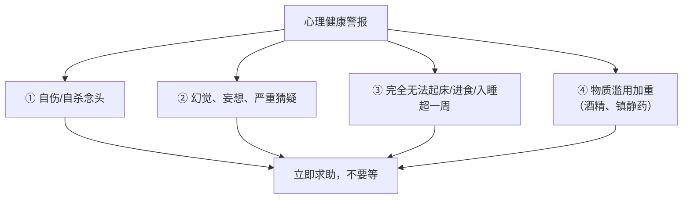
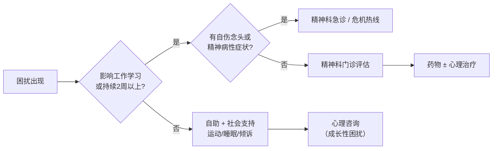

# 心理健康核心 20% — 先分清"情绪"和"疾病"

> **一句话**：多数人卡在两个错误上——把正常情绪当病，把真正的病当"想开点就好"。分清了，80% 的困惑就有了方向。

> **重要提示**：本页是科普与自助参考，不能替代专业诊断。若出现自伤念头，请立即联系当地急救或心理危机热线，不要独自承受。

---

## 🎯 这 20% 能解决哪些问题

| 常见困惑 | 本质 | 本页答案 |
|----------|------|----------|
| 我最近很难受，是不是病了？ | 缺少"程度/时长/功能"三把尺 | 见「四个判断维度」 |
| 是不是我太脆弱？ | 把疾病道德化 | 心理疾病有生理基础，不是意志问题 |
| 运动、冥想真的有用吗？ | 不知道对什么有效 | 见「三种有证据的自助」 |
| 该找心理咨询还是看医生？ | 混淆两类资源 | 见「求助路线图」 |
| 家人抑郁了，我该说什么？ | 说了"想开点"反而伤害 | 见「家属四要与四不要」 |

---

## 一、四个判断维度：情绪 vs 心理疾病

用四把尺同时量，比凭感觉判断可靠得多。

| 维度 | 正常情绪波动 | 需要专业评估 |
|------|--------------|--------------|
| **时长** | 几天内缓解 | 持续 2 周以上几乎每天 |
| **程度** | 与事件相称 | 明显超出事件，或没有诱因 |
| **功能** | 工作学习社交基本正常 | 明显受损（无法上班/上学、不能自理） |
| **范围** | 只在特定情境 | 泛化到几乎所有事，兴趣普遍丧失 |

> 四条中占两条以上、且持续两周 → 建议尽快做专业评估。

---

## 二、必须认真对待的四个警报

| 警报 | 具体表现 | 处理 |
|------|----------|------|
| 自伤/自杀念头 | 反复想到死亡、计划方式、告别行为 | **立即**联系急救/危机热线，移除危险物品，不要独处 |
| 精神病性症状 | 听到不存在的声音、坚信被迫害 | 尽快精神科就诊，越早干预预后越好 |
| 功能全面崩塌 | 一周以上不能起床、不进食、彻夜不眠 | 尽快就医，排除躯体疾病 |
| 物质滥用 | 靠酒精入睡、自行加量镇静药 | 就医评估，勿突然停药（有戒断风险） |

---

## 三、三种有证据支撑的自助方法

它们在**轻中度**问题上有明确效果，但不能替代治疗。

### 3.1 行为激活（对抑郁情绪最有效）

> 不是"心情好了才去行动"，而是"先行动，心情才会跟上"。

1. 列出 5 件过去让你有成就感或愉悦感的小事
2. 每天安排 1 件，固定时间，不等有动力
3. 完成后记录 0–10 分的情绪变化
4. 一周复盘：哪件事带来的提升最稳定，下周加倍

### 3.2 睡眠节律（对焦虑与情绪波动最有效）

| 做法 | 说明 |
|------|------|
| 固定起床时间 | 比固定入睡时间更重要 |
| 卧床只做两件事 | 睡觉与性生活，不在床上刷手机/工作 |
| 20 分钟睡不着就起身 | 到暗处做无聊的事，困了再回床 |
| 白天见光 30 分钟 | 上午自然光有助于夜间入睡 |

### 3.3 呼吸与着陆技术（对急性焦虑/惊恐最有效）

- **4-7-8 呼吸**：吸气 4 秒 → 屏息 7 秒 → 缓慢呼气 8 秒，重复 4 轮
- **5-4-3-2-1 着陆**：说出 5 样看到的、4 样摸到的、3 种听到的、2 种闻到的、1 种尝到的
- 要点：目标不是"消除焦虑"，而是把注意力从"灾难想象"拉回当下

---

## 四、求助路线图：别找错门

| 资源 | 适合什么 | 不适合什么 |
|------|----------|------------|
| 精神科医生 | 诊断、开药、中重度问题 | 只想聊成长话题 |
| 心理治疗师/咨询师 | 情绪困扰、关系问题、创伤 | 需要药物时须转诊 |
| 危机热线 | 当下有自伤冲动 | 长期治疗 |
| 自助小组/同伴支持 | 长期康复期陪伴 | 替代医疗 |

---

## 五、家属四要四不要

| ✅ 要 | ❌ 不要 |
|------|---------|
| "我在，需要我做什么？" | "想开点/别人更惨" |
| 陪着去做第一次就诊 | "你是不是想太多" |
| 把"没力气"当症状而非懒惰 | 逼着"振作起来" |
| 关注危险信号与用药情况 | 私自停药或换药 |

---

## 📋 一页速查

| 情形 | 立刻做什么 |
|------|------------|
| 连续两周情绪低落、兴趣丧失 | 预约精神科/心理门诊评估 |
| 惊恐发作（心跳快、濒死感） | 4-7-8 呼吸 + 着陆技术，事后评估是否需就医 |
| 失眠超过一个月 | 先做睡眠节律调整，无效就诊 |
| 亲友出现告别言语 | 不评判、不独处、立即联系专业资源 |

---

## 🔗 相关链接

| 主题 | 链接 |
|------|------|
| 家庭健康 | [家庭健康核心 20%](../family-health/01-essentials.md) |
| 慢性病管理 | [慢性病管理核心 20%](../chronic-disease/01-essentials.md) |
| 心理学 | [心理学知识体系](../../social-sciences/psychology/index.md) |
| 学习认知 | [学习认知](../../thinking/learning-cognition/index.md) |
