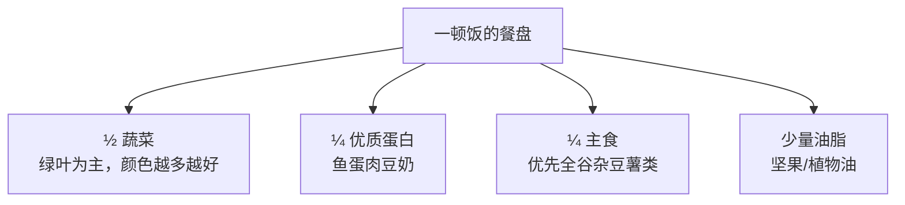

# 营养学核心 20% — 吃得对，只需记住四件事

> **一句话**：营养的 80% 由四件事决定——餐盘比例、蛋白质够不够、糖藏在哪、吃的时间对不对。复杂的营养素表可以先放着。

---

## 🎯 这 20% 能解决哪些问题

| 常见困惑 | 本质 | 本页答案 |
|----------|------|----------|
| 到底该不该戒碳水？ | 混淆"总量"和"质量" | 见「餐盘模型」 |
| 每天该吃多少蛋白质？ | 没有量化抓手 | 见「一个手掌法则」 |
| 我没吃甜食为什么还胖？ | 隐形糖 + 液体热量 | 见「隐形糖地图」 |
| 保健品要不要买？ | 把补充剂当主食 | 见「优先级排序」 |
| 减重总是反弹？ | 只减热量不减结构 | 见「可持续三原则」 |

---

## 一、餐盘模型：一个画面解决 80% 的搭配问题

不需要称重，看盘子就行。

| 餐盘区域 | 占比 | 具体选择 | 注意 |
|----------|------|----------|------|
| 蔬菜水果 | 1/2 | 深色蔬菜占一半，水果每天 1–2 份 | 果汁不算水果 |
| 优质蛋白 | 1/4 | 鱼虾、蛋、禽肉、豆制品、奶 | 加工肉（香肠培根）算"偶尔" |
| 主食 | 1/4 | 糙米、燕麦、玉米、薯类、杂豆 | 精白米面不禁止，但要减量 |
| 油脂 | 少量 | 坚果、橄榄油/菜籽油 | 坚果每天一小把（约 10 克） |

---

## 二、蛋白质：一个手掌法则

**每餐一个手掌大小、手掌厚度的蛋白食物**，大致对应 20–30 克蛋白质，一天 3 餐即可覆盖多数成人的需求。

| 人群 | 每日蛋白参考量（每公斤体重） | 上手换算 |
|------|------------------------------|----------|
| 一般成人 | 1.0–1.2 g | 每餐一掌心 |
| 增肌/运动量大 | 1.4–1.8 g | 每餐一掌心 + 一次加餐 |
| 65 岁以上 | 1.0–1.2 g，且均匀分布 | 三餐都要有蛋白，别集中在晚餐 |
| 慢性肾病患者 | **需医生个体化设定** | 不可自行高蛋白 |

> 判断是否"够"的简易信号：容易饿、肌肉无力、伤口愈合慢、头发指甲变差。

---

## 三、隐形糖地图：热量最容易漏算的地方

| 食物 | 看着"健康" | 实情 |
|------|------------|------|
| 果汁/果茶 | 有水果 | 一杯≈3–4 个水果的糖，且没有纤维 |
| 风味酸奶 | 有奶 | 常含 10 g 以上添加糖/杯 |
| 全麦面包 | 有全麦 | 常靠糖和油改善口感 |
| 沙拉酱/番茄酱 | 是蔬菜 | 脂肪或糖占比极高 |
| 无糖饮料 | 无糖 | 代糖不等于可以无限喝，仍需控量 |
| 坚果零食包 | 坚果好 | 蜜制、盐焗款热量翻倍 |

**唯一可靠的方法是看配料表**：配料按含量从高到低排列，糖/果葡糖浆/麦芽糊精排在前三位的，就是"糖做的零食"。

---

## 四、吃的时间：比"吃什么"更容易被忽略

| 习惯 | 影响 | 改法 |
|------|------|------|
| 不吃早餐 | 午餐过量、血糖波动大 | 至少一个蛋白 + 一份主食 |
| 晚餐过晚（睡前 2 小时内） | 影响睡眠与血糖 | 固定晚餐时间，睡前只喝水 |
| 边看屏幕边吃 | 无饱腹感，过量 20% 以上 | 专心吃 20 分钟 |
| 全天只在晚上吃一顿大餐 | 代谢负担集中 | 三餐分配大致 3:4:3 |

---

## 五、补充剂优先级：钱该花在哪

| 情况 | 可考虑的补充 | 说明 |
|------|--------------|------|
| 几乎不晒太阳 | 维生素 D | 剂量遵医嘱 |
| 严格素食 | 维生素 B12、铁、n-3 | 需监测 |
| 孕期/备孕 | 叶酸、铁 | 遵医嘱 |
| 无明显缺口 | 一般不需要复合维生素 | 先改饮食结构 |

> 原则：**补充剂是补"缺口"，不是补"心安"**。服用前告知医生，避免与药物相互作用。

---

## 六、可持续的三条原则（减重与长期健康通用）

1. **能坚持一辈子的方案才是方案**：极端饮食的失败率极高
2. **不追求完美，追求平均**：一周 80% 的餐次达标就够
3. **先加后减**：先加蔬菜和蛋白，主食与零食自然吃少了

---

## 📋 一页速查

| 场景 | 做法 |
|------|------|
| 在外点餐 | 先点一份蔬菜 + 一份蛋白，再决定主食 |
| 想吃零食 | 先喝水，等 10 分钟；仍想吃就选坚果/酸奶（无糖） |
| 外卖 | 主食减半，多要一份青菜 |
| 聚餐 | 先吃菜和蛋白，酒与甜点二选一 |
| 减重停滞 | 查睡眠、蛋白质摄入、隐形液体热量 |

---

## 🔗 相关链接

| 主题 | 链接 |
|------|------|
| 慢性病管理 | [慢性病管理核心 20%](../chronic-disease/01-essentials.md) |
| 家庭健康 | [家庭健康核心 20%](../family-health/01-essentials.md) |
| 康复医学 | [康复医学](../rehabilitation/index.md) |
| 基础医学 | [基础医学](../basic-medicine/index.md) |
