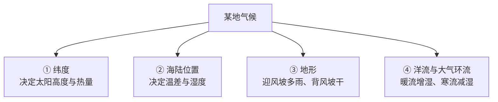

# 地理学核心 20% — 一张地图背后的因果

> **一句话**：地理的实用价值是"因果解释力"——纬度定冷暖、地形定水土、洋流定干湿、位置定交通。掌握这四条，八成地理现象都能自己推出来。

---

## 🎯 这 20% 能解决哪些问题

| 常见困惑 | 本质 | 本页答案 |
|----------|------|----------|
| 同纬度为什么一边沙漠一边雨林？ | 只看纬度不看环流 | 见「气候四因子」 |
| 为什么有些城市天生繁荣？ | 位置与地形决定成本 | 见「城市选址五要素」 |
| 看地图总搞不清比例与方向 | 没建立坐标感 | 见「读图三步」 |
| 为什么同一国家气候差异巨大？ | 缺地形与海陆位置视角 | 见「中国三大自然区」 |
| 时区、日界线总记错 | 只背结论不理解原理 | 见「经度换算速算法」 |

---

## 一、气候四因子：从"记住分布"到"推理分布"

| 因子 | 一句话规则 | 典型现象 |
|------|------------|----------|
| 纬度 | 越低越热，赤道多对流雨 | 新加坡全年湿热 |
| 海陆 | 沿海温差小、内陆温差大 | 同纬度沿海温和、内陆极端 |
| 地形 | 每升高 100 m 约降 0.6℃；迎风坡雨、背风坡旱 | 喜马拉雅南坡多雨、北坡干旱 |
| 环流 | 上升气流多雨、下沉气流干旱 | 副热带高压带形成大沙漠 |

> 用这四条推一遍：**撒哈拉**（低纬 + 内陆 + 下沉气流）→ 干热；**西欧**（中纬 + 沿海 + 暖流 + 西风）→ 温和湿润。结论不用背，能推。

---

## 二、城市选址五要素

| 要素 | 意义 | 例子 |
|------|------|------|
| 水源 | 生存与运输的第一约束 | 大河沿岸城市密集 |
| 地形平坦 | 建设成本低、可扩张 | 平原城市规模更大 |
| 交通节点 | 降低交易成本 | 河口、海峡、铁路枢纽 |
| 资源 | 矿业、能源驱动型城市 | 煤铁复合体型城市 |
| 防御/气候 | 历史安全与宜居性 | 盆地、避风港湾 |

> 判断一个新区域值不值得去/投资，先看这五条，比看宣传语可靠。

---

## 三、读图三步：把地图变成工具

1. **看比例尺**：1:100000 表示图上 1 cm 约 1 km；先建立"距离感"
2. **看方向与坐标**：一般上北下南；有经纬网时按经纬度定位
3. **看图层**：等高线密=坡陡，疏=坡缓；等压线密=风大；颜色块=土地利用/气候类型

| 常见符号 | 含义 |
|----------|------|
| 等高线闭合小圈 | 山顶或洼地（看数值标注） |
| 等高线凸向高处 | 山谷（可能有河） |
| 等高线凸向低处 | 山脊（分水岭） |
| 河流箭头 | 流向 + 上游到下游 |

---

## 四、中国三大自然区（速记框架）

| 区域 | 范围 | 关键特征 | 农业与生活 |
|------|------|----------|------------|
| 东部季风区 | 大兴安岭—阴山—贺兰山以东 | 夏雨集中、雨热同期 | 种植业为主，人口密集 |
| 西北干旱区 | 贺兰山以西、昆仑山以北 | 深居内陆、降水稀少 | 灌溉农业、绿洲城市 |
| 青藏高寒区 | 青藏高原 | 海拔高、气温低、辐射强 | 河谷农业、牧业 |

> 记忆锚点：**季风看雨、干旱看水、高寒看热**——每个区域的核心约束不同，解决问题的手段也不同。

---

## 五、经度换算速算法

- 每 15° 经度 = 1 小时时差；每 1° = 4 分钟
- 东经时间早于西经：**东加西减**
- 国际日界线大致沿 180° 经线，向东越过日期减一天

| 例 | 计算 |
|----|------|
| 北京（东八区）12:00，伦敦（零时区）？ | 12 − 8 = 4:00 |
| 北京 12:00，纽约（西五区）？ | 12 − 13 = 前一日 23:00 |

---

## 📋 一页速查

| 场景 | 用什么 |
|------|--------|
| 判断某地气候 | 纬度 → 海陆 → 地形 → 环流，四步推 |
| 看懂旅行地形 | 等高线疏密判断坡度与体力消耗 |
| 判断城市潜力 | 水源、地形、交通、资源、气候 |
| 跨时区开会 | 每 15° 一小时，东加西减 |
| 辨别地理谣言 | 先问"什么尺度、什么时段、数据口径" |

---

## 🔗 相关链接

| 主题 | 链接 |
|------|------|
| 自然科学概览 | [自然科学](../index.md) |
| 天文学 | [天文学核心 20%](../astronomy/01-essentials.md) |
| 生物学 | [生物学](../biology/index.md) |
| AI 与 GIS | [应用场景](../../ai-it/ai-core/practice/02-ai-application-scenarios.md) |
