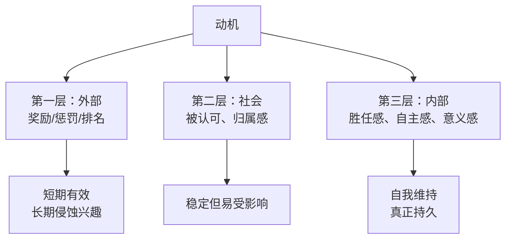

# 教育学核心 20% — 学习是如何真正发生的

> **一句话**：教育学里真正能改变结果的只有四件事——动机从哪里来、练习如何间隔、反馈怎么给、学到的能否迁移。其余多是包装。

---

## 🎯 这 20% 能解决哪些问题

| 常见困惑 | 本质 | 本页答案 |
|----------|------|----------|
| 孩子很聪明就是不爱学 | 动机类型搞错了 | 见「动机三层」 |
| 上课听懂了，考试不会 | 缺少检索练习 | 见「学习四步法」 |
| 补课越补越差 | 反馈方向错了 | 见「有效反馈公式」 |
| 学的东西用不上 | 没有迁移设计 | 见「迁移三条件」 |
| 为什么"快乐教育"和"严格管教"都失败 | 缺的是结构而非温度 | 见「权威型教养」 |

---

## 一、动机三层：从外部推力到内部驱动

| 层次 | 表现 | 怎么用 |
|------|------|--------|
| 外部 | 为了奖励/怕批评而学 | 只作启动器，别长期依赖 |
| 社会 | 为了同伴、老师、家人 | 建立学习小组、公开小目标 |
| 内部 | 因为"我能""我想""这有意义" | 提供选择权、适度挑战、真实任务 |

> **自驱力公式**：自主（我能选）+ 胜任（我能做到）+ 联结（有人一起）。

---

## 二、学习四步法：把"听懂"变成"会用"

| 步骤 | 动作 | 判断是否做到 |
|------|------|--------------|
| ① 输入 | 读/听/看，一次只攻一个点 | 能用一句话说出核心 |
| ② 检索 | 合上材料，凭记忆写出要点 | 能写出 80% 关键点 |
| ③ 反馈 | 对照材料找差距，立刻修正 | 能说清错在哪、为什么 |
| ④ 间隔 | 隔 1 天、3 天、7 天各复习一次 | 一周后仍能复述 |

**关键**：多数人只做第①步，所以"看懂了但不会用"。

---

## 三、有效反馈公式

> 反馈 = 具体行为 + 影响 + 下一步（而不是评价人）

| ❌ 无效反馈 | ✅ 有效反馈 |
|-------------|-------------|
| "你真聪明" | "你这道题先画了图再列式，思路清楚" |
| "怎么又错了" | "这一步漏了单位，下次先写单位" |
| "再努力一点" | "把这三道同类题连做两遍，明天我抽查" |
| "你太粗心" | "检查环节固定为三步：单位、符号、答案范围" |

**表扬努力与策略，不表扬天赋**——后者会让孩子回避难题以保护"聪明"标签。

---

## 四、迁移三条件：学了能用出去

| 条件 | 意思 | 设计方法 |
|------|------|----------|
| 相似情境 | 练习与真实场景接近 | 用真实任务替代纯习题 |
| 多例对比 | 见过多个变体 | 同一原理至少 3 个例子 |
| 抽象提炼 | 说出通用规则 | 让学生自己总结"这类题的共同点" |

---

## 五、教养方式：权威型 > 专制型 / 放任型

| 类型 | 高要求 | 高回应 | 结果 |
|------|--------|--------|------|
| 权威型（推荐） | ✅ | ✅ | 自控力强、学业与社交更好 |
| 专制型 | ✅ | ❌ | 服从但缺自主，易焦虑 |
| 放任型 | ❌ | ✅ | 自由但缺规则感 |
| 忽视型 | ❌ | ❌ | 各项指标最差 |

**落地做法**：规则少而明确、执行一致、解释理由、允许在边界内选择。

---

## 📋 一页速查

| 场景 | 做法 |
|------|------|
| 孩子说"不想学" | 先查动机层：是不会（胜任感缺失）还是没意义（意义感缺失） |
| 复习计划 | 1 天 / 3 天 / 7 天 / 30 天 四次检索 |
| 布置任务 | 一次一个明确目标，可当场验证 |
| 考试失利 | 只分析"哪一步断了"，不评价能力 |
| 培养习惯 | 固定时间 + 极小起步量 + 可视化打卡 |

---

## 🔗 相关链接

| 主题 | 链接 |
|------|------|
| 学习认知 | [学习认知](../../thinking/learning-cognition/index.md) |
| 高效学习实战 | [高效学习实战](../../thinking/learning-cognition/01-effective-learning-practice.md) |
| 亲子教育 | [亲子教育](../../health/life/child/index.md) |
| 心理学 | [心理学知识体系](../psychology/index.md) |
