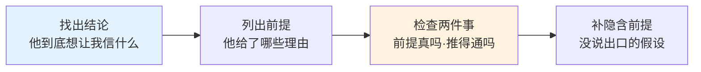

# 哲学思维

> **哲学的主目录在 [人文科学/哲学](../../humanities/philosophy/index.md)**，那里讲流派与哲学史。本页只留一套可操作的工具：**怎么判断一个说法站不站得住。**

---

## 🎯 这个视角独有的 20%

| 你听到的话 | 问题出在哪 | 一句话反问 |
|------------|------------|------------|
| 「大家都这么说」 | 诉诸多数，多数不等于正确 | 有多少人是**查过**才这么说 |
| 「专家都说了」 | 诉诸权威，权威也有边界 | 他的专长覆盖这个问题吗 |
| 「再这样下去就完了」 | 滑坡谬误，环节没被论证 | 中间那几步凭什么必然发生 |
| 「你行你上啊」 | 诉诸人身，攻击人而非论点 | 我说得对不对，跟我是谁无关 |
| 「这没法证明，但你不能否认」 | 不可证伪，等于什么都没说 | 什么证据能让你改主意 |

---

## 🧱 一个论证就是「前提 → 结论」

**90% 的争论其实死在 D 步**：双方共享一个没说出口的假设，却以为在吵结论。

例：「他都道歉了，你就该原谅。」隐含前提是**道歉足以抵消伤害**。把这个前提摊开，争论才真正开始。

---

## 🔧 四个常用工具

### 1. 可证伪性：能被推翻的才是知识

一个说法如果**任何观察都与它相容**，它就不提供信息。判断标准很简单：**什么结果会让你改主意？** 答不出来，这句话先放一边。

### 2. 概念分析：先定义，再争论

「公平」「自由」「内卷」这类词，争论双方常在心里装着不同定义。**先问「你说的 X 具体指哪种情况」**，一半的争论会当场消失。

### 3. 思想实验：用极端案例测直觉一致性

把条件推到极端，看你的两条直觉是否打架。例如「电车难题」不是为了给答案，而是为了**暴露你的原则在什么条件下自相矛盾**。

### 4. 钢人原则：先复述对方最强版本

在反驳之前，把对方观点说得比他本人更好。做不到，说明你还没理解——此时的反驳都是打空气。

---

## ⚠️ 哲学思维最容易走偏的两步

**把怀疑当成结论**：怀疑只是起点，停在怀疑等于放弃思考。
**把精确当成正确**：论证没漏洞，不等于前提为真；形式正确与现实正确是两件事。

---

## 🔗 去哪学更多

| 主题 | 链接 |
|------|------|
| 哲学主目录（流派与哲学史） | [人文科学/哲学](../../humanities/philosophy/index.md) |
| 学习方法与思维模型 | [学习认知](../learning-cognition/index.md) |
| 文化如何影响判断标准 | [文化研究](../cultural-studies/index.md) |
