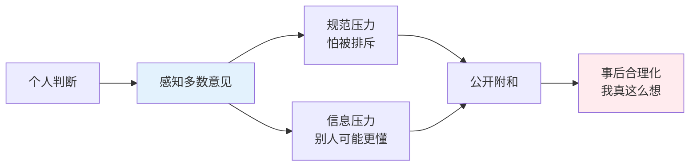

# 社会思维

> **社会学的主目录在 [社会科学/社会学](../../social-sciences/sociology/index.md)**，那里讲分层、组织、变迁。本页只讲一件事：**当人进入群体，判断会怎么变形。**

---

## 🎯 这个视角独有的 20%

| 你以为 | 实际发生 | 怎么用 |
|--------|----------|--------|
| 人多主意多 | 群体讨论会**强化原有倾向**（群体极化） | 决策前先各自书面写下观点，再开会 |
| 我不从众 | 多数人在**明确表态**时会附和明显错误 | 关键会议先让最年轻的人发言 |
| 他就是那种人 | **角色**会把人推向角色该有的行为 | 换人不如换角色定义与考核 |
| 关系靠感情 | 真正带来机会的是**弱连接** | 维护「认识但不熟」的人，比加深熟人更划算 |
| 大家都不吭声就是没意见 | 沉默常是**规范压力**，不是共识 | 明确要求反对意见，甚至指定「反方」 |

---

## 👥 群体如何改变个人

最危险的一步是 **F**：人公开附和之后，会调整自己的信念去匹配行为。所以「先让人表态」比「先讲道理」有效得多——这也是很多组织会议开完就定调的原因。

---

## 🏛️ 三个能直接用上的概念

### 1. 群体极化

讨论不会让群体走向中间，而是**朝着会前的主流倾向更极端**。原因有三：说服性论据集中在一侧、社会比较（谁都不想显得不够坚定）、责任分散。

**对策**：匿名先写、设置魔鬼代言人、把「反对」变成流程的一部分而不是勇气的表现。

### 2. 角色与情境的力量

人的行为高度依赖**被赋予的角色和期待**。经典的角色扮演实验虽然有方法论争议，但结论方向被大量现场研究支持：**给人一个身份和一套规则，行为会跟着变。**

**对策**：想改变行为，先改角色说明、评价标准和可见的榜样；只靠培训和口号几乎无效。

### 3. 社会资本：弱连接更值钱

强连接（家人、密友）信息高度重叠；弱连接（同学的同学、前同事）跨越了不同圈子，**新信息几乎都从弱连接来**。这就是为什么「找工作靠熟人」里真正起作用的往往是点头之交。

**对策**：定期低成本维护弱连接（一句问候、一次转发），别只在需要时才出现。

---

## ⚠️ 一个提醒

社会学的核心训练叫**「社会学的想象力」**：把个人困扰还原为结构问题。一个人失业，可能是他不够努力，也可能是产业在迁移——**先分清是哪一层，再决定怪谁、改什么。** 反过来也要小心：把所有问题都推给结构，就失去了行动空间。

---

## 🔗 去哪学更多

| 主题 | 链接 |
|------|------|
| 社会学主目录 | [社会科学/社会学](../../social-sciences/sociology/index.md) |
| 心理学视角的行为成因 | [心理学](../psychology/index.md) |
| 文化如何塑造判断 | [文化研究](../cultural-studies/index.md) |
